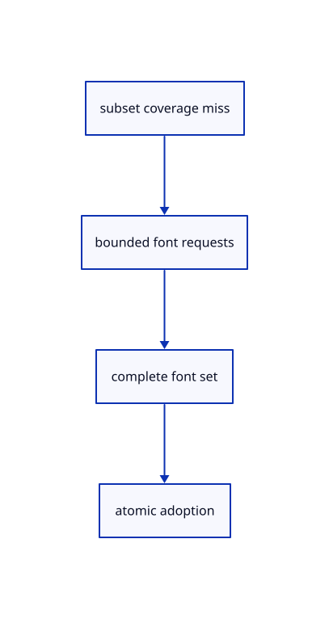

# 10.3.35 · Fetch missing whole fonts as one checked set

**Chapter 10 · Text and labels · Section 10.3 · Original scene labels** · [Contents](contents.md)

**Typing: 20–40 minutes.** [Estimate](typing-load.md).

Ask once when the subset lacks a character, fetch the three current whole fonts and adopt them atomically. An epoch prevents replies from a closed scene being reused.

## Type

Continue from [Draw original text IDs through bounded readback](62l-picking.md). [Save or recover your work](recovery.md).

### 1. `src/text_fonts.rs`

Fetch and validate the current whole fonts without letting stale replies survive Close.

Create the file and type:

```rust
--8<-- "journey/code/62m-whole-fonts-01.rs"
```

### 2. `src/lib.rs`

Register the source component.

<details>
<summary>Locate the existing block</summary>

```rust

pub mod scene_text_gpu;
```

</details>

After that block, type:

```rust
--8<-- "journey/code/62m-whole-fonts-02.rs" skip=25
```

## Run and check

Run this from `session_viewer` to select the fixed dependency versions and install supplied binary assets. It updates Cargo.lock and preserves the previous lock. It does not write implementation code:

```sh
npm --prefix ../session_tests run course -- dependencies 10.3.35
```

In your project:

```sh
cd workspace/journey
REGEN_PROTO=0 cargo build --lib --locked --target wasm32-unknown-unknown -j1
REGEN_PROTO=0 CARGO_BUILD_JOBS=1 trunk serve --port 8780
```

Open `http://127.0.0.1:8780/`. Keep an existing Trunk server running; saving rebuilds it.


### Recorded visual result

**Previous native render — current verification pending.**

The CAD bore and real-font screen specimen remain visible; this preparation adds no interactive scene-text example yet.


*This recorded image predates a source or checker change. Rebuild this checkpoint before using it as current evidence; browser controls require separate acceptance.*

This reference image is shared with [10.2.5 · Draw the specimen and prove real coverage reuse](61d-glyphs.md). It does not demonstrate a new feature by itself.

<details>
<summary>Code explanation and diagram</summary>


subset coverage miss → bounded font requests → complete font set → atomic adoption.



Can a partial or stale font reply replace current glyphs?

No. All fonts must arrive and validate together. Failed requests can retry; replies from an older inbox epoch are discarded after Close.

Study estimate, including typing and experiments: 0.5–1 hours.

</details>

<details>
<summary>Optional experiment</summary>

Use Ω to trigger the whole fonts. Compare the bundled coverage result with the full Noto face, and inspect the 4 MiB per-file cap and epoch check.

</details>

<details>
<summary>Check and save your work</summary>

Restore experimental edits, then run from `session_viewer`:

```sh
npm --prefix ../session_tests run course -- check 10.3.35
npm --prefix ../session_tests run course -- save 10.3.35
```

Source comparison leaves your project untouched. [Save and recovery instructions](recovery.md).

</details>

<details>
<summary>Viewer coverage and verification</summary>


The earlier glyph browser contract remains authored and unrun. Scene-label browser acceptance connects at the end of 62; native software rendering is not Lenovo timing.

[Full validation scope](release.md).

To reproduce the scripted acceptance of the reference checkpoint, run from `session_viewer` with the [course bundle server](release.md#reproduce) running on port 8781:

```sh
npm --prefix ../session_tests run course -- capture 10.3.35
```

This uses the verified reference bundle; it does not check or change your typed project.

</details>
