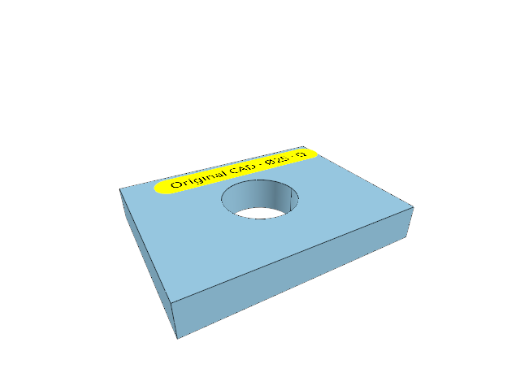
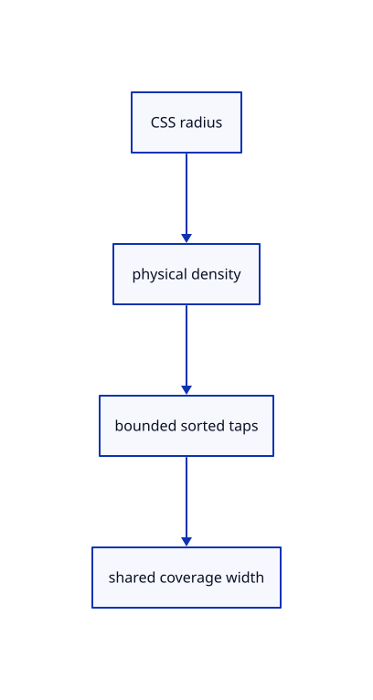

# 11.1.1 · Measure outline width in CSS pixels

**Chapter 11 · Outlines and point clouds · Section 11.1 · Screen-space outlines** · [Contents](contents.md)

**Typing: 9–18 minutes.** [Estimate](typing-load.md).

Convert one production CSS radius to physical pixels and sort bounded coverage taps nearest first. Flat and curved solids use the same screen-space rule.

## Type

Continue from [Create pick move and delete the original scene labels](62o-labels.md). [Save or recover your work](recovery.md).

### 1. `src/outline_math.rs`

Convert the current production CSS radius and build bounded nearest-first coverage taps.

Create the file and type:

```rust
--8<-- "journey/code/63-radius-01.rs"
```

### 2. `src/lib.rs`

Register the source component.

<details>
<summary>Locate the existing block</summary>

```rust
#[cfg(test)]
mod scene_label_tests;
```

</details>

After that block, type:

```rust
--8<-- "journey/code/63-radius-02.rs" skip=36
```

## Run and check

Run this from `session_viewer` to select the fixed dependency versions and install supplied binary assets. It updates Cargo.lock and preserves the previous lock. It does not write implementation code:

```sh
npm --prefix ../session_tests run course -- dependencies 11.1.1
```

In your project:

```sh
cd workspace/journey
REGEN_PROTO=0 cargo build --lib --locked --target wasm32-unknown-unknown -j1
REGEN_PROTO=0 CARGO_BUILD_JOBS=1 trunk serve --port 8780
```

Open `http://127.0.0.1:8780/`. Keep an existing Trunk server running; saving rebuilds it.

The selected original scene label and blue CAD bore remain visible. Select the CAD whole object after the compositor connects to see its silhouette.

### Recorded visual result

**Previous native render — current verification pending.**

The blue CAD bore and selected original scene label remain visible.



*This recorded image predates a source or checker change. Rebuild this checkpoint before using it as current evidence; browser controls require separate acceptance.*

<details>
<summary>Code explanation and diagram</summary>


CSS radius → physical density → bounded sorted taps → shared coverage width.



Should a smooth cylinder get a different outline radius from a box?

No. Their visible coverage differs, but both use the same CSS radius and tap weights. Physical resolution changes with density; geometry size does not set screen ink width.

Study estimate, including typing and experiments: 0.5–1 hours.

</details>

<details>
<summary>Optional experiment</summary>

Compare densities 1, 1.5 and 2. Check the 12-physical-pixel cap, 512-tap bound and decreasing tap weights.

</details>

<details>
<summary>Check and save your work</summary>

Restore experimental edits, then run from `session_viewer`:

```sh
npm --prefix ../session_tests run course -- check 11.1.1
npm --prefix ../session_tests run course -- save 11.1.1
```

Source comparison leaves your project untouched. [Save and recovery instructions](recovery.md).

</details>

<details>
<summary>Viewer coverage and verification</summary>


The earlier scene-label browser contract remains authored and unrun. New silhouette browser checks connect at the final endpoint; software-GPU pixels do not establish Lenovo timing.

[Full validation scope](release.md).

To reproduce the scripted acceptance of the reference checkpoint, run from `session_viewer` with the [course bundle server](release.md#reproduce) running on port 8781:

```sh
npm --prefix ../session_tests run course -- capture 11.1.1
```

This uses the verified reference bundle; it does not check or change your typed project.

</details>
