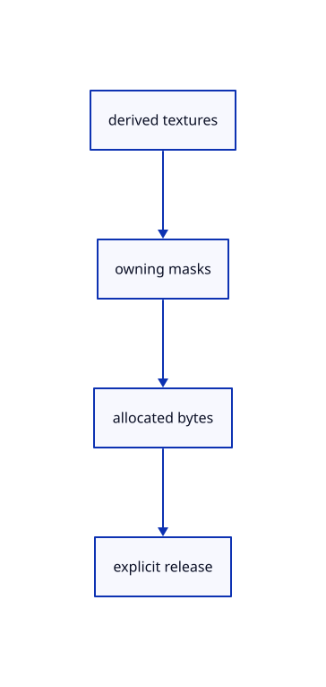

# 11.1.4 · Own and count the derived outline textures

**Chapter 11 · Outlines and point clouds · Section 11.1 · Screen-space outlines** · [Contents](contents.md)

**Typing: 28–55 minutes.** [Estimate](typing-load.md).

Keep full-size coverage and alpha alongside two coarse masks. Count actual textures and retained parameter buffers; dropping an image destroys its GPU texture.

## Type

Continue from [Pool and dilate a conservative outline mask](63aa-pool-and-dilate-a-conservative-outline-mask.md). [Save or recover your work](recovery.md).

### 1. `src/outline_gpu.rs`

Own R8 images, frame keys, pipeline state and the reusable fullscreen preparation pass.

Create the file and type:

```rust
--8<-- "journey/code/63b-resources-01.rs"
```

### 2. `src/lib.rs`

Register the source component.

<details>
<summary>Locate the existing block</summary>

```rust

pub mod outline_math;
```

</details>

After that block, type:

```rust
--8<-- "journey/code/63b-resources-02.rs" skip=23
```

## Run and check

Run this from `session_viewer` to select the fixed dependency versions and install supplied binary assets. It updates Cargo.lock and preserves the previous lock. It does not write implementation code:

```sh
npm --prefix ../session_tests run course -- dependencies 11.1.4
```

In your project:

```sh
cd workspace/journey
REGEN_PROTO=0 cargo build --lib --locked --target wasm32-unknown-unknown -j1
REGEN_PROTO=0 CARGO_BUILD_JOBS=1 trunk serve --port 8780
```

Open `http://127.0.0.1:8780/`. Keep an existing Trunk server running; saving rebuilds it.


### Recorded visual result

**Previous native render — current verification pending.**

The blue CAD bore and selected original scene label remain visible.


*This recorded image predates a source or checker change. Rebuild this checkpoint before using it as current evidence; browser controls require separate acceptance.*

This reference image is shared with [11.1.1 · Measure outline width in CSS pixels](63-radius.md). It does not demonstrate a new feature by itself.

<details>
<summary>Code explanation and diagram</summary>


derived textures → owning masks → allocated bytes → explicit release.



Does a zero live draw count mean no GPU allocation remains?

No. Reserved textures and buffers still occupy memory. Report their actual bytes while owned; dropping the complete lazy outline owner releases those allocations.

Study estimate, including typing and experiments: 0.5–1 hours.

</details>

<details>
<summary>Optional experiment</summary>

Compare full and coarse dimensions. Pooling rounds up at the right and bottom edges, including a viewport smaller than one block.

</details>

<details>
<summary>Check and save your work</summary>

Restore experimental edits, then run from `session_viewer`:

```sh
npm --prefix ../session_tests run course -- check 11.1.4
npm --prefix ../session_tests run course -- save 11.1.4
```

Source comparison leaves your project untouched. [Save and recovery instructions](recovery.md).

</details>

<details>
<summary>Viewer coverage and verification</summary>


The earlier scene-label browser contract remains authored and unrun. New silhouette browser checks connect at the final endpoint; software-GPU pixels do not establish Lenovo timing.

[Full validation scope](release.md).

To reproduce the scripted acceptance of the reference checkpoint, run from `session_viewer` with the [course bundle server](release.md#reproduce) running on port 8781:

```sh
npm --prefix ../session_tests run course -- capture 11.1.4
```

This uses the verified reference bundle; it does not check or change your typed project.

</details>
