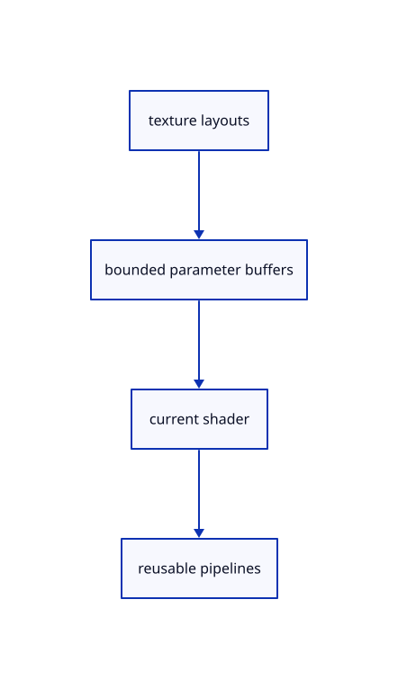

# 11.1.6 · Build bounded mask and tap bindings

**Chapter 11 · Outlines and point clouds · Section 11.1 · Screen-space outlines** · [Contents](contents.md)

**Typing: 28–56 minutes.** [Estimate](typing-load.md).

Create explicit texture layouts, a 16-byte radius uniform and one fixed 8208-byte sorted-tap buffer. Keep pipelines reusable for the lazy outline owner.

## Type

Continue from [Create the mask and fullscreen pipeline layouts](63c-pipelines.md). [Save or recover your work](recovery.md).

### 1. `src/outline_gpu.rs`

Build explicit current shader bindings and fixed parameter capacity.

<details>
<summary>Locate the existing block</summary>

```rust
}
impl Outline {
}
fn raster(
```

</details>

Edit the existing block to match this code; keep unchanged lines:

```rust
--8<-- "journey/code/63d-bindings-01.rs"
```

## Run and check

Run this from `session_viewer` to select the fixed dependency versions and install supplied binary assets. It updates Cargo.lock and preserves the previous lock. It does not write implementation code:

```sh
npm --prefix ../session_tests run course -- dependencies 11.1.6
```

In your project:

```sh
cd workspace/journey
REGEN_PROTO=0 cargo build --lib --locked --target wasm32-unknown-unknown -j1
REGEN_PROTO=0 CARGO_BUILD_JOBS=1 trunk serve --port 8780
```

Open `http://127.0.0.1:8780/`. Keep an existing Trunk server running; saving rebuilds it.


### Recorded visual result

**Previous native render — current verification pending.**

The blue CAD bore and selected original scene label remain visible.


*This recorded image predates a source or checker change. Rebuild this checkpoint before using it as current evidence; browser controls require separate acceptance.*

This reference image is shared with [11.1.1 · Measure outline width in CSS pixels](63-radius.md). It does not demonstrate a new feature by itself.

<details>
<summary>Code explanation and diagram</summary>


texture layouts → bounded parameter buffers → current shader → reusable pipelines.



Why is the sorted-tap buffer larger than the used tap count?

It has fixed capacity for 512 sixteen-byte taps and a sixteen-byte header. The shader reads the live count, while diagnostics report the complete allocation.

Study estimate, including typing and experiments: 0.5–1 hours.

</details>

<details>
<summary>Optional experiment</summary>

Match each shader group to its layout. The two search bindings share the same selected union mask, so the optional second production channel stays inactive.

</details>

<details>
<summary>Check and save your work</summary>

Restore experimental edits, then run from `session_viewer`:

```sh
npm --prefix ../session_tests run course -- check 11.1.6
npm --prefix ../session_tests run course -- save 11.1.6
```

Source comparison leaves your project untouched. [Save and recovery instructions](recovery.md).

</details>

<details>
<summary>Viewer coverage and verification</summary>


The earlier scene-label browser contract remains authored and unrun. New silhouette browser checks connect at the final endpoint; software-GPU pixels do not establish Lenovo timing.

[Full validation scope](release.md).

To reproduce the scripted acceptance of the reference checkpoint, run from `session_viewer` with the [course bundle server](release.md#reproduce) running on port 8781:

```sh
npm --prefix ../session_tests run course -- capture 11.1.6
```

This uses the verified reference bundle; it does not check or change your typed project.

</details>
