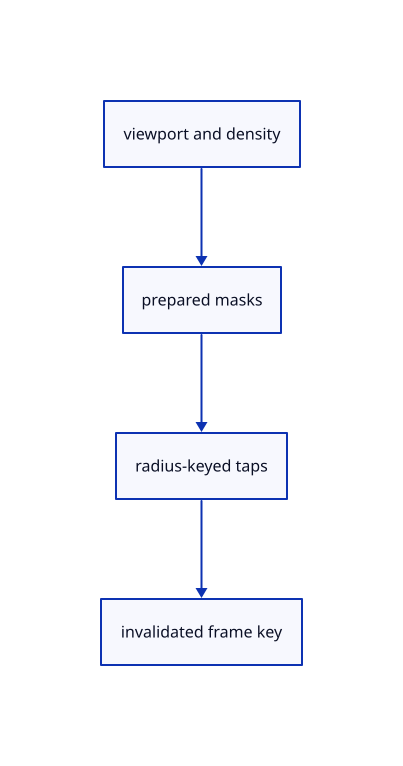

# 11.1.7 · Reuse masks while camera selection and density stay unchanged

**Chapter 11 · Outlines and point clouds · Section 11.1 · Screen-space outlines** · [Contents](contents.md)

**Typing: 30–59 minutes.** [Estimate](typing-load.md).

Allocate masks only when viewport size or coarse block changes. Upload the tap table only when physical radius changes; keep an explicit revision for scene and selection edits.

## Type

Continue from [Build bounded mask and tap bindings](63d-bindings.md). [Save or recover your work](recovery.md).

### 1. `src/outline_gpu.rs`

Prepare exact-size derived targets, bounded tap bytes and truthful resource counters.

<details>
<summary>Locate the existing block</summary>

```rust
    self.key = None;
  }
}
fn raster(
```

</details>

Edit the existing block to match this code; keep unchanged lines:

```rust
--8<-- "journey/code/63e-reuse-01.rs"
```

## Run and check

Run this from `session_viewer` to select the fixed dependency versions and install supplied binary assets. It updates Cargo.lock and preserves the previous lock. It does not write implementation code:

```sh
npm --prefix ../session_tests run course -- dependencies 11.1.7
```

In your project:

```sh
cd workspace/journey
REGEN_PROTO=0 cargo build --lib --locked --target wasm32-unknown-unknown -j1
REGEN_PROTO=0 CARGO_BUILD_JOBS=1 trunk serve --port 8780
```

Open `http://127.0.0.1:8780/`. Keep an existing Trunk server running; saving rebuilds it.


### Recorded visual result

**Previous native render — current verification pending.**

The blue CAD bore and selected original scene label remain visible.


*This recorded image predates a source or checker change. Rebuild this checkpoint before using it as current evidence; browser controls require separate acceptance.*

This reference image is shared with [11.1.1 · Measure outline width in CSS pixels](63-radius.md). It does not demonstrate a new feature by itself.

<details>
<summary>Code explanation and diagram</summary>


viewport and density → prepared masks → radius-keyed taps → invalidated frame key.



Can an unchanged camera alone prove a cached outline is current?

No. Geometry, visibility and whole selection can change without moving the camera. Include their explicit revision, physical size and density in the reuse key.

Study estimate, including typing and experiments: 0.5–1 hours.

</details>

<details>
<summary>Optional experiment</summary>

Read allocated-byte counters before and after a same-size preparation. Compare a camera change with a whole-selection change and a density change.

</details>

<details>
<summary>Check and save your work</summary>

Restore experimental edits, then run from `session_viewer`:

```sh
npm --prefix ../session_tests run course -- check 11.1.7
npm --prefix ../session_tests run course -- save 11.1.7
```

Source comparison leaves your project untouched. [Save and recovery instructions](recovery.md).

</details>

<details>
<summary>Viewer coverage and verification</summary>


The earlier scene-label browser contract remains authored and unrun. New silhouette browser checks connect at the final endpoint; software-GPU pixels do not establish Lenovo timing.

[Full validation scope](release.md).

To reproduce the scripted acceptance of the reference checkpoint, run from `session_viewer` with the [course bundle server](release.md#reproduce) running on port 8781:

```sh
npm --prefix ../session_tests run course -- capture 11.1.7
```

This uses the verified reference bundle; it does not check or change your typed project.

</details>
