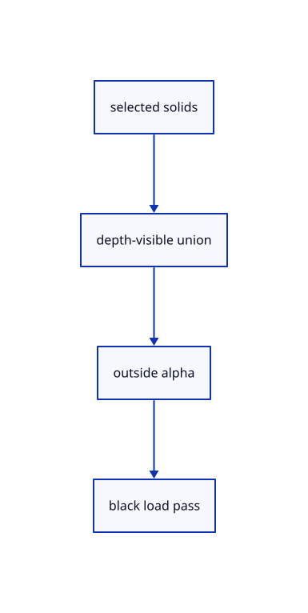

# 11.1.8 · Outline the visible union without internal seams

**Chapter 11 · Outlines and point clouds · Section 11.1 · Screen-space outlines** · [Contents](contents.md)

**Typing: 26–52 minutes.** [Estimate](typing-load.md).

Draw all whole-selected solids into one depth-visible mask, then pool, dilate and search outside that union. The black pass loads colour after surface and source-edge ink.

## Type

Continue from [Reuse masks while camera selection and density stay unchanged](63e-reuse.md). [Save or recover your work](recovery.md).

### 1. `src/gpu_mesh.rs`

Read whole-selection state from the existing uploaded object uniform.

<details>
<summary>Locate the existing block</summary>

```rust
    }

    pub fn settings_bytes(&self) -> u64 { self.model.size() }
```

</details>

Edit the existing block to match this code; keep unchanged lines:

```rust
--8<-- "journey/code/63f-union-01.rs"
```

### 2. `src/outline_gpu.rs`

Encode visible selected coverage, cached alpha and a black compositor after geometry ink.

<details>
<summary>Locate the existing block</summary>

```rust
    }
  }
}
fn raster(
```

</details>

Edit the existing block to match this code; keep unchanged lines:

```rust
--8<-- "journey/code/63f-union-02.rs"
```

## Run and check

Run this from `session_viewer` to select the fixed dependency versions and install supplied binary assets. It updates Cargo.lock and preserves the previous lock. It does not write implementation code:

```sh
npm --prefix ../session_tests run course -- dependencies 11.1.8
```

In your project:

```sh
cd workspace/journey
REGEN_PROTO=0 cargo build --lib --locked --target wasm32-unknown-unknown -j1
REGEN_PROTO=0 CARGO_BUILD_JOBS=1 trunk serve --port 8780
```

Open `http://127.0.0.1:8780/`. Keep an existing Trunk server running; saving rebuilds it.


### Recorded visual result

**Previous native render — current verification pending.**

The blue CAD bore and selected original scene label remain visible.


*This recorded image predates a source or checker change. Rebuild this checkpoint before using it as current evidence; browser controls require separate acceptance.*

This reference image is shared with [11.1.1 · Measure outline width in CSS pixels](63-radius.md). It does not demonstrate a new feature by itself.

<details>
<summary>Code explanation and diagram</summary>


selected solids → depth-visible union → outside alpha → black load pass.



Should two touching selected objects have an outline along their shared join?

No. A union silhouette surrounds visible coverage, including real holes. Internal tessellation and shared solid joins remain inside the coverage and contribute no outline alpha.

Study estimate, including typing and experiments: 0.5–1 hours.

</details>

<details>
<summary>Optional experiment</summary>

Compare touching boxes, a smooth cylinder and a block with a bore. Keep the bore center open and its inner contour black; leave original mesh/BRep topology untouched.

</details>

<details>
<summary>Check and save your work</summary>

Restore experimental edits, then run from `session_viewer`:

```sh
npm --prefix ../session_tests run course -- check 11.1.8
npm --prefix ../session_tests run course -- save 11.1.8
```

Source comparison leaves your project untouched. [Save and recovery instructions](recovery.md).

</details>

<details>
<summary>Viewer coverage and verification</summary>


The earlier scene-label browser contract remains authored and unrun. New silhouette browser checks connect at the final endpoint; software-GPU pixels do not establish Lenovo timing.

[Full validation scope](release.md).

To reproduce the scripted acceptance of the reference checkpoint, run from `session_viewer` with the [course bundle server](release.md#reproduce) running on port 8781:

```sh
npm --prefix ../session_tests run course -- capture 11.1.8
```

This uses the verified reference bundle; it does not check or change your typed project.

</details>
