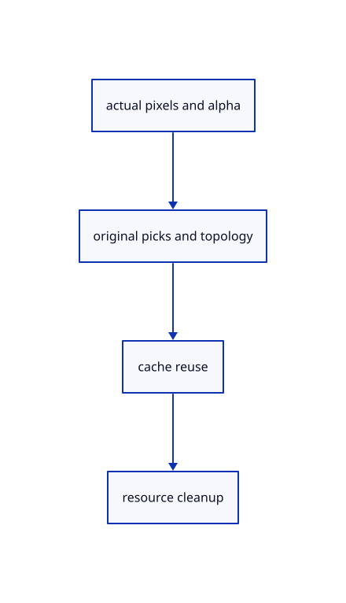

# 11.1.10 · Check real contours widths reuse picks and cleanup

**Chapter 11 · Outlines and point clouds · Section 11.1 · Screen-space outlines** · [Contents](contents.md)

**Typing: 2–3 minutes.** [Estimate](typing-load.md).

Copy the actual GPU silhouette regressions and connect browser diagnostics. Verify both original source lanes and two CSS densities before calling silhouette acceptance complete.

## Type

Continue from [Connect a lazy silhouette owner to the renderer](63g-composite.md). [Save or recover your work](recovery.md).

<details>
<summary>Supplied validation fixture</summary>

Copy this supplied authoring fixture once. Continue with the browser build below; the course does not require running native tests.

### 1. `src/outline_gpu.rs`

Copy the test-only actual-alpha readback accessor.

<details>
<summary>Locate the existing block</summary>

```text
    }),
    multisample: Default::default(),
    multiview_mask: None,
    cache: None,
  })
}
```

</details>

After that block, append this supplied code:

```text
--8<-- "journey/code/63h-outline-01.rs" skip=95
```

</details>

<details>
<summary>Supplied validation fixture</summary>

Copy this supplied authoring fixture once. Continue with the browser build below; the course does not require running native tests.

### 2. `src/renderer.rs`

Copy test-only R8 alpha readback with bounded row pitch and wait.

<details>
<summary>Locate the existing block</summary>

```text

fn rgba(rgb:[u8;3])->[f32;4] {[rgb[0] as f32/255.,rgb[1] as f32/255.,rgb[2] as f32/255.,1.]}
```

</details>

After that block, append this supplied code:

```text
--8<-- "journey/code/63h-outline-02.rs" skip=94
```

</details>

<details>
<summary>Supplied validation fixture</summary>

Copy this supplied authoring fixture once. Continue with the browser build below; the course does not require running native tests.

### 3. `src/outline_math_tests.rs`

Copy the current production radius, tap capacity and order regressions.

Copy this supplied file:

```text
--8<-- "journey/code/63h-outline-03.rs"
```

</details>

<details>
<summary>Supplied validation fixture</summary>

Copy this supplied authoring fixture once. Continue with the browser build below; the course does not require running native tests.

### 4. `src/lib.rs`

Register the source component.

<details>
<summary>Locate the existing block</summary>

```text

pub mod outline_gpu;
```

</details>

After that block, append this supplied code:

```text
--8<-- "journey/code/63h-outline-04.rs" skip=22
```

</details>

<details>
<summary>Supplied validation fixture</summary>

Copy this supplied authoring fixture once. Continue with the browser build below; the course does not require running native tests.

### 5. `src/pick_gpu_tests.rs`

Copy actual joined-solid, occlusion, curved/flat density, bore-contour, source/pick/reuse/release regressions.

<details>
<summary>Locate the existing block</summary>

```text
    assert!(changed>50);renderer.request_pick([-0.0625,0.],identity()).unwrap();assert_eq!(finish(&mut renderer).unwrap()[0],id.value());renderer.request_pick([0.125,0.],identity()).unwrap();assert!(finish(&mut renderer).is_none());
}
```

</details>

After that block, append this supplied code:

```text
--8<-- "journey/code/63h-outline-05.rs" skip=235
```

</details>

### 6. `src/browser.rs`

Expose actual outline allocation, rebuild, skip and compositor draw counters.

<details>
<summary>Locate the existing block</summary>

```rust
    canvas.set_attribute("data-pick-gpu", &serde_json::to_string(&renderer.pick_usage()).unwrap())?;
    canvas.set_attribute("data-point-gpu", &serde_json::to_string(&renderer.point_usage()).unwrap())?;
    canvas.set_attribute("data-scene-text-stats",&serde_json::to_string(&renderer.text_stats()).unwrap())?;
    canvas.set_attribute("data-scene-text-cpu",&serde_json::to_string(&crate::memory::texts(editor.presentation_scenes())).unwrap())?;
```

</details>

Edit the existing block to match this code; keep unchanged lines:

```rust
--8<-- "journey/code/63h-outline-06.rs"
```

## Run and check

Run this from `session_viewer` to select the fixed dependency versions and install supplied binary assets. It updates Cargo.lock and preserves the previous lock. It does not write implementation code:

```sh
npm --prefix ../session_tests run course -- dependencies 11.1.10
```

In your project:

```sh
cd workspace/journey
REGEN_PROTO=0 cargo build --lib --locked --target wasm32-unknown-unknown -j1
REGEN_PROTO=0 CARGO_BUILD_JOBS=1 trunk serve --port 8780
```

Open `http://127.0.0.1:8780/`. Keep an existing Trunk server running; saving rebuilds it.

Type Close, Example CAD, Fit and View Isometric, then Select Next. The selected CAD solid has black outer and bore contours. Whole selection creates derived outline resources; deselection and Close drop them. Repeat an unchanged frame to reuse coverage, and compare curved and flat solids at both CSS densities.

### Recorded visual result

**Previous native render — current verification pending.**

The selected CAD solid keeps its real open bore, yellow faces and black outer and inner silhouette contours.


*This recorded image predates a source or checker change. Rebuild this checkpoint before using it as current evidence; browser controls require separate acceptance.*

<details>
<summary>Code explanation and diagram</summary>


actual pixels and alpha → original picks and topology → cache reuse → resource cleanup.



Does a native software-GPU check establish smooth Lenovo rotation?

No. It establishes rendered behavior and source/resource invariants. Fresh browser acceptance and same-hardware full-floor and dome timing remain separate required checks.

Study estimate, including typing and experiments: 0.5–1 hours.

</details>

<details>
<summary>Optional experiment</summary>

Type Close, Example CAD, Fit and View Isometric, then Select Next. Inspect the black outer and bore contours. Deselect, select a source face, and confirm its highlight remains local.

</details>

<details>
<summary>Check and save your work</summary>

Restore experimental edits, then run from `session_viewer`:

```sh
npm --prefix ../session_tests run course -- check 11.1.10
npm --prefix ../session_tests run course -- save 11.1.10
```

Source comparison leaves your project untouched. [Save and recovery instructions](recovery.md).

</details>

<details>
<summary>Viewer coverage and verification</summary>

Use the current production 1.6875 CSS-pixel surface radius, bounded sorted taps, coarse coverage pooling, dilation and black compositor. This subject outlines the visible union of whole selected solids with the cumulative forward-depth convention. Face and edge highlights keep their local source scope. Arctic display and multisampling connect in later rendering subjects.

All earlier checks remain. Final copied actual GPU cases verify joined solids without internal seams, occlusion, curved and flat CSS widths at two densities, a real open CAD bore, black outline over selected edge ink, unchanged original topology and integer picks, reuse and cleanup.

The authored silhouette browser contract checks real selected-solid pixels, source identity, geometry reuse, density and cleanup. It remains unrun; native rendering does not establish Lenovo timing.

[Full validation scope](release.md).

To reproduce the scripted acceptance of the reference checkpoint, run from `session_viewer` with the [course bundle server](release.md#reproduce) running on port 8781:

```sh
npm --prefix ../session_tests run course -- capture 11.1.10
```

This uses the verified reference bundle; it does not check or change your typed project.

</details>
