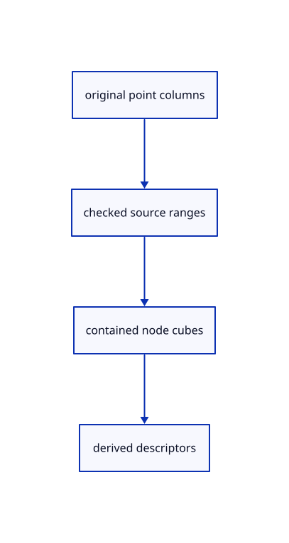

# 11.2.1 · Check cloud cubes against their original point rows

**Chapter 11 · Outlines and point clouds · Section 11.2 · Point clouds and detail levels** · [Contents](contents.md)

**Typing: 28–55 minutes.** [Estimate](typing-load.md).

Keep immutable original f64 coordinates and stable point IDs beside derived node descriptors. Reject invalid ranges, nonfinite cubes and children outside their parent.

## Type

Continue from [Check real contours widths reuse picks and cleanup](63h-outline.md). [Save or recover your work](recovery.md).

### 1. `src/cloud.rs`

Own original cloud sources and validate each derived node against its source ranges and parent cube.

Create the file and type:

```rust
--8<-- "journey/code/64-nodes-01.rs"
```

### 2. `src/lib.rs`

Register the source component.

<details>
<summary>Locate the existing block</summary>

```rust
#[cfg(test)]
mod outline_math_tests;
```

</details>

After that block, type:

```rust
--8<-- "journey/code/64-nodes-02.rs" skip=37
```

## Run and check

Run this from `session_viewer` to select the fixed dependency versions and install supplied binary assets. It updates Cargo.lock and preserves the previous lock. It does not write implementation code:

```sh
npm --prefix ../session_tests run course -- dependencies 11.2.1
```

In your project:

```sh
cd workspace/journey
REGEN_PROTO=0 cargo build --lib --locked --target wasm32-unknown-unknown -j1
REGEN_PROTO=0 CARGO_BUILD_JOBS=1 trunk serve --port 8780
```

Open `http://127.0.0.1:8780/`. Keep an existing Trunk server running; saving rebuilds it.

The selected CAD bore and its black silhouette remain visible. These preparations add the original cloud lane; the final checkpoint connects its interactive examples.

### Recorded visual result

**Previous native render — current verification pending.**

The selected CAD bore and black original and silhouette contours remain visible.


*This recorded image predates a source or checker change. Rebuild this checkpoint before using it as current evidence; browser controls require separate acceptance.*

<details>
<summary>Code explanation and diagram</summary>


original point columns → checked source ranges → contained node cubes → derived descriptors.



Does an octree range identify a new editable point?

No. It names a run in the original stored point columns. Stable point IDs remain independent of storage order; a cube must contain its own points before the view can trust its spacing.

Study estimate, including typing and experiments: 0.5–1 hours.

</details>

<details>
<summary>Optional experiment</summary>

Compare a source point ID with its current storage index. Try an out-of-range child, a negative count and a cube shifted away from its source points.

</details>

<details>
<summary>Check and save your work</summary>

Restore experimental edits, then run from `session_viewer`:

```sh
npm --prefix ../session_tests run course -- check 11.2.1
npm --prefix ../session_tests run course -- save 11.2.1
```

Source comparison leaves your project untouched. [Save and recovery instructions](recovery.md).

</details>

<details>
<summary>Viewer coverage and verification</summary>


The inherited silhouette browser contract remains authored and unrun. Cloud acceptance connects at the final endpoint; native software rendering is not Lenovo timing.

[Full validation scope](release.md).

To reproduce the scripted acceptance of the reference checkpoint, run from `session_viewer` with the [course bundle server](release.md#reproduce) running on port 8781:

```sh
npm --prefix ../session_tests run course -- capture 11.2.1
```

This uses the verified reference bundle; it does not check or change your typed project.

</details>
