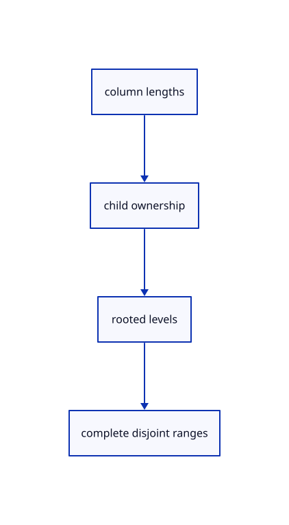

# 11.2.2 · Validate one rooted tree and disjoint original ranges

**Chapter 11 · Outlines and point clouds · Section 11.2 · Point clouds and detail levels** · [Contents](contents.md)

**Typing: 15–29 minutes.** [Estimate](typing-load.md).

Check every octree column length before indexing. Require one parent per child, increasing levels and nonoverlapping ranges that cover the complete original point storage.

## Type

Continue from [Check cloud cubes against their original point rows](64-nodes.md). [Save or recover your work](recovery.md).

### 1. `src/cloud.rs`

Validate complete octree columns, rooted ownership and source-row coverage before traversal.

<details>
<summary>Locate the existing block</summary>

```rust
  pub bounds: Rc<crate::bounds::Bounds>,
  pub spacing: f32,
}
```

</details>

After that block, type:

```rust
--8<-- "journey/code/64a-tree-01.rs" skip=64
```

## Run and check

Run this from `session_viewer` to select the fixed dependency versions and install supplied binary assets. It updates Cargo.lock and preserves the previous lock. It does not write implementation code:

```sh
npm --prefix ../session_tests run course -- dependencies 11.2.2
```

In your project:

```sh
cd workspace/journey
REGEN_PROTO=0 cargo build --lib --locked --target wasm32-unknown-unknown -j1
REGEN_PROTO=0 CARGO_BUILD_JOBS=1 trunk serve --port 8780
```

Open `http://127.0.0.1:8780/`. Keep an existing Trunk server running; saving rebuilds it.


### Recorded visual result

**Previous native render — current verification pending.**

The selected CAD bore and black original and silhouette contours remain visible.


*This recorded image predates a source or checker change. Rebuild this checkpoint before using it as current evidence; browser controls require separate acceptance.*

This reference image is shared with [11.2.1 · Check cloud cubes against their original point rows](64-nodes.md). It does not demonstrate a new feature by itself.

<details>
<summary>Code explanation and diagram</summary>


column lengths → child ownership → rooted levels → complete disjoint ranges.



Can a cyclic or disconnected octree reach the view walk?

No. Its levels and unique rooted ownership are validated before adoption. Point ranges must cover the original storage once, so neither duplicated rows nor omitted source rows become display detail.

Study estimate, including typing and experiments: 0.5–1 hours.

</details>

<details>
<summary>Optional experiment</summary>

Corrupt one child index or repeat one owner. Compare an empty node table with a malformed partial table and verify rejection happens before scene ID allocation.

</details>

<details>
<summary>Check and save your work</summary>

Restore experimental edits, then run from `session_viewer`:

```sh
npm --prefix ../session_tests run course -- check 11.2.2
npm --prefix ../session_tests run course -- save 11.2.2
```

Source comparison leaves your project untouched. [Save and recovery instructions](recovery.md).

</details>

<details>
<summary>Viewer coverage and verification</summary>


The inherited silhouette browser contract remains authored and unrun. Cloud acceptance connects at the final endpoint; native software rendering is not Lenovo timing.

[Full validation scope](release.md).

To reproduce the scripted acceptance of the reference checkpoint, run from `session_viewer` with the [course bundle server](release.md#reproduce) running on port 8781:

```sh
npm --prefix ../session_tests run course -- capture 11.2.2
```

This uses the verified reference bundle; it does not check or change your typed project.

</details>
