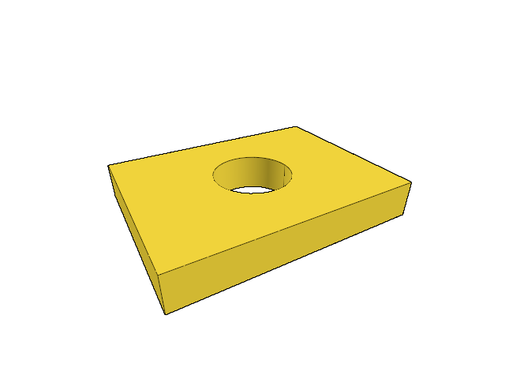
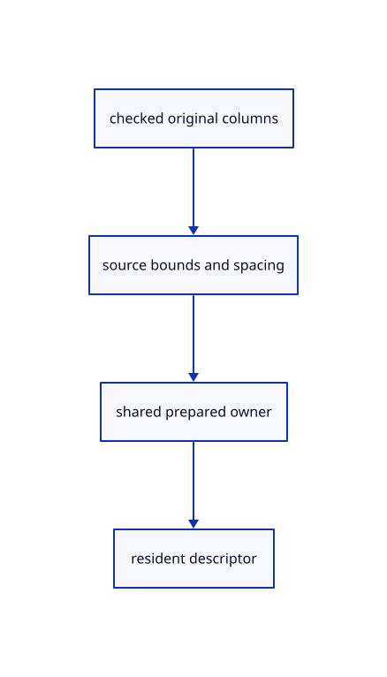

# 11.2.3 · Prepare bounds and spacing without replacing source words

**Chapter 11 · Outlines and point clouds · Section 11.2 · Point clouds and detail levels** · [Contents](contents.md)

**Typing: 20–39 minutes.** [Estimate](typing-load.md).

Validate coordinates, colours, normals, size and stable IDs. Measure original f64 bounds and retain the original PointCloud beside shared derived node descriptors.

## Type

Continue from [Validate one rooted tree and disjoint original ranges](64a-tree.md). [Save or recover your work](recovery.md).

### 1. `src/cloud.rs`

Keep original source columns and measured bounds separate from derived node descriptors.

<details>
<summary>Locate the existing block</summary>

```rust
  pub bounds: Rc<crate::bounds::Bounds>,
  pub spacing: f32,
}
```

</details>

After that block, type:

```rust
--8<-- "journey/code/64b-source-01.rs" skip=64
```

## Run and check

Run this from `session_viewer` to select the fixed dependency versions and install supplied binary assets. It updates Cargo.lock and preserves the previous lock. It does not write implementation code:

```sh
npm --prefix ../session_tests run course -- dependencies 11.2.3
```

In your project:

```sh
cd workspace/journey
REGEN_PROTO=0 cargo build --lib --locked --target wasm32-unknown-unknown -j1
REGEN_PROTO=0 CARGO_BUILD_JOBS=1 trunk serve --port 8780
```

Open `http://127.0.0.1:8780/`. Keep an existing Trunk server running; saving rebuilds it.


### Recorded visual result

**Previous native render — current verification pending.**

The selected CAD bore and black original and silhouette contours remain visible.



*This recorded image predates a source or checker change. Rebuild this checkpoint before using it as current evidence; browser controls require separate acceptance.*

This reference image is shared with [11.2.1 · Check cloud cubes against their original point rows](64-nodes.md). It does not demonstrate a new feature by itself.

<details>
<summary>Code explanation and diagram</summary>


checked original columns → source bounds and spacing → shared prepared owner → resident descriptor.



Are accessible payload bytes the complete reserved source capacity?

No. Public slices expose their used bytes, not private vector capacity. Diagnostics keep logical original payload separate from actual derived and GPU allocations.

Study estimate, including typing and experiments: 0.5–1 hours.

</details>

<details>
<summary>Optional experiment</summary>

Inspect f64 coordinates before any GPU float conversion. Reject duplicate explicit IDs, mismatched colour/normal columns and nonfinite point size; initialize the lazy source GUID before comparing serialized invariants.

</details>

<details>
<summary>Check and save your work</summary>

Restore experimental edits, then run from `session_viewer`:

```sh
npm --prefix ../session_tests run course -- check 11.2.3
npm --prefix ../session_tests run course -- save 11.2.3
```

Source comparison leaves your project untouched. [Save and recovery instructions](recovery.md).

</details>

<details>
<summary>Viewer coverage and verification</summary>


The inherited silhouette browser contract remains authored and unrun. Cloud acceptance connects at the final endpoint; native software rendering is not Lenovo timing.

[Full validation scope](release.md).

To reproduce the scripted acceptance of the reference checkpoint, run from `session_viewer` with the [course bundle server](release.md#reproduce) running on port 8781:

```sh
npm --prefix ../session_tests run course -- capture 11.2.3
```

This uses the verified reference bundle; it does not check or change your typed project.

</details>
