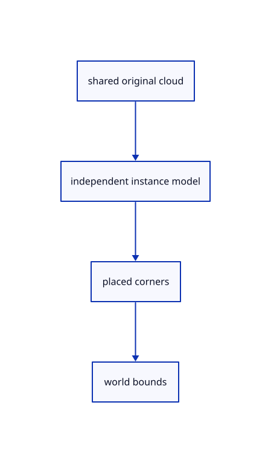

# 11.2.4 · Place the cloud through an independent f64 instance model

**Chapter 11 · Outlines and point clouds · Section 11.2 · Point clouds and detail levels** · [Contents](contents.md)

**Typing: 7–14 minutes.** [Estimate](typing-load.md).

Give every cloud row its own viewer ID, GUID and f64 model while sharing the original PointCloud and its derived nodes. Transform all eight bound corners for Fit.

## Type

Continue from [Prepare bounds and spacing without replacing source words](64b-source.md). [Save or recover your work](recovery.md).

### 1. `src/cloud.rs`

Preserve original cloud ownership and derive world bounds from a separate f64 model.

<details>
<summary>Locate the existing block</summary>

```rust
}

fn checked_node(source: &PointCloud, p: &session_rust::proto::PointCloud, i: usize) -> Result<LodNode, &'static str> {
  let n = p.lod_size.len();
```

</details>

Edit the existing block to match this code; keep unchanged lines:

```rust
--8<-- "journey/code/64c-placements-01.rs"
```

## Run and check

Run this from `session_viewer` to select the fixed dependency versions and install supplied binary assets. It updates Cargo.lock and preserves the previous lock. It does not write implementation code:

```sh
npm --prefix ../session_tests run course -- dependencies 11.2.4
```

In your project:

```sh
cd workspace/journey
REGEN_PROTO=0 cargo build --lib --locked --target wasm32-unknown-unknown -j1
REGEN_PROTO=0 CARGO_BUILD_JOBS=1 trunk serve --port 8780
```

Open `http://127.0.0.1:8780/`. Keep an existing Trunk server running; saving rebuilds it.


### Recorded visual result

**Previous native render — current verification pending.**

The selected CAD bore and black original and silhouette contours remain visible.


*This recorded image predates a source or checker change. Rebuild this checkpoint before using it as current evidence; browser controls require separate acceptance.*

This reference image is shared with [11.2.1 · Check cloud cubes against their original point rows](64-nodes.md). It does not demonstrate a new feature by itself.

<details>
<summary>Code explanation and diagram</summary>


shared original cloud → independent instance model → placed corners → world bounds.



Should moving a cloud rewrite every original coordinate?

No. Move changes the instance model. Copies can share original columns and derived nodes while retaining their own identities and placements.

Study estimate, including typing and experiments: 0.5–1 hours.

</details>

<details>
<summary>Optional experiment</summary>

Compare the same source under two placements. Translate by 1,000,000,000.125 and inspect the exact model and unchanged original coordinates; GPU rebasing connects in the precision subject.

</details>

<details>
<summary>Check and save your work</summary>

Restore experimental edits, then run from `session_viewer`:

```sh
npm --prefix ../session_tests run course -- check 11.2.4
npm --prefix ../session_tests run course -- save 11.2.4
```

Source comparison leaves your project untouched. [Save and recovery instructions](recovery.md).

</details>

<details>
<summary>Viewer coverage and verification</summary>


The inherited silhouette browser contract remains authored and unrun. Cloud acceptance connects at the final endpoint; native software rendering is not Lenovo timing.

[Full validation scope](release.md).

To reproduce the scripted acceptance of the reference checkpoint, run from `session_viewer` with the [course bundle server](release.md#reproduce) running on port 8781:

```sh
npm --prefix ../session_tests run course -- capture 11.2.4
```

This uses the verified reference bundle; it does not check or change your typed project.

</details>
