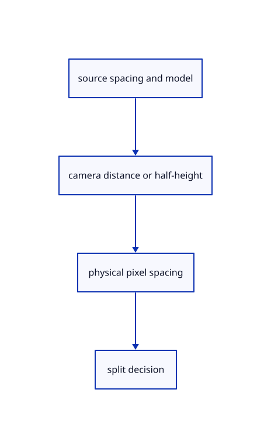

# 11.2.7 · Measure point spacing in the current projection

**Chapter 11 · Outlines and point clouds · Section 11.2 · Point clouds and detail levels** · [Contents](contents.md)

**Typing: 24–48 minutes.** [Estimate](typing-load.md).

Carry camera eye, orthographic half-height, physical viewport height and a pixel split threshold. Project node spacing after applying the instance scale.

## Type

Continue from [Include clouds in whole selection history and rectangle checks](64e-identity.md). [Save or recover your work](recovery.md).

### 1. `src/cloud_lod.rs`

Measure current production projected spacing and radius factors from explicit camera facts.

Create the file and type:

```rust
--8<-- "journey/code/64f-projection-01.rs"
```

### 2. `src/lib.rs`

Register the source component.

<details>
<summary>Locate the existing block</summary>

```rust

pub mod cloud;
```

</details>

After that block, type:

```rust
--8<-- "journey/code/64f-projection-02.rs" skip=16
```

## Run and check

Run this from `session_viewer` to select the fixed dependency versions and install supplied binary assets. It updates Cargo.lock and preserves the previous lock. It does not write implementation code:

```sh
npm --prefix ../session_tests run course -- dependencies 11.2.7
```

In your project:

```sh
cd workspace/journey
REGEN_PROTO=0 cargo build --lib --locked --target wasm32-unknown-unknown -j1
REGEN_PROTO=0 CARGO_BUILD_JOBS=1 trunk serve --port 8780
```

Open `http://127.0.0.1:8780/`. Keep an existing Trunk server running; saving rebuilds it.


### Recorded visual result

**Previous native render — current verification pending.**

The selected CAD bore and black original and silhouette contours remain visible.


*This recorded image predates a source or checker change. Rebuild this checkpoint before using it as current evidence; browser controls require separate acceptance.*

This reference image is shared with [11.2.1 · Check cloud cubes against their original point rows](64-nodes.md). It does not demonstrate a new feature by itself.

<details>
<summary>Code explanation and diagram</summary>


source spacing and model → camera distance or half-height → physical pixel spacing → split decision.



Does the node cube size alone decide whether to refine?

No. Its point spacing and the camera projection decide the screen gap. Physical viewport height and object scale affect that gap; perspective also depends on distance from the eye.

Study estimate, including typing and experiments: 0.5–1 hours.

</details>

<details>
<summary>Optional experiment</summary>

Compare one node at two orthographic half-heights and two perspective distances. Trace the metre conversion in both spacing and distance; the ratio stays independent of that shared unit scale.

</details>

<details>
<summary>Check and save your work</summary>

Restore experimental edits, then run from `session_viewer`:

```sh
npm --prefix ../session_tests run course -- check 11.2.7
npm --prefix ../session_tests run course -- save 11.2.7
```

Source comparison leaves your project untouched. [Save and recovery instructions](recovery.md).

</details>

<details>
<summary>Viewer coverage and verification</summary>


The inherited silhouette browser contract remains authored and unrun. Cloud acceptance connects at the final endpoint; native software rendering is not Lenovo timing.

[Full validation scope](release.md).

To reproduce the scripted acceptance of the reference checkpoint, run from `session_viewer` with the [course bundle server](release.md#reproduce) running on port 8781:

```sh
npm --prefix ../session_tests run course -- capture 11.2.7
```

This uses the verified reference bundle; it does not check or change your typed project.

</details>
