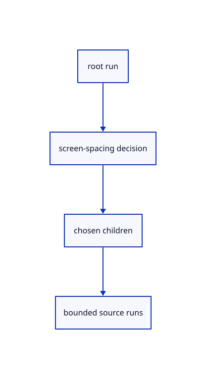

# 11.2.8 · Walk only detail whose screen spacing needs refinement

**Chapter 11 · Outlines and point clouds · Section 11.2 · Point clouds and detail levels** · [Contents](contents.md)

**Typing: 21–41 minutes.** [Estimate](typing-load.md).

Reuse stack and visit lists. Keep the coarse node points and visit children while their spacing exceeds the threshold; pass finer spacing back to the visited parents.

## Type

Continue from [Measure point spacing in the current projection](64f-projection.md). [Save or recover your work](recovery.md).

### 1. `src/cloud_lod.rs`

Use the current production reusable LOD walk without inventing source points.

<details>
<summary>Locate the existing block</summary>

```rust
    stack: Vec<(usize, usize)>, // nodes still to visit, with parent
    visits: Vec<Visit>,         // nodes visited
}
```

</details>

After that block, type:

```rust
--8<-- "journey/code/64g-detail-01.rs" skip=121
```

<details>
<summary>Supplied validation fixture</summary>

Copy this supplied authoring fixture once. Continue with the browser build below; the course does not require running native tests.

### 2. `src/cloud_tests.rs`

Copy original-ID, malformed-tree, view-run, radius and source/history/close regressions.

Copy this supplied file:

```text
--8<-- "journey/code/64g-detail-02.rs"
```

</details>

<details>
<summary>Supplied validation fixture</summary>

Copy this supplied authoring fixture once. Continue with the browser build below; the course does not require running native tests.

### 3. `src/lib.rs`

Register the source component.

<details>
<summary>Locate the existing block</summary>

```text

pub mod cloud_lod;
```

</details>

After that block, append this supplied code:

```text
--8<-- "journey/code/64g-detail-03.rs" skip=20
```

</details>

## Run and check

Run this from `session_viewer` to select the fixed dependency versions and install supplied binary assets. It updates Cargo.lock and preserves the previous lock. It does not write implementation code:

```sh
npm --prefix ../session_tests run course -- dependencies 11.2.8
```

In your project:

```sh
cd workspace/journey
REGEN_PROTO=0 cargo build --lib --locked --target wasm32-unknown-unknown -j1
REGEN_PROTO=0 CARGO_BUILD_JOBS=1 trunk serve --port 8780
```

Open `http://127.0.0.1:8780/`. Keep an existing Trunk server running; saving rebuilds it.


### Recorded visual result

**Previous native render — current verification pending.**

The selected CAD bore and black original and silhouette contours remain visible.


*This recorded image predates a source or checker change. Rebuild this checkpoint before using it as current evidence; browser controls require separate acceptance.*

This reference image is shared with [11.2.1 · Check cloud cubes against their original point rows](64-nodes.md). It does not demonstrate a new feature by itself.

<details>
<summary>Code explanation and diagram</summary>


root run → screen-spacing decision → chosen children → bounded source runs.



Does zooming in discard the original coarse point IDs?

No. Coarse points remain part of the chosen runs, with their original stored indices. Small clouds below two million points and clouds without an octree draw their complete resident prefix.

Study estimate, including typing and experiments: 0.5–1 hours.

</details>

<details>
<summary>Optional experiment</summary>

Inspect the supplied walk checks for coarse, fine and partially resident cases. The final large fixture contains 2,000,064 real points so zoom changes actual drawn detail.

</details>

<details>
<summary>Check and save your work</summary>

Restore experimental edits, then run from `session_viewer`:

```sh
npm --prefix ../session_tests run course -- check 11.2.8
npm --prefix ../session_tests run course -- save 11.2.8
```

Source comparison leaves your project untouched. [Save and recovery instructions](recovery.md).

</details>

<details>
<summary>Viewer coverage and verification</summary>


The inherited silhouette browser contract remains authored and unrun. Cloud acceptance connects at the final endpoint; native software rendering is not Lenovo timing.

[Full validation scope](release.md).

To reproduce the scripted acceptance of the reference checkpoint, run from `session_viewer` with the [course bundle server](release.md#reproduce) running on port 8781:

```sh
npm --prefix ../session_tests run course -- capture 11.2.8
```

This uses the verified reference bundle; it does not check or change your typed project.

</details>
