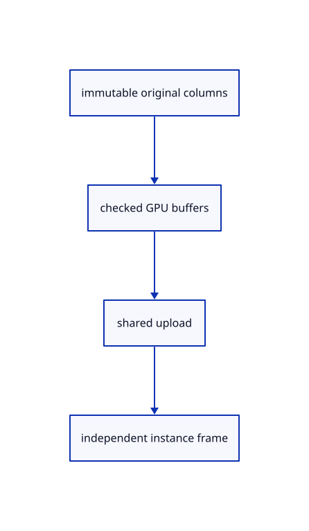

# 11.2.14 · Upload original point columns once per shared source

**Chapter 11 · Outlines and point clouds · Section 11.2 · Point clouds and detail levels** · [Contents](contents.md)

**Typing: 28–56 minutes.** [Estimate](typing-load.md).

Keep positions, packed colours and packed normals in separate source buffers. Check the device storage binding limit before allocating; instance models stay outside those columns.

## Type

Continue from [Check cloud shaders on the actual browser device](64hd-check-cloud-shaders-on-the-actual-browser-device.md). [Save or recover your work](recovery.md).

### 1. `src/cloud_gpu.rs`

Create checked original column uploads and explicit view facts.

Create the file and type:

```rust
--8<-- "journey/code/64i-columns-01.rs"
```

### 2. `src/lib.rs`

Register the source component.

<details>
<summary>Locate the existing block</summary>

```rust

pub mod cloud_normals;
```

</details>

After that block, type:

```rust
--8<-- "journey/code/64i-columns-02.rs" skip=24
```

## Run and check

Run this from `session_viewer` to select the fixed dependency versions and install supplied binary assets. It updates Cargo.lock and preserves the previous lock. It does not write implementation code:

```sh
npm --prefix ../session_tests run course -- dependencies 11.2.14
```

In your project:

```sh
cd workspace/journey
REGEN_PROTO=0 cargo build --lib --locked --target wasm32-unknown-unknown -j1
REGEN_PROTO=0 CARGO_BUILD_JOBS=1 trunk serve --port 8780
```

Open `http://127.0.0.1:8780/`. Keep an existing Trunk server running; saving rebuilds it.


### Recorded visual result

**Previous native render — current verification pending.**

The selected CAD bore and black original and silhouette contours remain visible.


*This recorded image predates a source or checker change. Rebuild this checkpoint before using it as current evidence; browser controls require separate acceptance.*

This reference image is shared with [11.2.1 · Check cloud cubes against their original point rows](64-nodes.md). It does not demonstrate a new feature by itself.

<details>
<summary>Code explanation and diagram</summary>


immutable original columns → checked GPU buffers → shared upload → independent instance frame.



Does copying one cloud require uploading all its points again?

No. Copies share the original prepared source and its GPU columns. Only their placements and small draw records differ; normals retain their original source values beside the packed display words.

Study estimate, including typing and experiments: 0.5–1 hours.

</details>

<details>
<summary>Optional experiment</summary>

Compare original f64 coordinates with uploaded f32 positions. Inspect black fallback colours and the no-normal sentinel; verify no cloud source exceeds this device’s storage binding limit.

</details>

<details>
<summary>Check and save your work</summary>

Restore experimental edits, then run from `session_viewer`:

```sh
npm --prefix ../session_tests run course -- check 11.2.14
npm --prefix ../session_tests run course -- save 11.2.14
```

Source comparison leaves your project untouched. [Save and recovery instructions](recovery.md).

</details>

<details>
<summary>Viewer coverage and verification</summary>


The inherited silhouette browser contract remains authored and unrun. Cloud acceptance connects at the final endpoint; native software rendering is not Lenovo timing.

[Full validation scope](release.md).

To reproduce the scripted acceptance of the reference checkpoint, run from `session_viewer` with the [course bundle server](release.md#reproduce) running on port 8781:

```sh
npm --prefix ../session_tests run course -- capture 11.2.14
```

This uses the verified reference bundle; it does not check or change your typed project.

</details>
