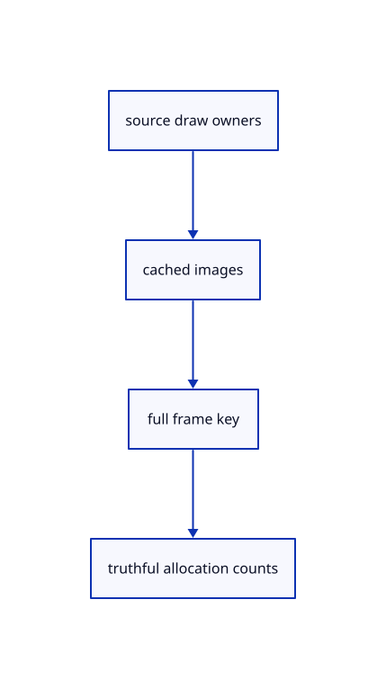

# 11.2.15 · Own the cached cloud images and frame identity

**Chapter 11 · Outlines and point clouds · Section 11.2 · Point clouds and detail levels** · [Contents](contents.md)

**Typing: 20–39 minutes.** [Estimate](typing-load.md).

Keep cached point colour, nearest depth and owner/index textures alongside a reuse key. Count live source columns, record buffers and exact target allocations separately.

## Type

Continue from [Upload original point columns once per shared source](64i-columns.md). [Save or recover your work](recovery.md).

### 1. `src/cloud_gpu.rs`

Own cached colour/depth/IDs, per-instance draw records and complete frame identity.

<details>
<summary>Locate the existing block</summary>

```rust
  })
}
```

</details>

After that block, type:

```rust
--8<-- "journey/code/64j-targets-01.rs" skip=7
```

## Run and check

Run this from `session_viewer` to select the fixed dependency versions and install supplied binary assets. It updates Cargo.lock and preserves the previous lock. It does not write implementation code:

```sh
npm --prefix ../session_tests run course -- dependencies 11.2.15
```

In your project:

```sh
cd workspace/journey
REGEN_PROTO=0 cargo build --lib --locked --target wasm32-unknown-unknown -j1
REGEN_PROTO=0 CARGO_BUILD_JOBS=1 trunk serve --port 8780
```

Open `http://127.0.0.1:8780/`. Keep an existing Trunk server running; saving rebuilds it.


### Recorded visual result

**Previous native render — current verification pending.**

The selected CAD bore and black original and silhouette contours remain visible.


*This recorded image predates a source or checker change. Rebuild this checkpoint before using it as current evidence; browser controls require separate acceptance.*

This reference image is shared with [11.2.1 · Check cloud cubes against their original point rows](64-nodes.md). It does not demonstrate a new feature by itself.

<details>
<summary>Code explanation and diagram</summary>


source draw owners → cached images → full frame key → truthful allocation counts.



Does an unchanged point count make cached pixels reusable?

No. Camera, viewport, density, LOD facts, visibility, placement and selection can change while point count stays constant. Their key and explicit scene revision govern reuse.

Study estimate, including typing and experiments: 0.5–1 hours.

</details>

<details>
<summary>Optional experiment</summary>

List every input in the key. Compare a full-size 4-byte colour, 4-byte depth and 8-byte owner/index image; dropping the image owner destroys its GPU texture.

</details>

<details>
<summary>Check and save your work</summary>

Restore experimental edits, then run from `session_viewer`:

```sh
npm --prefix ../session_tests run course -- check 11.2.15
npm --prefix ../session_tests run course -- save 11.2.15
```

Source comparison leaves your project untouched. [Save and recovery instructions](recovery.md).

</details>

<details>
<summary>Viewer coverage and verification</summary>


The inherited silhouette browser contract remains authored and unrun. Cloud acceptance connects at the final endpoint; native software rendering is not Lenovo timing.

[Full validation scope](release.md).

To reproduce the scripted acceptance of the reference checkpoint, run from `session_viewer` with the [course bundle server](release.md#reproduce) running on port 8781:

```sh
npm --prefix ../session_tests run course -- capture 11.2.15
```

This uses the verified reference bundle; it does not check or change your typed project.

</details>
