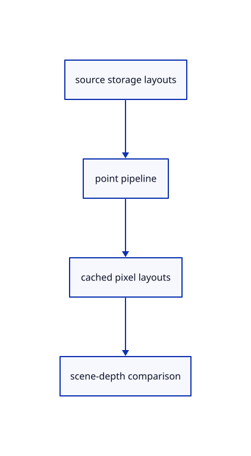

# 11.2.16 · Bind source storage and cached pixels explicitly

**Chapter 11 · Outlines and point clouds · Section 11.2 · Point clouds and detail levels** · [Contents](contents.md)

**Typing: 26–52 minutes.** [Estimate](typing-load.md).

Create separate layouts for point records/source columns and cached textures. Point draws write nearest forward depth; cached resolve compares that depth with the existing scene.

## Type

Continue from [Own the cached cloud images and frame identity](64j-targets.md). [Save or recover your work](recovery.md).

### 1. `src/cloud_gpu.rs`

Define compatible explicit storage, texture and forward-depth pipeline layouts.

Edit these blocks from bottom to top. Keep the surrounding lines unchanged.

<details>
<summary>Locate this block</summary>

```rust
  image: wgpu::BindGroupLayout,
}
```

</details>

Replace it with:

```rust
  image: wgpu::BindGroupLayout,
}

fn layouts(ctx: &GpuCtx) -> Layouts {
  let uniform = crate::gpu_layout::uniform(&ctx.device, 48);
  let window_layout = crate::gpu_layout::uniform(&ctx.device, 16);
  let storage = |binding| wgpu::BindGroupLayoutEntry {
    binding,
    visibility: wgpu::ShaderStages::VERTEX,
    ty: wgpu::BindingType::Buffer {
      ty: wgpu::BufferBindingType::Storage { read_only: true },
      has_dynamic_offset: false,
      min_binding_size: None,
    },
    count: None,
  };
  let columns_layout = ctx.device.create_bind_group_layout(&wgpu::BindGroupLayoutDescriptor {
    label: Some("cloud source columns and bounded records"),
    entries: &[storage(0), storage(1), storage(2), storage(3)],
  });
  let texture = |binding, sample_type| {
    crate::text_gpu_support::texture_entry(binding, wgpu::ShaderStages::FRAGMENT, sample_type, false)
  };
  let image_layout = ctx.device.create_bind_group_layout(&wgpu::BindGroupLayoutDescriptor {
    label: Some("cached cloud images"),
    entries: &[
      texture(0, wgpu::TextureSampleType::Depth),
      texture(1, wgpu::TextureSampleType::Float { filterable: false }),
      texture(2, wgpu::TextureSampleType::Uint),
    ],
  });
  Layouts { uniform, window: window_layout, columns: columns_layout, image: image_layout }
}
```

<details>
<summary>Locate this block</summary>

```rust
}
impl Lane {
}
struct Layouts {
  uniform: wgpu::BindGroupLayout,
  window: wgpu::BindGroupLayout,
```

</details>

Replace it with:

```rust
}
impl Lane {
}
fn pipeline(
  device: &wgpu::Device,
  shader: &wgpu::ShaderModule,
  groups: &[&wgpu::BindGroupLayout],
  vertex: &str,
  fragment: &str,
  formats: &[wgpu::TextureFormat],
) -> wgpu::RenderPipeline {
  let layout = device.create_pipeline_layout(&wgpu::PipelineLayoutDescriptor {
    label: Some(fragment),
    bind_group_layouts: &groups.iter().map(|g| Some(*g)).collect::<Vec<_>>(),
    immediate_size: 0,
  });
  device.create_render_pipeline(&wgpu::RenderPipelineDescriptor {
    label: Some(fragment),
    layout: Some(&layout),
    vertex: wgpu::VertexState {
      module: shader,
      entry_point: Some(vertex),
      buffers: &[],
      compilation_options: Default::default(),
    },
    fragment: Some(wgpu::FragmentState {
      module: shader,
      entry_point: Some(fragment),
      targets: &formats.iter().copied().map(|format| Some(format.into())).collect::<Vec<_>>(),
      compilation_options: Default::default(),
    }),
    primitive: Default::default(),
    depth_stencil: Some(wgpu::DepthStencilState {
      format: crate::depth::FORMAT,
      depth_write_enabled: Some(true),
      depth_compare: Some(wgpu::CompareFunction::LessEqual),
      stencil: Default::default(),
      bias: Default::default(),
    }),
    multisample: Default::default(),
    multiview_mask: None,
    cache: None,
  })
}
struct Layouts {
  uniform: wgpu::BindGroupLayout,
  window: wgpu::BindGroupLayout,
```

<details>
<summary>Complete updated block reference</summary>

```rust
use crate::{
  cloud::Row,
  cloud_lod::{LodWalk, Projection},
  text_gpu_support::{GpuCtx, resource_group},
};
use std::{collections::HashMap, rc::Rc};
use wgpu::util::DeviceExt;
const MAX_RECORDS: usize = 4096;

#[derive(Clone, Copy)]
pub struct View {
  pub eye: [f32; 3],
  pub ortho_h: f32,
  pub lod_px: f32,
}
impl Default for View {
  fn default() -> Self {
    Self { eye: [0., 0., 3.], ortho_h: 0., lod_px: 2. }
  }
}
impl View {
  pub fn camera(camera: &crate::camera::Camera) -> Self {
    let forward = camera.orientation.rotate_vector(session_rust::Vector::y_axis());
    Self {
      eye: std::array::from_fn(|i| (camera.target[i] - forward[i] * camera.distance) as f32),
      ortho_h: if camera.projection == crate::camera::Projection::Orthographic {
        (camera.distance * std::f64::consts::FRAC_PI_6.tan()) as f32
      } else {
        0.
      },
      lod_px: 2.,
    }
  }
}
struct Columns {
  positions: wgpu::Buffer,
  colors: wgpu::Buffer,
  normals: wgpu::Buffer,
  has_normals: bool,
}
impl Columns {
  fn new(ctx: &GpuCtx, row: &Row) -> Result<Self, &'static str> {
    let source = &row.prepared.source;
    let count = source.len();
    let limit = ctx.device.limits().max_storage_buffer_binding_size as usize;
    if count.checked_mul(12).is_none_or(|n| n > limit) {
      return Err("Cloud positions exceed this device's storage binding limit");
    }
    let positions = source.coords().iter().flat_map(|v| (*v as f32).to_ne_bytes()).collect::<Vec<_>>();
    let colors = (0..count)
      .map(|i| {
        if source.colors().is_empty() {
          0xff00_0000
        } else {
          let c = &source.colors()[i * 4..i * 4 + 4];
          (c[0] as u32) | (c[1] as u32) << 8 | (c[2] as u32) << 16 | (c[3] as u32) << 24
        }
      })
      .flat_map(u32::to_ne_bytes)
      .collect::<Vec<_>>();
    let has_normals = !source.normals().is_empty();
    let normals = source
      .normals()
      .chunks_exact(3)
      .map(|n| crate::cloud_normals::oct16(&[n[0], n[1], n[2]]).unwrap_or(0))
      .flat_map(u32::to_ne_bytes)
      .collect::<Vec<_>>();
    Ok(Self {
      positions: buffer(&ctx.device, "original cloud positions", &positions),
      colors: buffer(&ctx.device, "original cloud colors", &colors),
      normals: buffer(&ctx.device, "original cloud normals", &normals),
      has_normals,
    })
  }
  fn bytes(&self) -> u64 {
    self.positions.size() + self.colors.size() + self.normals.size()
  }
}
fn buffer(device: &wgpu::Device, label: &str, bytes: &[u8]) -> wgpu::Buffer {
  device.create_buffer_init(&wgpu::util::BufferInitDescriptor {
    label: Some(label),
    contents: if bytes.is_empty() { &[0; 4] } else { bytes },
    usage: wgpu::BufferUsages::STORAGE,
  })
}
struct Draw {
  row: Row,
  columns: Rc<Columns>,
  records: wgpu::Buffer,
  group: wgpu::BindGroup,
  visible: bool,
  pickable: bool,
  selected: bool,
  color: Option<[u8; 3]>,
  total: u32,
}
struct Image {
  texture: wgpu::Texture,
  view: wgpu::TextureView,
  bytes: u64,
}
impl Image {
  fn new(device: &wgpu::Device, size: [u32; 2], format: wgpu::TextureFormat, bytes: u64) -> Self {
    let texture = device.create_texture(&wgpu::TextureDescriptor {
      label: Some("cached cloud image"),
      size: wgpu::Extent3d { width: size[0], height: size[1], depth_or_array_layers: 1 },
      mip_level_count: 1,
      sample_count: 1,
      dimension: wgpu::TextureDimension::D2,
      format,
      usage: wgpu::TextureUsages::RENDER_ATTACHMENT | wgpu::TextureUsages::TEXTURE_BINDING,
      view_formats: &[],
    });
    let view = texture.create_view(&Default::default());
    Self { texture, view, bytes: bytes * size[0] as u64 * size[1] as u64 }
  }
}
impl Drop for Image {
  fn drop(&mut self) {
    self.texture.destroy();
  }
}
struct Targets {
  color: Image,
  depth: Image,
  ids: Image,
  size: [u32; 2],
  group: wgpu::BindGroup,
}
#[derive(PartialEq)]
struct Key {
  transform: [f32; 16],
  size: [u32; 2],
  density: u32,
  eye: [u32; 3],
  ortho: u32,
  lod: u32,
  revision: u64,
}

pub struct Lane {
  point: wgpu::RenderPipeline,
  resolve: wgpu::RenderPipeline,
  pick: wgpu::RenderPipeline,
  settings: wgpu::Buffer,
  settings_group: wgpu::BindGroup,
  columns_layout: wgpu::BindGroupLayout,
  image_layout: wgpu::BindGroupLayout,
  window: wgpu::Buffer,
  window_group: wgpu::BindGroup,
  draws: Vec<Draw>,
  targets: Option<Targets>,
  key: Option<Key>,
  revision: u64,
  pub uploads: u64,
  pub preparations: u64,
  pub skips: u64,
  pub total: u64,
}
impl Lane {
}
fn pipeline(
  device: &wgpu::Device,
  shader: &wgpu::ShaderModule,
  groups: &[&wgpu::BindGroupLayout],
  vertex: &str,
  fragment: &str,
  formats: &[wgpu::TextureFormat],
) -> wgpu::RenderPipeline {
  let layout = device.create_pipeline_layout(&wgpu::PipelineLayoutDescriptor {
    label: Some(fragment),
    bind_group_layouts: &groups.iter().map(|g| Some(*g)).collect::<Vec<_>>(),
    immediate_size: 0,
  });
  device.create_render_pipeline(&wgpu::RenderPipelineDescriptor {
    label: Some(fragment),
    layout: Some(&layout),
    vertex: wgpu::VertexState {
      module: shader,
      entry_point: Some(vertex),
      buffers: &[],
      compilation_options: Default::default(),
    },
    fragment: Some(wgpu::FragmentState {
      module: shader,
      entry_point: Some(fragment),
      targets: &formats.iter().copied().map(|format| Some(format.into())).collect::<Vec<_>>(),
      compilation_options: Default::default(),
    }),
    primitive: Default::default(),
    depth_stencil: Some(wgpu::DepthStencilState {
      format: crate::depth::FORMAT,
      depth_write_enabled: Some(true),
      depth_compare: Some(wgpu::CompareFunction::LessEqual),
      stencil: Default::default(),
      bias: Default::default(),
    }),
    multisample: Default::default(),
    multiview_mask: None,
    cache: None,
  })
}
struct Layouts {
  uniform: wgpu::BindGroupLayout,
  window: wgpu::BindGroupLayout,
  columns: wgpu::BindGroupLayout,
  image: wgpu::BindGroupLayout,
}

fn layouts(ctx: &GpuCtx) -> Layouts {
  let uniform = crate::gpu_layout::uniform(&ctx.device, 48);
  let window_layout = crate::gpu_layout::uniform(&ctx.device, 16);
  let storage = |binding| wgpu::BindGroupLayoutEntry {
    binding,
    visibility: wgpu::ShaderStages::VERTEX,
    ty: wgpu::BindingType::Buffer {
      ty: wgpu::BufferBindingType::Storage { read_only: true },
      has_dynamic_offset: false,
      min_binding_size: None,
    },
    count: None,
  };
  let columns_layout = ctx.device.create_bind_group_layout(&wgpu::BindGroupLayoutDescriptor {
    label: Some("cloud source columns and bounded records"),
    entries: &[storage(0), storage(1), storage(2), storage(3)],
  });
  let texture = |binding, sample_type| {
    crate::text_gpu_support::texture_entry(binding, wgpu::ShaderStages::FRAGMENT, sample_type, false)
  };
  let image_layout = ctx.device.create_bind_group_layout(&wgpu::BindGroupLayoutDescriptor {
    label: Some("cached cloud images"),
    entries: &[
      texture(0, wgpu::TextureSampleType::Depth),
      texture(1, wgpu::TextureSampleType::Float { filterable: false }),
      texture(2, wgpu::TextureSampleType::Uint),
    ],
  });
  Layouts { uniform, window: window_layout, columns: columns_layout, image: image_layout }
}
```

</details>

<details>
<summary>Optional patch references</summary>

Use these original edit fragments when comparing a saved checkpoint. Apply the complete blocks above.

```text
--8<-- "journey/code/64k-layouts-01.rs"
```

```text
--8<-- "journey/code/64k-layouts-02.rs"
```

</details>

## Run and check

Run this from `session_viewer` to select the fixed dependency versions and install supplied binary assets. It updates Cargo.lock and preserves the previous lock. It does not write implementation code:

```sh
npm --prefix ../session_tests run course -- dependencies 11.2.16
```

In your project:

```sh
cd workspace/journey
REGEN_PROTO=0 cargo build --lib --locked --target wasm32-unknown-unknown -j1
REGEN_PROTO=0 CARGO_BUILD_JOBS=1 trunk serve --port 8780
```

Open `http://127.0.0.1:8780/`. Keep an existing Trunk server running; saving rebuilds it.


### Recorded visual result

**Previous native render — current verification pending.**

The selected CAD bore and black original and silhouette contours remain visible.


*This recorded image predates a source or checker change. Rebuild this checkpoint before using it as current evidence; browser controls require separate acceptance.*

This reference image is shared with [11.2.1 · Check cloud cubes against their original point rows](64-nodes.md). It does not demonstrate a new feature by itself.

<details>
<summary>Code explanation and diagram</summary>


source storage layouts → point pipeline → cached pixel layouts → scene-depth comparison.



Should a cloud resolve overwrite a solid in front of it?

No. It writes the point’s actual nearest depth and compares against the scene. A locked visible cloud keeps colour/depth but writes zero ownership, so occluded geometry stays unavailable.

Study estimate, including typing and experiments: 0.5–1 hours.

</details>

<details>
<summary>Optional experiment</summary>

Check the storage binding count, 48-byte cloud settings and 16-byte pick origin. Compare the point colour/ID targets with the final scene colour and bounded integer targets.

</details>

<details>
<summary>Check and save your work</summary>

Restore experimental edits, then run from `session_viewer`:

```sh
npm --prefix ../session_tests run course -- check 11.2.16
npm --prefix ../session_tests run course -- save 11.2.16
```

Source comparison leaves your project untouched. [Save and recovery instructions](recovery.md).

</details>

<details>
<summary>Viewer coverage and verification</summary>


The inherited silhouette browser contract remains authored and unrun. Cloud acceptance connects at the final endpoint; native software rendering is not Lenovo timing.

[Full validation scope](release.md).

To reproduce the scripted acceptance of the reference checkpoint, run from `session_viewer` with the [course bundle server](release.md#reproduce) running on port 8781:

```sh
npm --prefix ../session_tests run course -- capture 11.2.16
```

This uses the verified reference bundle; it does not check or change your typed project.

</details>
