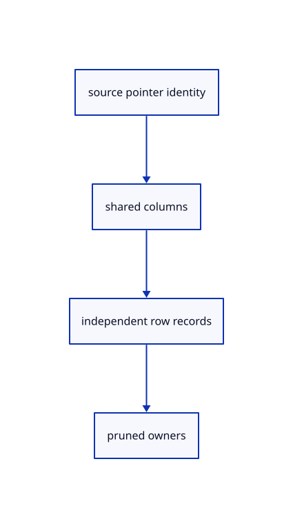

# 11.2.18 · Share column uploads across placed cloud rows

**Chapter 11 · Outlines and point clouds · Section 11.2 · Point clouds and detail levels** · [Contents](contents.md)

**Typing: 28–55 minutes.** [Estimate](typing-load.md).

Reuse one column owner for repeated original sources. Each instance keeps its own bounded record buffer and model; scene updates prune obsolete display owners.

## Type

Continue from [Create a lazy cloud lane with reusable pipelines](64l-pipelines.md). [Save or recover your work](recovery.md).

### 1. `src/cloud_gpu.rs`

Reuse original GPU columns across row placements and count actual shared allocations.

<details>
<summary>Locate the existing block</summary>

```rust
    }
  }
}
fn pipeline(
```

</details>

Edit the existing block to match this code; keep unchanged lines:

```rust
--8<-- "journey/code/64m-cache-01.rs"
```

## Run and check

Run this from `session_viewer` to select the fixed dependency versions and install supplied binary assets. It updates Cargo.lock and preserves the previous lock. It does not write implementation code:

```sh
npm --prefix ../session_tests run course -- dependencies 11.2.18
```

In your project:

```sh
cd workspace/journey
REGEN_PROTO=0 cargo build --lib --locked --target wasm32-unknown-unknown -j1
REGEN_PROTO=0 CARGO_BUILD_JOBS=1 trunk serve --port 8780
```

Open `http://127.0.0.1:8780/`. Keep an existing Trunk server running; saving rebuilds it.


### Recorded visual result

**Previous native render — current verification pending.**

The selected CAD bore and black original and silhouette contours remain visible.


*This recorded image predates a source or checker change. Rebuild this checkpoint before using it as current evidence; browser controls require separate acceptance.*

This reference image is shared with [11.2.1 · Check cloud cubes against their original point rows](64-nodes.md). It does not demonstrate a new feature by itself.

<details>
<summary>Code explanation and diagram</summary>


source pointer identity → shared columns → independent row records → pruned owners.



Should hiding a cloud change its original visibility field?

No. Existing viewer/layer flags decide current presentation and eligibility. The original source fields remain intact, and shared column buffers can be reused when a hidden cloud is shown again.

Study estimate, including typing and experiments: 0.5–1 hours.

</details>

<details>
<summary>Optional experiment</summary>

Copy a cloud and inspect the upload counter before and after. Change selection or layer colour; its records change while original column uploads remain shared.

</details>

<details>
<summary>Check and save your work</summary>

Restore experimental edits, then run from `session_viewer`:

```sh
npm --prefix ../session_tests run course -- check 11.2.18
npm --prefix ../session_tests run course -- save 11.2.18
```

Source comparison leaves your project untouched. [Save and recovery instructions](recovery.md).

</details>

<details>
<summary>Viewer coverage and verification</summary>


The inherited silhouette browser contract remains authored and unrun. Cloud acceptance connects at the final endpoint; native software rendering is not Lenovo timing.

[Full validation scope](release.md).

To reproduce the scripted acceptance of the reference checkpoint, run from `session_viewer` with the [course bundle server](release.md#reproduce) running on port 8781:

```sh
npm --prefix ../session_tests run course -- capture 11.2.18
```

This uses the verified reference bundle; it does not check or change your typed project.

</details>
