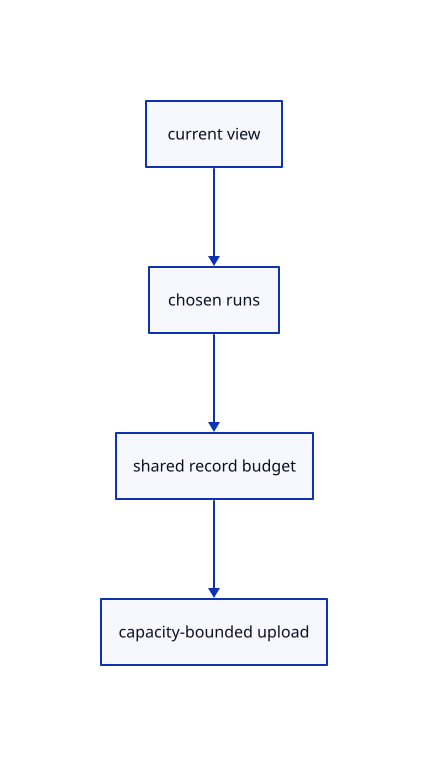

# 11.2.20 · Keep one shared record budget for the whole view

**Chapter 11 · Outlines and point clouds · Section 11.2 · Point clouds and detail levels** · [Contents](contents.md)

**Typing: 20–39 minutes.** [Estimate](typing-load.md).

Choose original runs for each visible instance and enforce one 4096-record limit across all clouds. Grow each record buffer only to used capacity and reject overflowing vertex counts.

## Type

Continue from [Encode each source run in the exact 160-byte layout](64n-records.md). [Save or recover your work](recovery.md).

### 1. `src/cloud_gpu.rs`

Select bounded view runs and grow record storage only to used capacity.

<details>
<summary>Locate the existing block</summary>

```rust
    Ok(())
  }
  pub fn failed(&mut self) {
    self.targets = None;
```

</details>

Edit the existing block to match this code; keep unchanged lines:

```rust
--8<-- "journey/code/64o-runs-01.rs"
```

## Run and check

Run this from `session_viewer` to select the fixed dependency versions and install supplied binary assets. It updates Cargo.lock and preserves the previous lock. It does not write implementation code:

```sh
npm --prefix ../session_tests run course -- dependencies 11.2.20
```

In your project:

```sh
cd workspace/journey
REGEN_PROTO=0 cargo build --lib --locked --target wasm32-unknown-unknown -j1
REGEN_PROTO=0 CARGO_BUILD_JOBS=1 trunk serve --port 8780
```

Open `http://127.0.0.1:8780/`. Keep an existing Trunk server running; saving rebuilds it.


### Recorded visual result

**Previous native render — current verification pending.**

The selected CAD bore and black original and silhouette contours remain visible.


*This recorded image predates a source or checker change. Rebuild this checkpoint before using it as current evidence; browser controls require separate acceptance.*

This reference image is shared with [11.2.1 · Check cloud cubes against their original point rows](64-nodes.md). It does not demonstrate a new feature by itself.

<details>
<summary>Code explanation and diagram</summary>


current view → chosen runs → shared record budget → capacity-bounded upload.



Is 4096 records allowed separately for every cloud?

No. It is the whole-view budget. Repeated clouds share original columns, and record buffers reserve only their needed bounded capacity. A failed preparation cannot expose stale cached picks.

Study estimate, including typing and experiments: 0.5–1 hours.

</details>

<details>
<summary>Optional experiment</summary>

Compare one small cloud with many placements. Inspect live record counts versus reserved bytes and the checked six-vertices-per-point draw limit.

</details>

<details>
<summary>Check and save your work</summary>

Restore experimental edits, then run from `session_viewer`:

```sh
npm --prefix ../session_tests run course -- check 11.2.20
npm --prefix ../session_tests run course -- save 11.2.20
```

Source comparison leaves your project untouched. [Save and recovery instructions](recovery.md).

</details>

<details>
<summary>Viewer coverage and verification</summary>


The inherited silhouette browser contract remains authored and unrun. Cloud acceptance connects at the final endpoint; native software rendering is not Lenovo timing.

[Full validation scope](release.md).

To reproduce the scripted acceptance of the reference checkpoint, run from `session_viewer` with the [course bundle server](release.md#reproduce) running on port 8781:

```sh
npm --prefix ../session_tests run course -- capture 11.2.20
```

This uses the verified reference bundle; it does not check or change your typed project.

</details>
