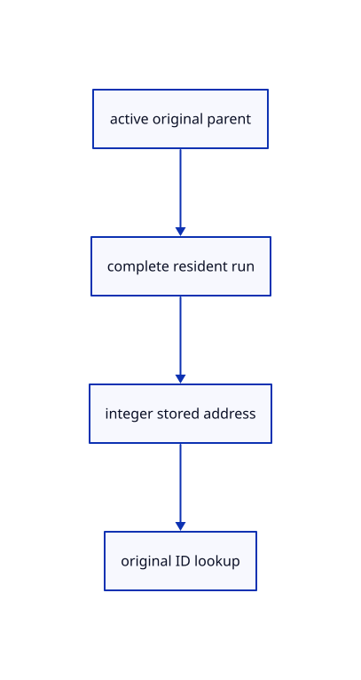

# 11.3.2 · Recover original IDs from integer cloud pixels

**Chapter 11 · Outlines and point clouds · Section 11.3 · Point identity and manifest records** · [Contents](contents.md)

**Typing: 5–9 minutes.** [Estimate](typing-load.md).

In control mode, return the cached owner and original storage address. Only the active parent exposes original points; other visible clouds still occlude.

## Type

Continue from [Resolve source point identities and precise positions](65-originals.md). [Save or recover your work](recovery.md).

### 1. `src/pick_sources.rs`

Return original integer storage addresses and query the active parent’s complete resident points.

<details>
<summary>Locate the existing block</summary>

```rust
        if mode == Mode::Object { return Some(Target { owner, part: Part::Object }); }
        let (kind, address) = sub_id::decode(pixel[1])?;
        let target = match (mode, kind) {
            (Mode::Face, Kind::Face) => self.faces.get(address),
```

</details>

Edit the existing block to match this code; keep unchanged lines:

```rust
--8<-- "journey/code/65a-addresses-01.rs"
```

### 2. `src/cloud_gpu.rs`

Return original integer storage addresses and query the active parent’s complete resident points.

<details>
<summary>Locate the existing block</summary>

```rust
        ortho_h: view.ortho_h,
        height_px: size[1],
        lod_px: view.lod_px,
        nodes: &row.prepared.nodes,
      };
```

</details>

Edit the existing block to match this code; keep unchanged lines:

```rust
--8<-- "journey/code/65a-addresses-02.rs"
```

### 3. `src/cloud_resolve.wgsl`

Return original integer storage addresses and query the active parent’s complete resident points.

<details>
<summary>Locate the existing block</summary>

```wgsl
    let q=vec2<i32>(p.xy)+vec2<i32>(window.origin);let d=textureLoad(sdepth,q,0);if (d>=1.0) {discard;}
    let ids=textureLoad(sids,q,0).xy;
    return Pick(select(vec2<u32>(0u),vec2<u32>(ids.x,0u),window.mode==0u),d);
}
```

</details>

Edit the existing block to match this code; keep unchanged lines:

```wgsl
--8<-- "journey/code/65a-addresses-03.rs"
```

## Run and check

Run this from `session_viewer` to select the fixed dependency versions and install supplied binary assets. It updates Cargo.lock and preserves the previous lock. It does not write implementation code:

```sh
npm --prefix ../session_tests run course -- dependencies 11.3.2
```

In your project:

```sh
cd workspace/journey
REGEN_PROTO=0 cargo build --lib --locked --target wasm32-unknown-unknown -j1
REGEN_PROTO=0 CARGO_BUILD_JOBS=1 trunk serve --port 8780
```

Open `http://127.0.0.1:8780/`. Keep an existing Trunk server running; saving rebuilds it.


### Recorded visual result

**Previous native render — current verification pending.**

The coloured original cloud remains visible.


*This recorded image predates a source or checker change. Rebuild this checkpoint before using it as current evidence; browser controls require separate acceptance.*

This reference image is shared with [11.3.1 · Resolve source point identities and precise positions](65-originals.md). It does not demonstrate a new feature by itself.

<details>
<summary>Code explanation and diagram</summary>


active original parent → complete resident run → integer stored address → original ID lookup.



Can ordinary coarse display points limit the control query?

No. The active resident parent uses the complete original resident prefix. Returning to object viewing restores ordinary LOD, reusing source columns; streamed queries later inspect bounded source pages instead.

Study estimate, including typing and experiments: 0.5–1 hours.

</details>

<details>
<summary>Optional experiment</summary>

Compare a coarse 64-point view with its active 2000064-point source query. Keep the same GPU upload counter and return to the 64-point display after Controls Off.

</details>

<details>
<summary>Check and save your work</summary>

Restore experimental edits, then run from `session_viewer`:

```sh
npm --prefix ../session_tests run course -- check 11.3.2
npm --prefix ../session_tests run course -- save 11.3.2
```

Source comparison leaves your project untouched. [Save and recovery instructions](recovery.md).

</details>

<details>
<summary>Viewer coverage and verification</summary>


The inherited cloud browser contract is authored and unrun. Original-point browser assertions connect at the final checkpoint; software rendering is not Lenovo timing.

[Full validation scope](release.md).

To reproduce the scripted acceptance of the reference checkpoint, run from `session_viewer` with the [course bundle server](release.md#reproduce) running on port 8781:

```sh
npm --prefix ../session_tests run course -- capture 11.3.2
```

This uses the verified reference bundle; it does not check or change your typed project.

</details>
