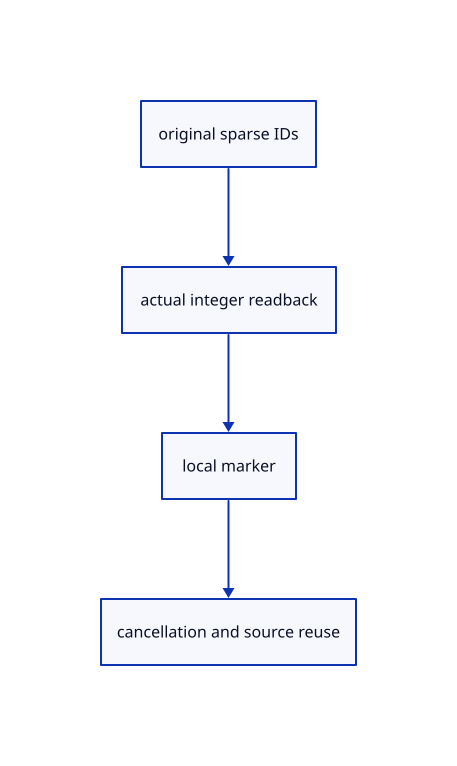

# 11.3.4 · Pick original points and prove source query reuse

**Chapter 11 · Outlines and point clouds · Section 11.3 · Point identity and manifest records** · [Contents](contents.md)

**Typing: 0–0 minutes.** [Estimate](typing-load.md).

Copy source and GPU regressions. Query original points omitted by a real coarse view, then restore display detail without reuploading source columns.

## Type

Continue from [Enter source controls with the current command or F10](65b-controls.md). [Save or recover your work](recovery.md).

<details>
<summary>Supplied validation fixture</summary>

Copy this supplied authoring fixture once. Continue with the browser build below; the course does not require running native tests.

### 1. `src/cloud_pick_tests.rs`

Copy original point-ID, f64 placement, eligibility, parent and source/history invariants.

Copy this supplied file:

```text
--8<-- "journey/code/65c-cloud-point-01.rs"
```

</details>

<details>
<summary>Supplied validation fixture</summary>

Copy this supplied authoring fixture once. Continue with the browser build below; the course does not require running native tests.

### 2. `src/lib.rs`

Register the source component.

<details>
<summary>Locate the existing block</summary>

```text

pub mod cloud_pick;
```

</details>

After that block, append this supplied code:

```text
--8<-- "journey/code/65c-cloud-point-02.rs" skip=21
```

</details>

<details>
<summary>Supplied validation fixture</summary>

Copy this supplied authoring fixture once. Continue with the browser build below; the course does not require running native tests.

### 3. `src/pick_gpu_tests.rs`

Copy actual full-u32 integer picks, local highlights, locked coverage, resident source queries, cancellation and shared-upload checks.

<details>
<summary>Locate the existing block</summary>

```text
    camera.distance=100./std::f64::consts::FRAC_PI_6.tan();assert_eq!(camera_pixels(&mut renderer,&camera),coarse);assert_eq!(renderer.cloud_usage()[0],64);assert_eq!(renderer.cloud_usage()[2],uploads);
    scene.clear();renderer.set_scene(&scene,None);assert_eq!(renderer.cloud_usage(),[0;5]);
}
```

</details>

After that block, append this supplied code:

```text
--8<-- "journey/code/65c-cloud-point-03.rs" skip=297
```

</details>

## Run and check

Run this from `session_viewer` to select the fixed dependency versions and install supplied binary assets. It updates Cargo.lock and preserves the previous lock. It does not write implementation code:

```sh
npm --prefix ../session_tests run course -- dependencies 11.3.4
```

In your project:

```sh
cd workspace/journey
REGEN_PROTO=0 cargo build --lib --locked --target wasm32-unknown-unknown -j1
REGEN_PROTO=0 CARGO_BUILD_JOBS=1 trunk serve --port 8780
```

Open `http://127.0.0.1:8780/`. Keep an existing Trunk server running; saving rebuilds it.

Select the cloud, type Controls or press canvas F10, then click a visible original point. Its source ID is reported and only that point receives a yellow marker. Controls Off returns to the original parent and ordinary view detail. Cloud point editing is explicitly guarded until77. Close releases all cloud and highlight owners.

### Recorded visual result

**Previous native render — current verification pending.**

A local yellow marker identifies original cloud point 840 while the original coloured source cloud remains unchanged.


*This recorded image predates a source or checker change. Rebuild this checkpoint before using it as current evidence; browser controls require separate acceptance.*

<details>
<summary>Code explanation and diagram</summary>


original sparse IDs → actual integer readback → local marker → cancellation and source reuse.



Do the native checks replace browser or Lenovo acceptance?

No. They verify actual integer pixels and source invariants on the available software GPU. The browser contract remains pending, and hardware rotation/zoom timing still needs the Lenovo.

Study estimate, including typing and experiments: 0.5–1 hours.

</details>

<details>
<summary>Optional experiment</summary>

Type Example Cloud, Select Next and Controls, then click an original point and read its reported source ID. Use Controls Off to return to the parent. Read the optional high-ID and coarse-view fixtures for cases too large to infer from this small browser example.

</details>

<details>
<summary>Check and save your work</summary>

Restore experimental edits, then run from `session_viewer`:

```sh
npm --prefix ../session_tests run course -- check 11.3.4
npm --prefix ../session_tests run course -- save 11.3.4
```

Source comparison leaves your project untouched. [Save and recovery instructions](recovery.md).

</details>

<details>
<summary>Viewer coverage and verification</summary>

Current Controls/F10 binds one selected parent. Resident cloud controls draw the complete original resident prefix, matching current splat control_parent. The GPU returns a compact storage address; source.point_id resolves the complete original u32 identity. No per-point CPU target table is allocated. Streamed all-source page queries connect after byte ranges and bounded caches in 67–68; original point editing connects with transforms in 77.

All earlier checks remain. New source/selection regressions check full u32 IDs, precise f64 placement, invalid/locked/hidden owners, one control parent, zero CPU point target rows, unchanged sources/history and explicit edit guards. Actual GPU checks cover two densities, original IDs, local highlights, locked occlusion, cancellation, complete resident query over a real two-million-point coarse view and upload reuse after returning to ordinary display. F10 retains text-field ownership.

The authored original-point contract retains earlier cloud checks and adds Controls/F10, original identity, local highlight, source/history invariants, two densities, restoring display LOD and cleanup. It is syntax checked and unrun.

[Full validation scope](release.md).

To reproduce the scripted acceptance of the reference checkpoint, run from `session_viewer` with the [course bundle server](release.md#reproduce) running on port 8781:

```sh
npm --prefix ../session_tests run course -- capture 11.3.4
```

This uses the verified reference bundle; it does not check or change your typed project.

</details>
