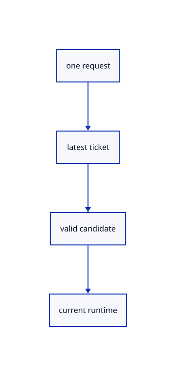

# 12.1.41 · Accept only current URL completions

**Chapter 12 · Files and streaming · Section 12.1 · Scene manifests and range reads** · [Contents](contents.md)

**Typing: 16–32 minutes.** [Estimate](typing-load.md).

Keep one read active and coalesce newer announcements. Verify ticket and runtime ownership before delivering a replacement.

## Type

Continue from [Own and cancel the URL loader](66ab-own-cancel-the-url-loader.md). [Save or recover your work](recovery.md).

### 1. `src/browser_publication.rs`

Accept only a current complete revision and coalesce announced rereads.

<details>
<summary>Locate the existing block</summary>

```rust
}

async fn read(route:&Route,index:&mut Index,signal:&web_sys::AbortSignal)->Result<(),String> {
    let started=crate::browser_phase::now();let mut response=crate::publication_fetch::get(&route.manifest,index.etag(&route.manifest),4*1024*1024,signal).await?;
```

</details>

Edit the existing block to match this code; keep unchanged lines:

```rust
--8<-- "journey/code/66ac-accept-only-current-url-completions-01.rs"
```

## Run and check

Run this from `session_viewer` to select the fixed dependency versions and install supplied binary assets. It updates Cargo.lock and preserves the previous lock. It does not write implementation code:

```sh
npm --prefix ../session_tests run course -- dependencies 12.1.41
```

In your project:

```sh
cd workspace/journey
REGEN_PROTO=0 cargo build --lib --locked --target wasm32-unknown-unknown -j1
REGEN_PROTO=0 CARGO_BUILD_JOBS=1 trunk serve --port 8780
```

Open `http://127.0.0.1:8780/`. Keep an existing Trunk server running; saving rebuilds it.


### Recorded visual result

**Previous native render — current verification pending.**

The original cloud and local point marker remain unchanged.


*This recorded image predates a source or checker change. Rebuild this checkpoint before using it as current evidence; browser controls require separate acceptance.*

This reference image is shared with [11.3.4 · Pick original points and prove source query reuse](65c-cloud-point.md). It does not demonstrate a new feature by itself.

<details>
<summary>Code explanation and diagram</summary>


one request → latest ticket → valid candidate → current runtime.



May an old GPU runtime accept a late fetch?

No. Both the ticket and current device owner must still match.

Study estimate, including typing and experiments: 0.5–1 hours.

</details>

<details>
<summary>Optional experiment</summary>

Cancel a read, replace the runtime and trace the rejected late completion without source adoption.

</details>

<details>
<summary>Check and save your work</summary>

Restore experimental edits, then run from `session_viewer`:

```sh
npm --prefix ../session_tests run course -- check 12.1.41
npm --prefix ../session_tests run course -- save 12.1.41
```

Source comparison leaves your project untouched. [Save and recovery instructions](recovery.md).

</details>

<details>
<summary>Viewer coverage and verification</summary>


Inherited browser assertions are authored and unrun. Publication browser assertions connect at the final checkpoint; native software rendering does not establish Lenovo performance.

[Full validation scope](release.md).

To reproduce the scripted acceptance of the reference checkpoint, run from `session_viewer` with the [course bundle server](release.md#reproduce) running on port 8781:

```sh
npm --prefix ../session_tests run course -- capture 12.1.41
```

This uses the verified reference bundle; it does not check or change your typed project.

</details>
