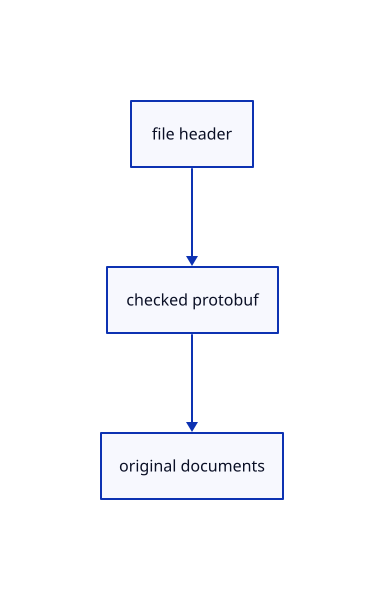

# 12.1.16 · Encode decode the viewer file

**Chapter 12 · Files and streaming · Section 12.1 · Scene manifests and range reads** · [Contents](contents.md)

**Typing: 20–40 minutes.** [Estimate](typing-load.md).

Add archive limits and source validation; copy malformed-file and metadata compatibility checks.

## Type

Continue from [Describe the saved scene metadata](66c-describe-the-saved-scene-metadata.md). [Save or recover your work](recovery.md).

### 1. `src/archive.rs`

Frame original source bytes and checked metadata without replacing geometry.

<details>
<summary>Locate the existing block</summary>

```rust
}
```

</details>

After that block, type:

```rust
--8<-- "journey/code/66d-encode-decode-the-viewer-file-01.rs" skip=3
```

<details>
<summary>Supplied validation fixture</summary>

Copy this supplied authoring fixture once. Continue with the browser build below; the course does not require running native tests.

### 2. `src/archive.rs`

Copy archive framing, original-source and compatibility regressions.

<details>
<summary>Locate the existing block</summary>

```text
        let mut bytes=Vec::with_capacity(size);bytes.extend_from_slice(MAGIC);archive.encode(&mut bytes).map_err(|e|e.to_string())?;Ok(bytes)
    }
}
```

</details>

After that block, append this supplied code:

```text
--8<-- "journey/code/66d-encode-decode-the-viewer-file-02.rs" skip=149
```

</details>

## Run and check

Run this from `session_viewer` to select the fixed dependency versions and install supplied binary assets. It updates Cargo.lock and preserves the previous lock. It does not write implementation code:

```sh
npm --prefix ../session_tests run course -- dependencies 12.1.16
```

In your project:

```sh
cd workspace/journey
REGEN_PROTO=0 cargo build --lib --locked --target wasm32-unknown-unknown -j1
REGEN_PROTO=0 CARGO_BUILD_JOBS=1 trunk serve --port 8780
```

Open `http://127.0.0.1:8780/`. Keep an existing Trunk server running; saving rebuilds it.


### Recorded visual result

**Previous native render — current verification pending.**

The original cloud and local point marker remain unchanged.


*This recorded image predates a source or checker change. Rebuild this checkpoint before using it as current evidence; browser controls require separate acceptance.*

This reference image is shared with [11.3.4 · Pick original points and prove source query reuse](65c-cloud-point.md). It does not demonstrate a new feature by itself.

<details>
<summary>Code explanation and diagram</summary>


file header → checked protobuf → original documents.



May a missing edge-colour field erase face colours?

No. Older metadata uses the face-colour override as its edge-colour fallback.

Study estimate, including typing and experiments: 0.5–1 hours.

</details>

<details>
<summary>Optional experiment</summary>

Check the 512 MiB envelope, bad header, document inventory and old metadata fields.

</details>

<details>
<summary>Check and save your work</summary>

Restore experimental edits, then run from `session_viewer`:

```sh
npm --prefix ../session_tests run course -- check 12.1.16
npm --prefix ../session_tests run course -- save 12.1.16
```

Source comparison leaves your project untouched. [Save and recovery instructions](recovery.md).

</details>

<details>
<summary>Viewer coverage and verification</summary>


Inherited browser assertions are authored and unrun. Publication browser assertions connect at the final checkpoint; native software rendering does not establish Lenovo performance.

[Full validation scope](release.md).

To reproduce the scripted acceptance of the reference checkpoint, run from `session_viewer` with the [course bundle server](release.md#reproduce) running on port 8781:

```sh
npm --prefix ../session_tests run course -- capture 12.1.16
```

This uses the verified reference bundle; it does not check or change your typed project.

</details>
