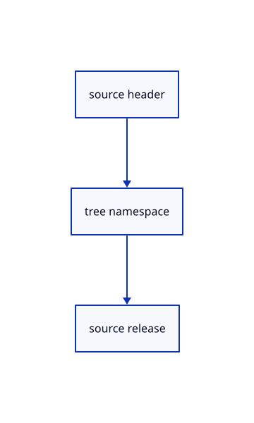

# 12.1.19 · Retain geometry free document headers

**Chapter 12 · Files and streaming · Section 12.1 · Scene manifests and range reads** · [Contents](contents.md)

**Typing: 16–32 minutes.** [Estimate](typing-load.md).

Keep original document identity without holding its kernel object collections after release.

## Type

Continue from [Snapshot original geometry types](66f-snapshot-geometry-types.md). [Save or recover your work](recovery.md).

### 1. `src/hierarchy.rs`

Retain lightweight original document metadata through layer edits.

Edit these blocks from bottom to top. Keep the surrounding lines unchanged.

<details>
<summary>Locate this block</summary>

```rust
fn save_node(doc:&Document,index:usize,scene:&Scene,parent:&Xform,parent_guid:&str,xforms:&mut Vec<proto::XformEntry>,placed:&mut HashSet<ObjectId>)->Result<Option<proto::TreeNode>, &'static str> {
    let original=&doc.nodes[index];let mut node=original.source.clone();node.guid=original.portable_guid.clone();node.parent_guid=parent_guid.to_owned();let mut matrix=parent.clone();
    if let Some(id)=original.object {
        let Some(row)=scene.objects().iter().find(|r|r.id==id) else {return Ok(None);};
        node.name=row.guid.clone();matrix=row.model.clone();let local=&parent.inverse().ok_or("Parent placement cannot be inverted for Save")?*&matrix;
        if local.m!=Xform::identity().m {xforms.push(proto::XformEntry {guid:row.guid.clone(),xform:Some(local.to_proto())});} placed.insert(id);
    }
    for child in index+1..original.end {if doc.nodes[child].parent==Some(index) {if let Some(child)=save_node(doc,child,scene,&matrix,&node.guid,xforms,placed)? {node.children.push(child);}}}
    Ok(Some(node))
```

</details>

Replace it with:

```rust
fn save_node(doc:&Document,index:usize,scene:&Scene,parent:&Xform,parent_guid:&str,xforms:&mut Vec<proto::XformEntry>,placed:&mut HashSet<ObjectId>)->Result<Option<proto::TreeNode>, &'static str> {
    let original=&doc.nodes[index];let mut node=original.source.clone();node.guid=original.portable_guid.clone();node.parent_guid=parent_guid.to_owned();let mut matrix=parent.clone();
    if let Some(id)=original.object {
        let Some(guid)=scene.row_guid(id) else {return Ok(None);};
        node.name=guid.to_owned();matrix=scene.placement(id).ok_or("Saved source placement is missing")?;let local=&parent.inverse().ok_or("Parent placement cannot be inverted for Save")?*&matrix;
        if local.m!=Xform::identity().m {xforms.push(proto::XformEntry {guid:guid.to_owned(),xform:Some(local.to_proto())});} placed.insert(id);
    }
    for child in index+1..original.end {if doc.nodes[child].parent==Some(index) {if let Some(child)=save_node(doc,child,scene,&matrix,&node.guid,xforms,placed)? {node.children.push(child);}}}
    Ok(Some(node))
```

<details>
<summary>Locate this block</summary>

```rust
            stack.extend(node.children.iter().rev().map(|child|(child,Some(index),depth+1,inside||object.is_some(),readonly,false)));
        }
        Rc::make_mut(&mut self.readonly_ids).extend(nodes.iter().filter(|node|node.readonly).filter_map(|node|node.object));
        self.documents.push(Rc::new(Document {key,label,nodes}));
    }

    pub fn colours(&self,key:u32)->HashMap<ObjectId,[u8;3]> {
```

</details>

Replace it with:

```rust
            stack.extend(node.children.iter().rev().map(|child|(child,Some(index),depth+1,inside||object.is_some(),readonly,false)));
        }
        Rc::make_mut(&mut self.readonly_ids).extend(nodes.iter().filter(|node|node.readonly).filter_map(|node|node.object));
        self.documents.push(Rc::new(Document {header:None,key,label,nodes}));
    }

    pub(crate) fn push(&mut self,document:Document) {
        Rc::make_mut(&mut self.readonly_ids).extend(document.nodes.iter().filter(|node|node.readonly).filter_map(|node|node.object));
        self.documents.push(Rc::new(document));
    }

    pub fn colours(&self,key:u32)->HashMap<ObjectId,[u8;3]> {
```

<details>
<summary>Locate this block</summary>

```rust
#[derive(Clone)]
pub struct Node {pub portable_guid:String, pub source:proto::TreeNode,pub object:Option<ObjectId>,pub label:String,pub parent:Option<usize>,pub depth:usize,pub end:usize,pub readonly:bool }
#[derive(Clone)]
pub struct Document {pub key:u32,pub label:String,pub nodes:Vec<Node>}
#[derive(Clone,Default)]
pub struct Forest { pub documents:Vec<Rc<Document>>,readonly_ids:Rc<HashSet<ObjectId>> }
```

</details>

Replace it with:

```rust
#[derive(Clone)]
pub struct Node {pub portable_guid:String, pub source:proto::TreeNode,pub object:Option<ObjectId>,pub label:String,pub parent:Option<usize>,pub depth:usize,pub end:usize,pub readonly:bool }
#[derive(Clone)]
pub struct Document {pub header:Option<Rc<crate::origin::Origin>>,pub key:u32,pub label:String,pub nodes:Vec<Node>}
#[derive(Clone,Default)]
pub struct Forest { pub documents:Vec<Rc<Document>>,readonly_ids:Rc<HashSet<ObjectId>> }
```

<details>
<summary>Complete updated block reference</summary>

```rust
use crate::scene::{Scene,ObjectId};
use session_rust::{proto,Xform};
use std::{collections::{HashMap,HashSet},rc::Rc};

pub const MAX_NODES:usize=4096;
pub const MAX_DEPTH:usize=64;

pub fn validate(root:&proto::TreeNode,guids:&HashSet<&str>)->Result<(), &'static str> {
    let mut stack=vec![(root,0)];let mut seen=HashSet::new();let mut count=0;
    while let Some((node,depth))=stack.pop() {
        count+=1;if count>MAX_NODES || depth>MAX_DEPTH {return Err("Tree exceeds this checkpoint's node or depth limit");}
        if guids.contains(node.name.as_str()) && !seen.insert(node.name.as_str()) {return Err("A source object occurs twice in the tree");}
        stack.extend(node.children.iter().rev().map(|child|(child,depth+1)));
    }
    if seen!=*guids {return Err("The tree must contain every source mesh once");} Ok(())
}

pub fn world(root:Option<&proto::TreeNode>,xforms:&HashMap<String,Xform>,guid:&str)->Xform {
    let mut stack=root.into_iter().map(|node|(node,Xform::identity())).collect::<Vec<_>>();
    while let Some((node,parent))=stack.pop() {
        let local=xforms.get(&node.name).cloned().unwrap_or_else(Xform::identity);let matrix=&parent*&local;
        if node.name==guid {return matrix;}
        stack.extend(node.children.iter().rev().map(|child|(child,matrix.clone())));
    }
    xforms.get(guid).cloned().unwrap_or_else(Xform::identity)
}

#[derive(Clone)]
pub struct Node {pub portable_guid:String, pub source:proto::TreeNode,pub object:Option<ObjectId>,pub label:String,pub parent:Option<usize>,pub depth:usize,pub end:usize,pub readonly:bool }
#[derive(Clone)]
pub struct Document {pub header:Option<Rc<crate::origin::Origin>>,pub key:u32,pub label:String,pub nodes:Vec<Node>}
#[derive(Clone,Default)]
pub struct Forest { pub documents:Vec<Rc<Document>>,readonly_ids:Rc<HashSet<ObjectId>> }

impl Forest {
    pub fn add(&mut self,key:u32,label:String,root:Option<proto::TreeNode>,objects:&[(String,ObjectId,String)]) {
        let fallback=proto::TreeNode {name:label.clone(),children:objects.iter().map(|(guid,_,_)|proto::TreeNode {name:guid.clone(),..Default::default()}).collect(),..Default::default()};
        let root=root.unwrap_or(fallback);let lookup=objects.iter().map(|(guid,id,name)|(guid.as_str(),(*id,name.as_str()))).collect::<HashMap<_,_>>();
        let mut nodes:Vec<Node>=Vec::new();let mut stack=vec![(&root,None::<usize>,0,false,false,false)];
        while let Some((node,parent,depth,inside,readonly,exit))=stack.pop() {
            if exit {nodes[parent.unwrap()].end=nodes.len();continue;}
            let object=lookup.get(node.name.as_str()).copied();let readonly=readonly || inside && matches!(node.name.as_str(),"attributes"|"interactions");
            let index=nodes.len();let source=proto::TreeNode {guid:if node.guid.is_empty() {uuid::Uuid::new_v4().to_string()} else {node.guid.clone()},name:node.name.clone(),parent_guid:node.parent_guid.clone(),color:node.color.clone(),children:Vec::new()};
            nodes.push(Node {portable_guid:uuid::Uuid::new_v4().to_string(),source,object:object.map(|v|v.0),label:object.map_or_else(||node.name.clone(),|v|v.1.to_owned()),parent,depth,end:index+1,readonly});
            stack.push((node,Some(index),depth,inside,readonly,true));
            stack.extend(node.children.iter().rev().map(|child|(child,Some(index),depth+1,inside||object.is_some(),readonly,false)));
        }
        Rc::make_mut(&mut self.readonly_ids).extend(nodes.iter().filter(|node|node.readonly).filter_map(|node|node.object));
        self.documents.push(Rc::new(Document {header:None,key,label,nodes}));
    }

    pub(crate) fn push(&mut self,document:Document) {
        Rc::make_mut(&mut self.readonly_ids).extend(document.nodes.iter().filter(|node|node.readonly).filter_map(|node|node.object));
        self.documents.push(Rc::new(document));
    }

    pub fn colours(&self,key:u32)->HashMap<ObjectId,[u8;3]> {
        let mut out=HashMap::new();let Some(doc)=self.documents.iter().find(|doc|doc.key==key) else {return out;};
        let mut inherited=vec![None;doc.nodes.len()];
        for (index,node) in doc.nodes.iter().enumerate() {
            let colour=node.source.color.as_ref().map(|colour|[colour.r,colour.g,colour.b].map(|value|(value.clamp(0.,1.)*255.).round() as u8)).or_else(||node.parent.and_then(|parent|inherited[parent]));
            inherited[index]=colour;if let (Some(id),Some(colour))=(node.object,colour) {out.insert(id,colour);}
        }
        out
    }

    pub(crate) fn replace(&mut self,index:usize,document:Document) {
        self.documents[index]=Rc::new(document);
        self.readonly_ids=Rc::new(self.documents.iter().flat_map(|doc|doc.nodes.iter()).filter(|node|node.readonly).filter_map(|node|node.object).collect());
    }

    pub fn readonly(&self,id:ObjectId)->bool {self.readonly_ids.contains(&id)}
    pub fn descendants(&self,ids:&[ObjectId])->Vec<ObjectId> {
        let mut out=ids.to_vec();
        for doc in &self.documents {for (index,node) in doc.nodes.iter().enumerate() {if node.object.is_some_and(|id|ids.contains(&id)) {out.extend(doc.nodes[index+1..node.end].iter().filter_map(|n|n.object));}}}
        out.sort_unstable_by_key(|id|id.value());out.dedup();out
    }

    pub fn snapshot(&self,scene:&Scene,xforms:&mut Vec<proto::XformEntry>)->Result<(Vec<proto::TreeNode>,HashSet<ObjectId>), &'static str> {
        let mut roots=Vec::new();let mut placed=HashSet::new();
        for doc in &self.documents {if let Some(root)=save_node(doc,0,scene,&Xform::identity(),"",xforms,&mut placed)? {roots.push(root);}}
        Ok((roots,placed))
    }
}

fn save_node(doc:&Document,index:usize,scene:&Scene,parent:&Xform,parent_guid:&str,xforms:&mut Vec<proto::XformEntry>,placed:&mut HashSet<ObjectId>)->Result<Option<proto::TreeNode>, &'static str> {
    let original=&doc.nodes[index];let mut node=original.source.clone();node.guid=original.portable_guid.clone();node.parent_guid=parent_guid.to_owned();let mut matrix=parent.clone();
    if let Some(id)=original.object {
        let Some(guid)=scene.row_guid(id) else {return Ok(None);};
        node.name=guid.to_owned();matrix=scene.placement(id).ok_or("Saved source placement is missing")?;let local=&parent.inverse().ok_or("Parent placement cannot be inverted for Save")?*&matrix;
        if local.m!=Xform::identity().m {xforms.push(proto::XformEntry {guid:guid.to_owned(),xform:Some(local.to_proto())});} placed.insert(id);
    }
    for child in index+1..original.end {if doc.nodes[child].parent==Some(index) {if let Some(child)=save_node(doc,child,scene,&matrix,&node.guid,xforms,placed)? {node.children.push(child);}}}
    Ok(Some(node))
}

#[derive(Clone)]
pub struct Row {pub key:String,pub label:String,pub depth:usize,pub end:usize,pub ids:Vec<ObjectId>,pub readonly:bool}
pub fn rows(scene:&Scene)->Vec<Row> {
    let mut rows=Vec::new();let mut placed=HashSet::new();
    for doc in &scene.forest.documents {
        let mut visible=Vec::new();let mut index=0;
        while index<doc.nodes.len() {
            let node=&doc.nodes[index];
            if node.object.is_some_and(|id|!scene.contains(id)) {index=node.end;continue;}
            visible.push(index);index+=1;
        }
        let start=rows.len();
        for &index in &visible {
            let node=&doc.nodes[index];let ids=doc.nodes[index..node.end].iter().filter_map(|n|n.object).filter(|id|scene.contains(*id)).collect::<Vec<_>>();
            placed.extend(node.object);let end=start+visible.partition_point(|i|*i<node.end);
            rows.push(Row {key:format!("{}/{}",doc.key,node.source.guid),label:if index==0 {doc.label.clone()} else {node.label.clone()},depth:node.depth,end,ids,readonly:node.readonly});
        }
    }
    for row in scene.objects().iter().filter(|r|!placed.contains(&r.id)) {let index=rows.len();rows.push(Row {key:format!("created/{}",row.id.value()),label:row.metadata.name.clone(),depth:0,end:index+1,ids:vec![row.id],readonly:false});}
    let other=scene.lines().iter().map(|r|(r.id,r.prepared.source.name.as_str())).chain(scene.paths().iter().map(|r|(r.id,r.prepared.source.name()))).chain(scene.points().iter().map(|r|(r.id,r.prepared.source.name.as_str()))).chain(scene.texts().iter().map(|r|(r.id,r.prepared.source.name.as_str()))).chain(scene.clouds().iter().map(|r|(r.id,r.prepared.source.name.as_str())));
    for (id,label) in other.filter(|(id,_)|!placed.contains(id)) {let index=rows.len();rows.push(Row {key:format!("created/{}",id.value()),label:label.to_owned(),depth:0,end:index+1,ids:vec![id],readonly:false});}
    rows
}
```

</details>

<details>
<summary>Optional patch references</summary>

Use these original edit fragments when comparing a saved checkpoint. Apply the complete blocks above.

```text
--8<-- "journey/code/66g-retain-geometry-free-document-headers-01.rs"
```

```text
--8<-- "journey/code/66g-retain-geometry-free-document-headers-02.rs"
```

```text
--8<-- "journey/code/66g-retain-geometry-free-document-headers-03.rs"
```

</details>

### 2. `src/layer_edit.rs`

Retain lightweight original document metadata through layer edits.

<details>
<summary>Locate the existing block</summary>

```rust

fn replace(scene:&mut Scene,owner:usize,tree:Branch) {
    let old=&scene.forest.documents[owner];let mut document=Document {key:old.key,label:old.label.clone(),nodes:Vec::new()};
    flatten(tree,None,0,&mut document.nodes);scene.forest.replace(owner,document);Rc::make_mut(&mut scene.view).refresh(&scene.forest);
}
```

</details>

Edit the existing block to match this code; keep unchanged lines:

```rust
--8<-- "journey/code/66g-retain-geometry-free-document-headers-04.rs"
```

### 3. `src/scene.rs`

Attach geometry-free original headers to imported namespaces.

<details>
<summary>Locate the existing block</summary>

```rust
            let id=self.insert(prepared)?;objects.push((guid,id,name));
        }
        self.forest.add(key,loaded.document.name.clone(),loaded.tree,&objects);let colours=self.forest.colours(key);Rc::make_mut(&mut self.view).faces.extend(colours);Ok(())
    }
```

</details>

Edit the existing block to match this code; keep unchanged lines:

```rust
--8<-- "journey/code/66g-retain-geometry-free-document-headers-05.rs"
```

### 4. `src/revision.rs`

Include original nonmesh document revisions without owning source geometry.

<details>
<summary>Locate the existing block</summary>

```rust
pub fn versions(scene: &crate::scene::Scene) -> Vec<String> {
    let mut versions: Vec<_> = scene.objects().iter().filter_map(|object|
        object.origin().map(|origin| origin.version.hex())).collect();
    versions.sort(); versions.dedup(); versions
}
```

</details>

Edit the existing block to match this code; keep unchanged lines:

```rust
--8<-- "journey/code/66g-retain-geometry-free-document-headers-06.rs"
```

<details>
<summary>Supplied validation fixture</summary>

Copy this supplied authoring fixture once. Continue with the browser build below; the course does not require running native tests.

### 5. `src/archive.rs`

Copy mixed tree and line-identity integration checks after their source ownership is connected.

<details>
<summary>Locate the existing block</summary>

```text
    }
    #[test]
    fn old_metadata_keeps_face_colour_fallback_and_default_identity_fields() {
        let source=br#"{"documents":[{"name":"old","place":[1,0,0,0,0,1,0,0,0,0,1,0,0,0,0,1],"point_px":0}],"hidden":[],"colors":[[0,"guid",[12,34,56]]],"texts":[]}"#;
```

</details>

Update the existing block with this supplied code; keep unchanged lines:

```text
--8<-- "journey/code/66g-retain-geometry-free-document-headers-07.rs"
```

</details>

## Run and check

Run this from `session_viewer` to select the fixed dependency versions and install supplied binary assets. It updates Cargo.lock and preserves the previous lock. It does not write implementation code:

```sh
npm --prefix ../session_tests run course -- dependencies 12.1.19
```

In your project:

```sh
cd workspace/journey
REGEN_PROTO=0 cargo build --lib --locked --target wasm32-unknown-unknown -j1
REGEN_PROTO=0 CARGO_BUILD_JOBS=1 trunk serve --port 8780
```

Open `http://127.0.0.1:8780/`. Keep an existing Trunk server running; saving rebuilds it.


### Recorded visual result

**Previous native render — current verification pending.**

The original cloud and local point marker remain unchanged.


*This recorded image predates a source or checker change. Rebuild this checkpoint before using it as current evidence; browser controls require separate acceptance.*

This reference image is shared with [11.3.4 · Pick original points and prove source query reuse](65c-cloud-point.md). It does not demonstrate a new feature by itself.

<details>
<summary>Code explanation and diagram</summary>


source header → tree namespace → source release.



Does the layer tree need a retained kernel Session?

No. Its lightweight origin header has no geometry collections.

Study estimate, including typing and experiments: 0.5–1 hours.

</details>

<details>
<summary>Optional experiment</summary>

Close repeated imports and check original kernel and display owners are released.

</details>

<details>
<summary>Check and save your work</summary>

Restore experimental edits, then run from `session_viewer`:

```sh
npm --prefix ../session_tests run course -- check 12.1.19
npm --prefix ../session_tests run course -- save 12.1.19
```

Source comparison leaves your project untouched. [Save and recovery instructions](recovery.md).

</details>

<details>
<summary>Viewer coverage and verification</summary>


Inherited browser assertions are authored and unrun. Publication browser assertions connect at the final checkpoint; native software rendering does not establish Lenovo performance.

[Full validation scope](release.md).

To reproduce the scripted acceptance of the reference checkpoint, run from `session_viewer` with the [course bundle server](release.md#reproduce) running on port 8781:

```sh
npm --prefix ../session_tests run course -- capture 12.1.19
```

This uses the verified reference bundle; it does not check or change your typed project.

</details>
