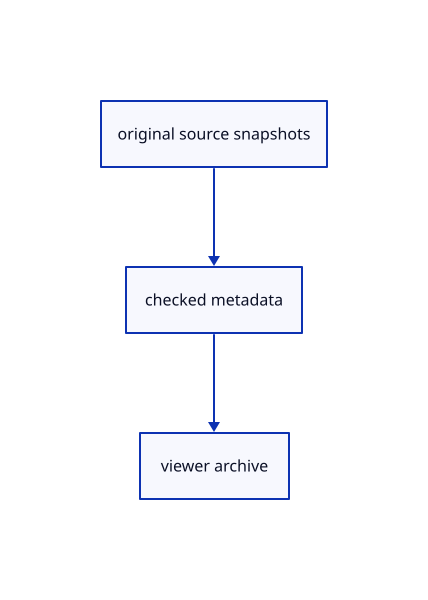

# 12.1.25 · Save the complete supported scene

**Chapter 12 · Files and streaming · Section 12.1 · Scene manifests and range reads** · [Contents](contents.md)

**Typing: 16–31 minutes.** [Estimate](typing-load.md).

Join original documents and world label metadata within one bounded viewer file.

## Type

Continue from [Save document display settings](66l-save-document-display-settings.md). [Save or recover your work](recovery.md).

### 1. `src/scene_archive.rs`

Encode original document payloads and current presentation as one bounded archive.

<details>
<summary>Locate the existing block</summary>

```rust
}
```

</details>

After that block, type:

```rust
--8<-- "journey/code/66m-save-the-complete-supported-scene-01.rs" skip=3
```

<details>
<summary>Supplied validation fixture</summary>

Copy this supplied authoring fixture once. Continue with the browser build below; the course does not require running native tests.

### 2. `src/scene_archive.rs`

Copy mixed scene, precision, source lifetime and repeated-namespace checks.

<details>
<summary>Locate the existing block</summary>

```text
    metadata.hidden.sort();metadata.locked.sort();metadata.colors.sort();metadata.edge_colors.as_mut().unwrap().sort();metadata.texts.sort_by(|a,b|a.0.cmp(&b.0));Bundle {documents,metadata}.encode()
}
```

</details>

After that block, append this supplied code:

```text
--8<-- "journey/code/66m-save-the-complete-supported-scene-02.rs" skip=201
```

</details>

## Run and check

Run this from `session_viewer` to select the fixed dependency versions and install supplied binary assets. It updates Cargo.lock and preserves the previous lock. It does not write implementation code:

```sh
npm --prefix ../session_tests run course -- dependencies 12.1.25
```

In your project:

```sh
cd workspace/journey
REGEN_PROTO=0 cargo build --lib --locked --target wasm32-unknown-unknown -j1
REGEN_PROTO=0 CARGO_BUILD_JOBS=1 trunk serve --port 8780
```

Open `http://127.0.0.1:8780/`. Keep an existing Trunk server running; saving rebuilds it.


### Recorded visual result

**Previous native render — current verification pending.**

The original cloud and local point marker remain unchanged.


*This recorded image predates a source or checker change. Rebuild this checkpoint before using it as current evidence; browser controls require separate acceptance.*

This reference image is shared with [11.3.4 · Pick original points and prove source query reuse](65c-cloud-point.md). It does not demonstrate a new feature by itself.

<details>
<summary>Code explanation and diagram</summary>


original source snapshots → checked metadata → viewer archive.



Does saving consume a geometry Undo transaction?

No. Saving reads the scene and leaves its original sources and history untouched.

Study estimate, including typing and experiments: 0.5–1 hours.

</details>

<details>
<summary>Optional experiment</summary>

Compare original CAD/cloud/curve bytes, copied line identities and separate original GUID namespaces.

</details>

<details>
<summary>Check and save your work</summary>

Restore experimental edits, then run from `session_viewer`:

```sh
npm --prefix ../session_tests run course -- check 12.1.25
npm --prefix ../session_tests run course -- save 12.1.25
```

Source comparison leaves your project untouched. [Save and recovery instructions](recovery.md).

</details>

<details>
<summary>Viewer coverage and verification</summary>


Inherited browser assertions are authored and unrun. Publication browser assertions connect at the final checkpoint; native software rendering does not establish Lenovo performance.

[Full validation scope](release.md).

To reproduce the scripted acceptance of the reference checkpoint, run from `session_viewer` with the [course bundle server](release.md#reproduce) running on port 8781:

```sh
npm --prefix ../session_tests run course -- capture 12.1.25
```

This uses the verified reference bundle; it does not check or change your typed project.

</details>
