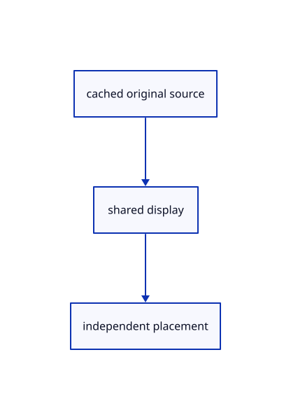

# 12.1.33 · Share repeated source placements

**Chapter 12 · Files and streaming · Section 12.1 · Scene manifests and range reads** · [Contents](contents.md)

**Typing: 27–54 minutes.** [Estimate](typing-load.md).

Allocate independent row identities while sharing original sources and derived display buffers.

## Type

Continue from [Prepare file adoption and live history](66t-prepare-file-adoption-live-history.md). [Save or recover your work](recovery.md).

### 1. `src/scene.rs`

Share complete original document rows while assigning independent instance identities.

<details>
<summary>Locate the existing block</summary>

```rust
    }

    pub(crate) fn reserve_document_key(&mut self)->Result<u32,&'static str> {
        let key=self.next_id;self.next_id=self.next_id.checked_add(1).ok_or("Object IDs exhausted")?;Ok(key)
```

</details>

Edit the existing block to match this code; keep unchanged lines:

```rust
--8<-- "journey/code/66u-share-repeated-source-placements-01.rs"
```

## Run and check

Run this from `session_viewer` to select the fixed dependency versions and install supplied binary assets. It updates Cargo.lock and preserves the previous lock. It does not write implementation code:

```sh
npm --prefix ../session_tests run course -- dependencies 12.1.33
```

In your project:

```sh
cd workspace/journey
REGEN_PROTO=0 cargo build --lib --locked --target wasm32-unknown-unknown -j1
REGEN_PROTO=0 CARGO_BUILD_JOBS=1 trunk serve --port 8780
```

Open `http://127.0.0.1:8780/`. Keep an existing Trunk server running; saving rebuilds it.


### Recorded visual result

**Previous native render — current verification pending.**

The original cloud and local point marker remain unchanged.


*This recorded image predates a source or checker change. Rebuild this checkpoint before using it as current evidence; browser controls require separate acceptance.*

This reference image is shared with [11.3.4 · Pick original points and prove source query reuse](65c-cloud-point.md). It does not demonstrate a new feature by itself.

<details>
<summary>Code explanation and diagram</summary>


cached original source → shared display → independent placement.



Must repeated manifest entries upload separate original geometry?

No. Their rows share source and display allocations while keeping their own models and IDs.

Study estimate, including typing and experiments: 0.5–1 hours.

</details>

<details>
<summary>Optional experiment</summary>

Trace two repeated meshes/clouds and compare shared source, node and display pointers.

</details>

<details>
<summary>Check and save your work</summary>

Restore experimental edits, then run from `session_viewer`:

```sh
npm --prefix ../session_tests run course -- check 12.1.33
npm --prefix ../session_tests run course -- save 12.1.33
```

Source comparison leaves your project untouched. [Save and recovery instructions](recovery.md).

</details>

<details>
<summary>Viewer coverage and verification</summary>


Inherited browser assertions are authored and unrun. Publication browser assertions connect at the final checkpoint; native software rendering does not establish Lenovo performance.

[Full validation scope](release.md).

To reproduce the scripted acceptance of the reference checkpoint, run from `session_viewer` with the [course bundle server](release.md#reproduce) running on port 8781:

```sh
npm --prefix ../session_tests run course -- capture 12.1.33
```

This uses the verified reference bundle; it does not check or change your typed project.

</details>
