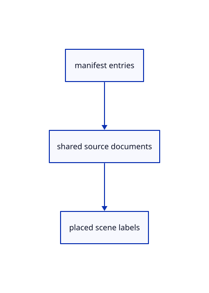

# 12.1.35 · Assemble placed manifest entries

**Chapter 12 · Files and streaming · Section 12.1 · Scene manifests and range reads** · [Contents](contents.md)

**Typing: 15–30 minutes.** [Estimate](typing-load.md).

Build repeated file placements and world labels from the checked manifest and retained originals.

## Type

Continue from [Start an empty scene without examples](66v-start-an-empty-scene-without-examples.md). [Save or recover your work](recovery.md).

### 1. `src/scene_manifest.rs`

Assemble a checked scene from shared original source documents and placed labels.

Create the file and type:

```rust
--8<-- "journey/code/66w-assemble-placed-manifest-entries-01.rs"
```

### 2. `src/lib.rs`

Register the source component.

<details>
<summary>Locate the existing block</summary>

```rust

pub mod publication;
```

</details>

After that block, type:

```rust
--8<-- "journey/code/66w-assemble-placed-manifest-entries-02.rs" skip=22
```

<details>
<summary>Supplied validation fixture</summary>

Copy this supplied authoring fixture once. Continue with the browser build below; the course does not require running native tests.

### 3. `src/scene_manifest.rs`

Copy source and integration regressions.

<details>
<summary>Locate the existing block</summary>

```text
    Ok(scene)
}
```

</details>

After that block, append this supplied code:

```text
--8<-- "journey/code/66w-assemble-placed-manifest-entries-03.rs" skip=16
```

</details>

## Run and check

Run this from `session_viewer` to select the fixed dependency versions and install supplied binary assets. It updates Cargo.lock and preserves the previous lock. It does not write implementation code:

```sh
npm --prefix ../session_tests run course -- dependencies 12.1.35
```

In your project:

```sh
cd workspace/journey
REGEN_PROTO=0 cargo build --lib --locked --target wasm32-unknown-unknown -j1
REGEN_PROTO=0 CARGO_BUILD_JOBS=1 trunk serve --port 8780
```

Open `http://127.0.0.1:8780/`. Keep an existing Trunk server running; saving rebuilds it.


### Recorded visual result

**Previous native render — current verification pending.**

The original cloud and local point marker remain unchanged.


*This recorded image predates a source or checker change. Rebuild this checkpoint before using it as current evidence; browser controls require separate acceptance.*

This reference image is shared with [11.3.4 · Pick original points and prove source query reuse](65c-cloud-point.md). It does not demonstrate a new feature by itself.

<details>
<summary>Code explanation and diagram</summary>


manifest entries → shared source documents → placed scene labels.



Should a point-size override change shared source bytes?

No. Each placement gets its own size and model; the original source stays shared.

Study estimate, including typing and experiments: 0.5–1 hours.

</details>

<details>
<summary>Optional experiment</summary>

Run repeated4px/7px cloud placements, exact1000000000.125 pose and original display reuse.

</details>

<details>
<summary>Check and save your work</summary>

Restore experimental edits, then run from `session_viewer`:

```sh
npm --prefix ../session_tests run course -- check 12.1.35
npm --prefix ../session_tests run course -- save 12.1.35
```

Source comparison leaves your project untouched. [Save and recovery instructions](recovery.md).

</details>

<details>
<summary>Viewer coverage and verification</summary>


Inherited browser assertions are authored and unrun. Publication browser assertions connect at the final checkpoint; native software rendering does not establish Lenovo performance.

[Full validation scope](release.md).

To reproduce the scripted acceptance of the reference checkpoint, run from `session_viewer` with the [course bundle server](release.md#reproduce) running on port 8781:

```sh
npm --prefix ../session_tests run course -- capture 12.1.35
```

This uses the verified reference bundle; it does not check or change your typed project.

</details>
