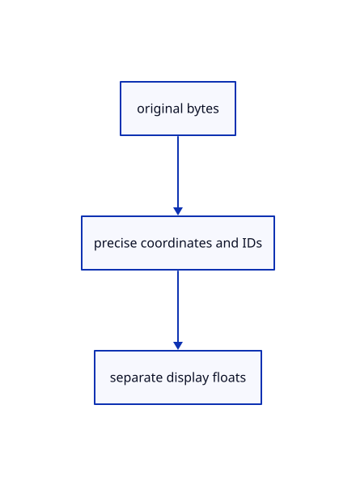

# 12.2.14 · Retain original point page values

**Chapter 12 · Files and streaming · Section 12.2 · Bounded read scheduling and cancellation** · [Contents](contents.md)

**Typing: 15–30 minutes.** [Estimate](typing-load.md).

Keep original doubles and IDs beside derived display floats. An absent ID column uses the source row.

## Type

Continue from [Validate exact HTTP range replies](67b-validate-exact-http-range-replies.md). [Save or recover your work](recovery.md).

### 1. `src/range_page.rs`

Retain original f64 pages and stable IDs separately from derived display values.

Create the file and type:

```rust
--8<-- "journey/code/67c-retain-original-point-page-values-01.rs"
```

### 2. `src/lib.rs`

Register the source component.

<details>
<summary>Locate the existing block</summary>

```rust

pub mod range_rules;
```

</details>

After that block, type:

```rust
--8<-- "journey/code/67c-retain-original-point-page-values-02.rs" skip=22
```

<details>
<summary>Supplied validation fixture</summary>

Copy this supplied authoring fixture once. Continue with the browser build below; the course does not require running native tests.

### 3. `src/range_page.rs`

Copy source precision, high-ID, incomplete page and invalid-double fixtures.

<details>
<summary>Locate the existing block</summary>

```text
    pub fn bytes(&self)->usize {self.coordinates.capacity()*8+self.display.capacity()*4+self.ids.capacity()*4}
}
```

</details>

After that block, append this supplied code:

```text
--8<-- "journey/code/67c-retain-original-point-page-values-03.rs" skip=113
```

</details>

## Run and check

Run this from `session_viewer` to select the fixed dependency versions and install supplied binary assets. It updates Cargo.lock and preserves the previous lock. It does not write implementation code:

```sh
npm --prefix ../session_tests run course -- dependencies 12.2.14
```

In your project:

```sh
cd workspace/journey
REGEN_PROTO=0 cargo build --lib --locked --target wasm32-unknown-unknown -j1
REGEN_PROTO=0 CARGO_BUILD_JOBS=1 trunk serve --port 8780
```

Open `http://127.0.0.1:8780/`. Keep an existing Trunk server running; saving rebuilds it.


### Recorded visual result

**Previous native render — current verification pending.**

The mixed source archive scene remains unchanged.


*This recorded image predates a source or checker change. Rebuild this checkpoint before using it as current evidence; browser controls require separate acceptance.*

This reference image is shared with [12.1.44 · Connect browser save open and URL adoption](66af-connect-browser-save-open-url-adoption.md). It does not demonstrate a new feature by itself.

<details>
<summary>Code explanation and diagram</summary>


original bytes → precise coordinates and IDs → separate display floats.



Can nearby original doubles become the same display float?

Yes. Preserve both original doubles so picking and measurements can recover the precise source values.

Study estimate, including typing and experiments: 0.5–1 hours.

</details>

<details>
<summary>Optional experiment</summary>

Compare1000000000.125 and1000000000.375, original ID4294967295 and invalid source pages.

</details>

<details>
<summary>Check and save your work</summary>

Restore experimental edits, then run from `session_viewer`:

```sh
npm --prefix ../session_tests run course -- check 12.2.14
npm --prefix ../session_tests run course -- save 12.2.14
```

Source comparison leaves your project untouched. [Save and recovery instructions](recovery.md).

</details>

<details>
<summary>Viewer coverage and verification</summary>


The mixed-source Save/Open browser contract remains authored and unrun. These preparatory range helpers connect to actual browser streaming and page drawing in68.

[Full validation scope](release.md).

To reproduce the scripted acceptance of the reference checkpoint, run from `session_viewer` with the [course bundle server](release.md#reproduce) running on port 8781:

```sh
npm --prefix ../session_tests run course -- capture 12.2.14
```

This uses the verified reference bundle; it does not check or change your typed project.

</details>
