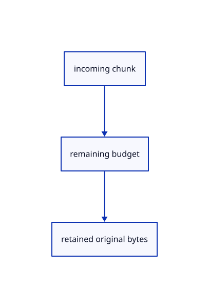

# 12.2.17 · Bound incoming range body chunks

**Chapter 12 · Files and streaming · Section 12.2 · Bounded read scheduling and cancellation** · [Contents](contents.md)

**Typing: 11–22 minutes.** [Estimate](typing-load.md).

Check every chunk against the requested byte length before allocating its copied bytes.

## Type

Continue from [Time out stalled source reads](67e-time-out-stalled-source-reads.md). [Save or recover your work](recovery.md).

### 1. `src/range_fetch.rs`

Read bounded body chunks while retaining the checked source request owner.

<details>
<summary>Locate the existing block</summary>

```rust
pub fn retryable(error:&str)->bool {error.starts_with("network error")}
```

</details>

After that block, type:

```rust
--8<-- "journey/code/67f-bound-incoming-range-body-chunks-01.rs" skip=73
```

## Run and check

Run this from `session_viewer` to select the fixed dependency versions and install supplied binary assets. It updates Cargo.lock and preserves the previous lock. It does not write implementation code:

```sh
npm --prefix ../session_tests run course -- dependencies 12.2.17
```

In your project:

```sh
cd workspace/journey
REGEN_PROTO=0 cargo build --lib --locked --target wasm32-unknown-unknown -j1
REGEN_PROTO=0 CARGO_BUILD_JOBS=1 trunk serve --port 8780
```

Open `http://127.0.0.1:8780/`. Keep an existing Trunk server running; saving rebuilds it.


### Recorded visual result

**Previous native render — current verification pending.**

The mixed source archive scene remains unchanged.


*This recorded image predates a source or checker change. Rebuild this checkpoint before using it as current evidence; browser controls require separate acceptance.*

This reference image is shared with [12.1.44 · Connect browser save open and URL adoption](66af-connect-browser-save-open-url-adoption.md). It does not demonstrate a new feature by itself.

<details>
<summary>Code explanation and diagram</summary>


incoming chunk → remaining budget → retained original bytes.



Can Content-Length replace a chunk-by-chunk limit?

No. Servers may omit it, and encoded bodies can decode to more bytes.

Study estimate, including typing and experiments: 0.5–1 hours.

</details>

<details>
<summary>Optional experiment</summary>

Trace reader cancellation and release when a response grows beyond its declared range.

</details>

<details>
<summary>Check and save your work</summary>

Restore experimental edits, then run from `session_viewer`:

```sh
npm --prefix ../session_tests run course -- check 12.2.17
npm --prefix ../session_tests run course -- save 12.2.17
```

Source comparison leaves your project untouched. [Save and recovery instructions](recovery.md).

</details>

<details>
<summary>Viewer coverage and verification</summary>


The mixed-source Save/Open browser contract remains authored and unrun. These preparatory range helpers connect to actual browser streaming and page drawing in68.

[Full validation scope](release.md).

To reproduce the scripted acceptance of the reference checkpoint, run from `session_viewer` with the [course bundle server](release.md#reproduce) running on port 8781:

```sh
npm --prefix ../session_tests run course -- capture 12.2.17
```

This uses the verified reference bundle; it does not check or change your typed project.

</details>
