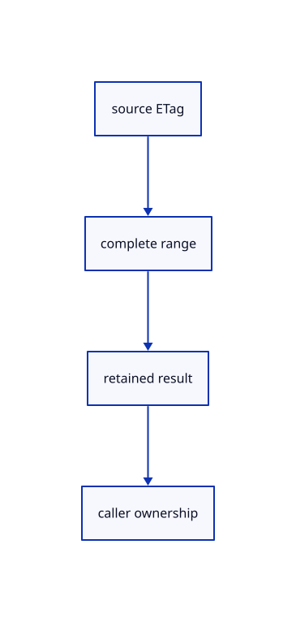

# 12.2.19 · Keep range revisions and background results

**Chapter 12 · Files and streaming · Section 12.2 · Bounded read scheduling and cancellation** · [Contents](contents.md)

**Typing: 11–21 minutes.** [Estimate](typing-load.md).

Compare every accepted ETag with the source revision and retain a background result until its caller awaits it.

## Type

Continue from [Request and accept one source interval](67g-request-and-accept-one-source-interval.md). [Save or recover your work](recovery.md).

### 1. `src/range_fetch.rs`

Validate source revisions and provide background range reads.

<details>
<summary>Locate the existing block</summary>

```rust
    }Ok(bytes)
}
```

</details>

After that block, type:

```rust
--8<-- "journey/code/67h-keep-range-revisions-and-background-results-01.rs" skip=17
```

## Run and check

Run this from `session_viewer` to select the fixed dependency versions and install supplied binary assets. It updates Cargo.lock and preserves the previous lock. It does not write implementation code:

```sh
npm --prefix ../session_tests run course -- dependencies 12.2.19
```

In your project:

```sh
cd workspace/journey
REGEN_PROTO=0 cargo build --lib --locked --target wasm32-unknown-unknown -j1
REGEN_PROTO=0 CARGO_BUILD_JOBS=1 trunk serve --port 8780
```

Open `http://127.0.0.1:8780/`. Keep an existing Trunk server running; saving rebuilds it.


### Recorded visual result

**Previous native render — current verification pending.**

The mixed source archive scene remains unchanged.


*This recorded image predates a source or checker change. Rebuild this checkpoint before using it as current evidence; browser controls require separate acceptance.*

This reference image is shared with [12.1.44 · Connect browser save open and URL adoption](66af-connect-browser-save-open-url-adoption.md). It does not demonstrate a new feature by itself.

<details>
<summary>Code explanation and diagram</summary>


source ETag → complete range → retained result → caller ownership.



Does starting a Task transfer its page into the scene?

No. The task owns only its result. The caller must still check the current source and runtime before adoption.

Study estimate, including typing and experiments: 0.5–1 hours.

</details>

<details>
<summary>Optional experiment</summary>

Trace changed validators, failed requests and result release after a dropped caller.

</details>

<details>
<summary>Check and save your work</summary>

Restore experimental edits, then run from `session_viewer`:

```sh
npm --prefix ../session_tests run course -- check 12.2.19
npm --prefix ../session_tests run course -- save 12.2.19
```

Source comparison leaves your project untouched. [Save and recovery instructions](recovery.md).

</details>

<details>
<summary>Viewer coverage and verification</summary>


The mixed-source Save/Open browser contract remains authored and unrun. These preparatory range helpers connect to actual browser streaming and page drawing in68.

[Full validation scope](release.md).

To reproduce the scripted acceptance of the reference checkpoint, run from `session_viewer` with the [course bundle server](release.md#reproduce) running on port 8781:

```sh
npm --prefix ../session_tests run course -- capture 12.2.19
```

This uses the verified reference bundle; it does not check or change your typed project.

</details>
