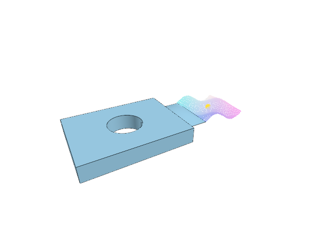

# 12.2.23 · Fetch original coordinates normals and colours

**Chapter 12 · Files and streaming · Section 12.2 · Bounded read scheduling and cancellation** · [Contents](contents.md)

**Typing: 23–46 minutes.** [Estimate](typing-load.md).

Fetch bounded source-array slices through the queue already written. Convert coordinate doubles and normal records, and advance the variable-length colour cursor using its consumed bytes.

## Type

Continue from [Read original cloud node tables](67hzc-read-original-cloud-node-tables.md). [Save or recover your work](recovery.md).

### 1. `src/stream.rs`

Type today’s complete browser source readers; reuse the decoding and queue helpers already written.

<details>
<summary>Locate the existing block</summary>

```rust
}

#[cfg(test)]
mod tests {
```

</details>

Edit the existing block to match this code; keep unchanged lines:

```rust
--8<-- "journey/code/67i-read-source-arrays-through-the-bounded-queue-1.rs"
```

## Run and check

Run this from `session_viewer` to select the fixed dependency versions and install supplied binary assets. It updates Cargo.lock and preserves the previous lock. It does not write implementation code:

```sh
npm --prefix ../session_tests run course -- dependencies 12.2.23
```

In your project:

```sh
cd workspace/journey
REGEN_PROTO=0 cargo build --lib --locked --target wasm32-unknown-unknown -j1
REGEN_PROTO=0 CARGO_BUILD_JOBS=1 trunk serve --port 8780
```

Open `http://127.0.0.1:8780/`. Keep an existing Trunk server running; saving rebuilds it.

The complete bounded source-array reader compiles before browser import and streaming are connected.

### Recorded visual result

**Previous native render — current verification pending.**

The mixed source archive scene remains unchanged.



*This recorded image predates a source or checker change. Rebuild this checkpoint before using it as current evidence; browser controls require separate acceptance.*

This reference image is shared with [12.2.20 · Queue original source range reads](67hza-queue-original-source-range-reads.md). It does not demonstrate a new feature by itself.

<details>
<summary>Code explanation and diagram</summary>


bounded HTTP read → revision and layout → source-array slice → decoded points.


Why advance colours by consumed bytes?

Packed varints have variable size. The fetched window can contain bytes beyond the requested colours.

Study estimate, including typing and experiments: 0.5–1 hours.

</details>

<details>
<summary>Optional experiment</summary>

Compare position and normal strides with a short varint colour slice.

</details>

<details>
<summary>Check and save your work</summary>

Restore experimental edits, then run from `session_viewer`:

```sh
npm --prefix ../session_tests run course -- check 12.2.23
npm --prefix ../session_tests run course -- save 12.2.23
```

Source comparison leaves your project untouched. [Save and recovery instructions](recovery.md).

</details>

<details>
<summary>Viewer coverage and verification</summary>


The mixed-source Save/Open browser contract remains authored and unrun. These preparatory range helpers connect to actual browser streaming and page drawing in68.

[Full validation scope](release.md).

To reproduce the scripted acceptance of the reference checkpoint, run from `session_viewer` with the [course bundle server](release.md#reproduce) running on port 8781:

```sh
npm --prefix ../session_tests run course -- capture 12.2.23
```

This uses the verified reference bundle; it does not check or change your typed project.

</details>
