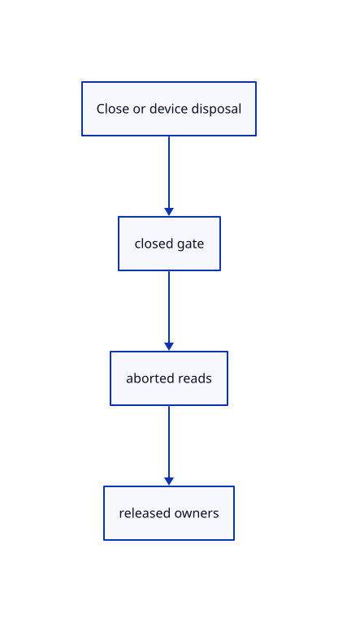

# 12.2.27 · Cancel range work when its runtime closes

**Chapter 12 · Files and streaming · Section 12.2 · Bounded read scheduling and cancellation** · [Contents](contents.md)

**Typing: 3–6 minutes.** [Estimate](typing-load.md).

Connect gate replacement and active-request abortion to Close and browser runtime disposal.

## Type

Continue from [Fetch precise coordinates and original IDs](67l-fetch-precise-coordinates-and-original-ids.md). [Save or recover your work](recovery.md).

### 1. `src/browser_runtime.rs`

Cancel queued and active range work with its browser runtime.

<details>
<summary>Locate the existing block</summary>

```rust
impl Drop for Runtime {
    fn drop(&mut self) {
        self.request.borrow_mut().cancel();
        self.reload.borrow_mut().cancel();
```

</details>

Edit the existing block to match this code; keep unchanged lines:

```rust
--8<-- "journey/code/67m-cancel-range-work-when-its-runtime-closes-01.rs"
```

### 2. `src/browser.rs`

Cancel queued and active range work with its browser runtime.

<details>
<summary>Locate the existing block</summary>

```rust
            Err(error) => { panel.result(&error); None }
            Ok(crate::commands::Command::Editor(mut action)) => {
                if matches!(action, Action::Close) { publication_control.cancel();request.borrow_mut().cancel();let _={text_fonts.clear();renderer.clear_text_fonts();renderer.set_text(Vec::new())}; }
                if shortcut.is_some() && editor.selected.is_some() && matches!(action, Action::Fit) { action = Action::FitSelected; }
                Some(action)
```

</details>

Edit the existing block to match this code; keep unchanged lines:

```rust
--8<-- "journey/code/67m-cancel-range-work-when-its-runtime-closes-02.rs"
```

## Run and check

Run this from `session_viewer` to select the fixed dependency versions and install supplied binary assets. It updates Cargo.lock and preserves the previous lock. It does not write implementation code:

```sh
npm --prefix ../session_tests run course -- dependencies 12.2.27
```

In your project:

```sh
cd workspace/journey
REGEN_PROTO=0 cargo build --lib --locked --target wasm32-unknown-unknown -j1
REGEN_PROTO=0 CARGO_BUILD_JOBS=1 trunk serve --port 8780
```

Open `http://127.0.0.1:8780/`. Keep an existing Trunk server running; saving rebuilds it.


### Recorded visual result

**Previous native render — current verification pending.**

The mixed source archive scene remains unchanged.


*This recorded image predates a source or checker change. Rebuild this checkpoint before using it as current evidence; browser controls require separate acceptance.*

This reference image is shared with [12.1.44 · Connect browser save open and URL adoption](66af-connect-browser-save-open-url-adoption.md). It does not demonstrate a new feature by itself.

<details>
<summary>Code explanation and diagram</summary>


Close or device disposal → closed gate → aborted reads → released owners.



Can a cancelled request revive a closed source scene?

No. Its request is aborted; the page adoption in68 also checks the source generation and runtime owner.

Study estimate, including typing and experiments: 0.5–1 hours.

</details>

<details>
<summary>Optional experiment</summary>

Close with queued and active reads; keep the mixed archive picture unchanged until streamed page display connects.

</details>

<details>
<summary>Check and save your work</summary>

Restore experimental edits, then run from `session_viewer`:

```sh
npm --prefix ../session_tests run course -- check 12.2.27
npm --prefix ../session_tests run course -- save 12.2.27
```

Source comparison leaves your project untouched. [Save and recovery instructions](recovery.md).

</details>

<details>
<summary>Viewer coverage and verification</summary>

Use current cloud/sheet array layout parsing, octree validation and FIFO range permits. Preserve original URL revisions, f64 coordinates and full-u32 point IDs. Strict response validation also rejects a mismatched Content-Range. Sheet drawing connects in71; this subject only validates its array layout.

Earlier assertions remain. Source layout, malformed offsets, finite arrays, octree topology, FIFO/cancelled permits, actual kernel protobuf precision, high IDs and incomplete responses have native regressions. Runtime disposal and Close cancel active range readers. Native/WASM checks do not establish browser network acceptance.

The mixed-source Save/Open browser contract remains authored and unrun. These preparatory range helpers connect to actual browser streaming and page drawing in68.

[Full validation scope](release.md).

To reproduce the scripted acceptance of the reference checkpoint, run from `session_viewer` with the [course bundle server](release.md#reproduce) running on port 8781:

```sh
npm --prefix ../session_tests run course -- capture 12.2.27
```

This uses the verified reference bundle; it does not check or change your typed project.

</details>
