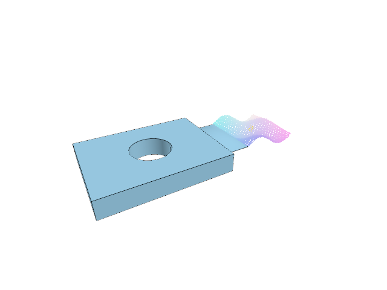

# 12.2.3 · Convert bounded doubles and cache metadata windows

**Chapter 12 · Files and streaming · Section 12.2 · Bounded read scheduling and cancellation** · [Contents](contents.md)

**Typing: 19–38 minutes.** [Estimate](typing-load.md).

Keep original source precision separate from the f32 upload representation.

## Type

Continue from [Locate original cloud and sheet array fields](67sa-locate-original-cloud-and-sheet-array-fields.md). [Save or recover your work](recovery.md).

### 1. `src/stream.rs`

Convert bounded doubles and cache metadata windows.

<details>
<summary>Locate the existing block</summary>

```rust
        } else {
            (0, 0)
        };
        let skip = skip_scalar(header, used, wire)?;
        return Some(Field {
            field,
            wire,
            value,
            body,
            next: body_end(body, skip as u64, end)?,
        });
    }

    let (length, extra) = varint(header, used)?;
    let body = body_end(body, extra as u64, end)?;
    Some(Field {
        field,
        wire,
        value: length,
        body,
        next: body_end(body, length, end)?,
    })
}
```

</details>

After that block, type:

```rust

/// `count` xyz triples as f32; None when short or not finite.
#[cfg(any(target_arch = "wasm32", test))]
fn checked_positions(raw: &[u8], count: u32) -> Option<Vec<f32>> {
    checked_doubles(raw, u64::from(count).checked_mul(3)?)
}

/// Exactly `n` doubles as f32; None when short or not finite.
#[cfg(any(target_arch = "wasm32", test))]
fn checked_doubles(raw: &[u8], n: u64) -> Option<Vec<f32>> {
    if raw.len() as u64 != n.checked_mul(8)? {
        return None;
    }

    let mut out = Vec::with_capacity(raw.len() / 8);

    for bytes in raw.chunks_exact(8) {
        let value = f64::from_le_bytes(bytes.try_into().ok()?);

        if !finite_float(value) {
            return None;
        }

        out.push(value as f32);
    }

    Some(out)
}

/// True when a range is small enough to read.
#[cfg(any(target_arch = "wasm32", test))]
fn bounded_range(at: u64, length: u64) -> bool {
    length <= 64 * 1024 * 1024 && at.checked_add(length).is_some()
}

/// A cached slice of the file's header bytes.
#[cfg(any(target_arch = "wasm32", test))]
#[derive(Default)]
struct MetadataWindow {
    at: u64,        // file position of `bytes[0]`
    bytes: Vec<u8>, // the cached bytes
}

#[cfg(any(target_arch = "wasm32", test))]
impl MetadataWindow {
    /// The cached bytes at `at`, if all present.
    fn slice(&self, at: u64, length: u64) -> Option<&[u8]> {
        let start = usize::try_from(at.checked_sub(self.at)?).ok()?;
        let length = usize::try_from(length).ok()?;
        self.bytes.get(start..start.checked_add(length)?)
    }

    /// How much to read at once: at least `length`, up to 64 KiB.
    fn read_length(at: u64, length: u64, end: u64) -> Option<u64> {
        if !bounded_range(at, length) {
            return None;
        }

        body_end(at, length, end)?;
        Some(length.max(64 * 1024).min(end - at))
    }
}
```

<details>
<summary>Optional patch references</summary>

Use these original edit fragments when comparing a saved checkpoint. Apply the complete blocks above.

```text
--8<-- "journey/code/67sb-convert-bounded-doubles-and-cache-metadata-windows-01.rs"
```

</details>

## Run and check

Run this from `session_viewer` to select the fixed dependency versions and install supplied binary assets. It updates Cargo.lock and preserves the previous lock. It does not write implementation code:

```sh
npm --prefix ../session_tests run course -- dependencies 12.2.3
```

In your project:

```sh
cd workspace/journey
REGEN_PROTO=0 cargo build --lib --locked --target wasm32-unknown-unknown -j1
REGEN_PROTO=0 CARGO_BUILD_JOBS=1 trunk serve --port 8780
```

Open `http://127.0.0.1:8780/`. Keep an existing Trunk server running; saving rebuilds it.


### Recorded visual result

**Previous native render — current verification pending.**

The mixed source archive scene remains unchanged.



*This recorded image predates a source or checker change. Rebuild this checkpoint before using it as current evidence; browser controls require separate acceptance.*

This reference image is shared with [12.2.1 · Bound scalar headers and byte addresses](67-supply-checked-array-layout-readers.md). It does not demonstrate a new feature by itself.

<details>
<summary>Code explanation and diagram</summary>

Require the exact declared byte count before converting doubles, then reject non-finite values in either representation. MetadataWindow serves a borrowed slice only when the complete range is cached. Its read length batches nearby small fields within 64 KiB and the enclosing message; it does not allocate a geometry-sized header.

original file bytes → checked source layout → existing GPU array owners → later range streaming.


Why reject a finite f64 that becomes infinite as f32?

The source value is valid as f64 but cannot be represented in the GPU coordinate format.

Study estimate, including typing and experiments: 0.5–1 hours.

</details>

<details>
<summary>Optional experiment</summary>

Compare a request inside a cached window with one crossing its end. Trace a finite 1 e 300 source coordinate through the f32 check.

</details>

<details>
<summary>Check and save your work</summary>

Restore experimental edits, then run from `session_viewer`:

```sh
npm --prefix ../session_tests run course -- check 12.2.3
npm --prefix ../session_tests run course -- save 12.2.3
```

Source comparison leaves your project untouched. [Save and recovery instructions](recovery.md).

</details>

<details>
<summary>Viewer coverage and verification</summary>


Parser preparation preserves the inherited scene; actual browser streaming is exercised after the range queue is connected.

[Full validation scope](release.md).

</details>
