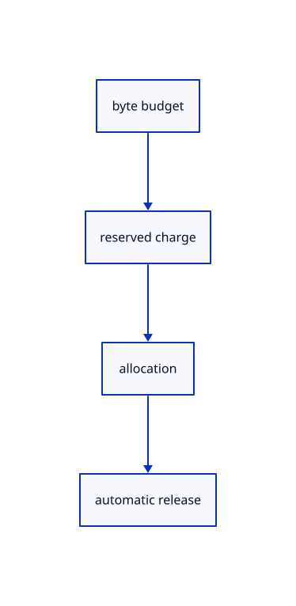

# 12.3.1 · Reserve page bytes before reading

**Chapter 12 · Files and streaming · Section 12.3 · Streaming page budgets and rendering** · [Contents](contents.md)

**Typing: 12–24 minutes.** [Estimate](typing-load.md).

Account for retained and pending payload before allocating a page. A dropped charge releases its reservation.

## Type

Continue from [Cancel range work when its runtime closes](67m-cancel-range-work-when-its-runtime-closes.md). [Save or recover your work](recovery.md).

### 1. `src/page_cache.rs`

Reserve bytes before allocation and release them with the owning charge.

Create the file and type:

```rust
--8<-- "journey/code/68-reserve-page-bytes-before-reading-01.rs"
```

### 2. `src/lib.rs`

Register the source component.

<details>
<summary>Locate the existing block</summary>

```rust

pub mod range_source;
```

</details>

After that block, type:

```rust
--8<-- "journey/code/68-reserve-page-bytes-before-reading-02.rs" skip=23
```

## Run and check

Run this from `session_viewer` to select the fixed dependency versions and install supplied binary assets. It updates Cargo.lock and preserves the previous lock. It does not write implementation code:

```sh
npm --prefix ../session_tests run course -- dependencies 12.3.1
```

In your project:

```sh
cd workspace/journey
REGEN_PROTO=0 cargo build --lib --locked --target wasm32-unknown-unknown -j1
REGEN_PROTO=0 CARGO_BUILD_JOBS=1 trunk serve --port 8780
```

Open `http://127.0.0.1:8780/`. Keep an existing Trunk server running; saving rebuilds it.

The mixed original CAD and surface scene remains visible. The final cache checkpoint draws actual coarse and detailed source pages; URL streaming connects after its owners and renderer are ready.

### Recorded visual result

**Previous native render — current verification pending.**

The mixed original CAD, surface and coloured cloud scene remains visible.


*This recorded image predates a source or checker change. Rebuild this checkpoint before using it as current evidence; browser controls require separate acceptance.*

This reference image is shared with [12.1.44 · Connect browser save open and URL adoption](66af-connect-browser-save-open-url-adoption.md). It does not demonstrate a new feature by itself.

<details>
<summary>Code explanation and diagram</summary>


byte budget → reserved charge → allocation → automatic release.



Does removing a cache entry necessarily release its memory?

No. A renderer or reader may still own that page. Its charge lasts until the final shared owner is dropped.

Study estimate, including typing and experiments: 0.5–1 hours.

</details>

<details>
<summary>Optional experiment</summary>

Reserve10bytes from12, refuse13, shrink to6 and release the charge.

</details>

<details>
<summary>Check and save your work</summary>

Restore experimental edits, then run from `session_viewer`:

```sh
npm --prefix ../session_tests run course -- check 12.3.1
npm --prefix ../session_tests run course -- save 12.3.1
```

Source comparison leaves your project untouched. [Save and recovery instructions](recovery.md).

</details>

<details>
<summary>Viewer coverage and verification</summary>


The existing mixed original archive browser exercise remains authored and unrun. The final cache endpoint adds real ranged URL loading, response validation, cancellation and cleanup exercises, also awaiting browser execution.

[Full validation scope](release.md).

To reproduce the scripted acceptance of the reference checkpoint, run from `session_viewer` with the [course bundle server](release.md#reproduce) running on port 8781:

```sh
npm --prefix ../session_tests run course -- capture 12.3.1
```

This uses the verified reference bundle; it does not check or change your typed project.

</details>
