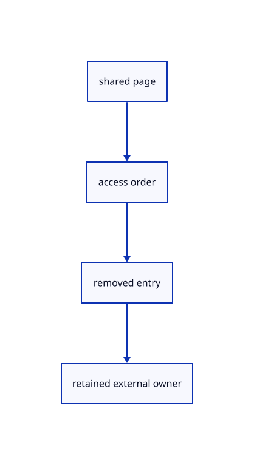

# 12.3.2 · Keep shared pages alive during eviction

**Chapter 12 · Files and streaming · Section 12.3 · Streaming page budgets and rendering** · [Contents](contents.md)

**Typing: 12–23 minutes.** [Estimate](typing-load.md).

Wrap each page with its charge and record access order. Removing an entry leaves external owners usable.

## Type

Continue from [Reserve page bytes before reading](68-reserve-page-bytes-before-reading.md). [Save or recover your work](recovery.md).

### 1. `src/page_cache.rs`

Keep page values and their accounting alive across cache removal.

<details>
<summary>Locate the existing block</summary>

```rust
}
```

</details>

After that block, type:

```rust
--8<-- "journey/code/68a-keep-shared-pages-alive-during-eviction-01.rs" skip=3
```

## Run and check

Run this from `session_viewer` to select the fixed dependency versions and install supplied binary assets. It updates Cargo.lock and preserves the previous lock. It does not write implementation code:

```sh
npm --prefix ../session_tests run course -- dependencies 12.3.2
```

In your project:

```sh
cd workspace/journey
REGEN_PROTO=0 cargo build --lib --locked --target wasm32-unknown-unknown -j1
REGEN_PROTO=0 CARGO_BUILD_JOBS=1 trunk serve --port 8780
```

Open `http://127.0.0.1:8780/`. Keep an existing Trunk server running; saving rebuilds it.


### Recorded visual result

**Previous native render — current verification pending.**

The mixed original CAD, surface and coloured cloud scene remains visible.


*This recorded image predates a source or checker change. Rebuild this checkpoint before using it as current evidence; browser controls require separate acceptance.*

This reference image is shared with [12.1.44 · Connect browser save open and URL adoption](66af-connect-browser-save-open-url-adoption.md). It does not demonstrate a new feature by itself.

<details>
<summary>Code explanation and diagram</summary>


shared page → access order → removed entry → retained external owner.



What prevents an evicted page from becoming dangling data?

Its shared owner retains the value and charge until every renderer and pending reader releases it.

Study estimate, including typing and experiments: 0.5–1 hours.

</details>

<details>
<summary>Optional experiment</summary>

Trace one externally held page through cache removal and inspect its unchanged bytes.

</details>

<details>
<summary>Check and save your work</summary>

Restore experimental edits, then run from `session_viewer`:

```sh
npm --prefix ../session_tests run course -- check 12.3.2
npm --prefix ../session_tests run course -- save 12.3.2
```

Source comparison leaves your project untouched. [Save and recovery instructions](recovery.md).

</details>

<details>
<summary>Viewer coverage and verification</summary>


The existing mixed original archive browser exercise remains authored and unrun. The final cache endpoint adds real ranged URL loading, response validation, cancellation and cleanup exercises, also awaiting browser execution.

[Full validation scope](release.md).

To reproduce the scripted acceptance of the reference checkpoint, run from `session_viewer` with the [course bundle server](release.md#reproduce) running on port 8781:

```sh
npm --prefix ../session_tests run course -- capture 12.3.2
```

This uses the verified reference bundle; it does not check or change your typed project.

</details>
