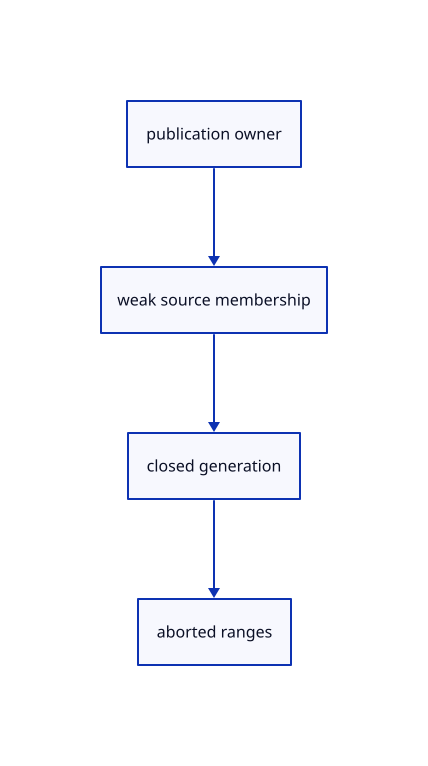

# 12.3.29 · Own cancellation for each published source

**Chapter 12 · Files and streaming · Section 12.3 · Streaming page budgets and rendering** · [Contents](contents.md)

**Typing: 17–33 minutes.** [Estimate](typing-load.md).

Track pending page cursors and weak source owners. Runtime closure cancels active ranges and releases pending work.

## Type

Continue from [Continue pages only for current source owners](68z-continue-pages-only-for-current-source-owners.md). [Save or recover your work](recovery.md).

### 1. `src/range_fetch.rs`

Cancel active range reads belonging to replaced source URLs.

Edit these blocks from bottom to top. Keep the surrounding lines unchanged.

<details>
<summary>Locate this block</summary>

```rust
    let (start,length)=opts.range.ok_or("This reader requires a byte range")?;
    if length==0 {return Ok(Reply {status:206,etag:None,total:None,bytes:vec![]});}
    let range=crate::range_rules::header(start,length)?;
    let mut read=Read::new()?;let init=web_sys::RequestInit::new();init.set_signal(Some(&read.controller.signal()));
    init.set_mode(web_sys::RequestMode::Cors);
    if opts.revalidate {init.set_cache(web_sys::RequestCache::NoCache);}
    let headers=web_sys::Headers::new().map_err(|error|describe(error.into()))?;headers.set("Range",&range).map_err(|error|describe(error.into()))?;init.set_headers(&headers);
```

</details>

Replace it with:

```rust
    let (start,length)=opts.range.ok_or("This reader requires a byte range")?;
    if length==0 {return Ok(Reply {status:206,etag:None,total:None,bytes:vec![]});}
    let range=crate::range_rules::header(start,length)?;
    let mut read=Read::new(url)?;let init=web_sys::RequestInit::new();init.set_signal(Some(&read.controller.signal()));
    init.set_mode(web_sys::RequestMode::Cors);
    if opts.revalidate {init.set_cache(web_sys::RequestCache::NoCache);}
    let headers=web_sys::Headers::new().map_err(|error|describe(error.into()))?;headers.set("Range",&range).map_err(|error|describe(error.into()))?;init.set_headers(&headers);
```

<details>
<summary>Locate this block</summary>

```rust
    callback:Closure<dyn FnMut()>,
}
impl Read {
    fn new()->Result<Self,String> {
        let controller=web_sys::AbortController::new().map_err(|error|describe(error.into()))?;
        let key=NEXT.with(|next| {let key=next.get().checked_add(1).ok_or("Range request IDs exhausted")?;next.set(key);Ok::<_,String>(key)})?;
        let stalled=Rc::new(Cell::new(false));let owned=controller.clone();let flag=stalled.clone();
        let callback=Closure::<dyn FnMut()>::new(move || {flag.set(true);owned.abort();});
        let mut read=Self {key,controller,timer:0,stalled,callback};read.touch()?;
        REQUESTS.with(|requests|requests.borrow_mut().insert(key,read.controller.clone()));Ok(read)
    }
    fn touch(&mut self)->Result<(),String> {
        let window=web_sys::window().ok_or("No browser window")?;window.clear_timeout_with_handle(self.timer);
```

</details>

Replace it with:

```rust
    callback:Closure<dyn FnMut()>,
}
impl Read {
    fn new(url:&str)->Result<Self,String> {
        let controller=web_sys::AbortController::new().map_err(|error|describe(error.into()))?;
        let key=NEXT.with(|next| {let key=next.get().checked_add(1).ok_or("Range request IDs exhausted")?;next.set(key);Ok::<_,String>(key)})?;
        let stalled=Rc::new(Cell::new(false));let owned=controller.clone();let flag=stalled.clone();
        let callback=Closure::<dyn FnMut()>::new(move || {flag.set(true);owned.abort();});
        let mut read=Self {key,controller,timer:0,stalled,callback};read.touch()?;
        REQUESTS.with(|requests|requests.borrow_mut().insert(key,(url.to_owned(),read.controller.clone())));Ok(read)
    }
    fn touch(&mut self)->Result<(),String> {
        let window=web_sys::window().ok_or("No browser window")?;window.clear_timeout_with_handle(self.timer);
```

<details>
<summary>Locate this block</summary>

```rust
pub use crate::range_rules::PROBE_BYTES;

thread_local! {
    static REQUESTS:RefCell<BTreeMap<u64,web_sys::AbortController>>=const {RefCell::new(BTreeMap::new())};
    static NEXT:Cell<u64>=const {Cell::new(0)};
}

pub fn cancel() {
    for controller in REQUESTS.with(|requests|std::mem::take(&mut *requests.borrow_mut())).into_values() {controller.abort();}
}

struct Read {
    key:u64,
    controller:web_sys::AbortController,
```

</details>

Replace it with:

```rust
pub use crate::range_rules::PROBE_BYTES;

thread_local! {
    static REQUESTS:RefCell<BTreeMap<u64,(String,web_sys::AbortController)>>=const {RefCell::new(BTreeMap::new())};
    static NEXT:Cell<u64>=const {Cell::new(0)};
}

pub fn cancel() {
    for (_,controller) in REQUESTS.with(|requests|std::mem::take(&mut *requests.borrow_mut())).into_values() {controller.abort();}
}

pub fn cancel_url(url:&str) {REQUESTS.with(|requests|requests.borrow_mut().retain(|_,(source,controller)| {if source==url {controller.abort();false} else {true}}));}

struct Read {
    key:u64,
    controller:web_sys::AbortController,
```

<details>
<summary>Complete updated block reference</summary>

```rust
use std::{cell::{Cell,RefCell},collections::BTreeMap,rc::Rc};
use wasm_bindgen::{JsCast,JsValue,closure::Closure};
use wasm_bindgen_futures::JsFuture;
pub use crate::range_rules::PROBE_BYTES;

thread_local! {
    static REQUESTS:RefCell<BTreeMap<u64,(String,web_sys::AbortController)>>=const {RefCell::new(BTreeMap::new())};
    static NEXT:Cell<u64>=const {Cell::new(0)};
}

pub fn cancel() {
    for (_,controller) in REQUESTS.with(|requests|std::mem::take(&mut *requests.borrow_mut())).into_values() {controller.abort();}
}

pub fn cancel_url(url:&str) {REQUESTS.with(|requests|requests.borrow_mut().retain(|_,(source,controller)| {if source==url {controller.abort();false} else {true}}));}

struct Read {
    key:u64,
    controller:web_sys::AbortController,
    timer:i32,
    stalled:Rc<Cell<bool>>,
    callback:Closure<dyn FnMut()>,
}
impl Read {
    fn new(url:&str)->Result<Self,String> {
        let controller=web_sys::AbortController::new().map_err(|error|describe(error.into()))?;
        let key=NEXT.with(|next| {let key=next.get().checked_add(1).ok_or("Range request IDs exhausted")?;next.set(key);Ok::<_,String>(key)})?;
        let stalled=Rc::new(Cell::new(false));let owned=controller.clone();let flag=stalled.clone();
        let callback=Closure::<dyn FnMut()>::new(move || {flag.set(true);owned.abort();});
        let mut read=Self {key,controller,timer:0,stalled,callback};read.touch()?;
        REQUESTS.with(|requests|requests.borrow_mut().insert(key,(url.to_owned(),read.controller.clone())));Ok(read)
    }
    fn touch(&mut self)->Result<(),String> {
        let window=web_sys::window().ok_or("No browser window")?;window.clear_timeout_with_handle(self.timer);
        self.timer=window.set_timeout_with_callback_and_timeout_and_arguments_0(self.callback.as_ref().unchecked_ref(),30_000).map_err(|error|describe(error.into()))?;Ok(())
    }
    fn error(&self,error:JsValue)->String {
        if self.stalled.get() {"network error: range read stalled for30s".into()}
        else if self.controller.signal().aborted() {"Range read cancelled".into()}
        else {format!("network error: {}",describe(error))}
    }
}
impl Drop for Read {
    fn drop(&mut self) {
        REQUESTS.with(|requests|requests.borrow_mut().remove(&self.key));self.controller.abort();
        if let Some(window)=web_sys::window() {window.clear_timeout_with_handle(self.timer);}
    }
}
fn describe(error:JsValue)->String {error.as_string().unwrap_or_else(||format!("{error:?}"))}
pub fn retryable(error:&str)->bool {error.starts_with("network error")}

#[derive(Default)]
pub struct GetOpts {pub range:Option<(u64,u64)>,pub revalidate:bool}
pub struct Reply {pub status:u16,pub etag:Option<String>,pub total:Option<u64>,pub bytes:Vec<u8>}
impl Reply {
    pub fn whole(self)->Option<Vec<u8>> {(self.status==206&&self.total==Some(self.bytes.len() as u64)).then_some(self.bytes)}
}

pub async fn get(url:&str,opts:&GetOpts)->Result<Reply,String> {
    let (start,length)=opts.range.ok_or("This reader requires a byte range")?;
    if length==0 {return Ok(Reply {status:206,etag:None,total:None,bytes:vec![]});}
    let range=crate::range_rules::header(start,length)?;
    let mut read=Read::new(url)?;let init=web_sys::RequestInit::new();init.set_signal(Some(&read.controller.signal()));
    init.set_mode(web_sys::RequestMode::Cors);
    if opts.revalidate {init.set_cache(web_sys::RequestCache::NoCache);}
    let headers=web_sys::Headers::new().map_err(|error|describe(error.into()))?;headers.set("Range",&range).map_err(|error|describe(error.into()))?;init.set_headers(&headers);
    let window=web_sys::window().ok_or("No browser window")?;let started=crate::browser_phase::now();
    let response=JsFuture::from(window.fetch_with_str_and_init(url,&init)).await.map_err(|error|read.error(error))?.dyn_into::<web_sys::Response>().map_err(|error|describe(error.into()))?;
    let status=response.status();let etag=response.headers().get("ETag").map_err(|error|describe(error.into()))?;
    let content=response.headers().get("Content-Range").map_err(|error|describe(error.into()))?;
    if status!=206 {return Ok(Reply {status,etag,total:None,bytes:vec![]});}
    if response.headers().get("Content-Length").map_err(|error|describe(error.into()))?.is_some_and(|size|size.parse::<u64>().map_or(true,|size|size>length)) {return Err("Range response exceeds its byte limit".into());}
    let reader=response.body().ok_or("Range response has no body")?.get_reader().dyn_into::<web_sys::ReadableStreamDefaultReader>().map_err(|error|describe(error.into()))?;
    let result=body(&reader,length,&mut read).await;if result.is_err() {let _=reader.cancel();}reader.release_lock();let bytes=result?;
    let total=crate::range_rules::accept(start,length,status,content.as_deref(),bytes.len() as u64)?;
    crate::browser_phase::finish("HTTP range",started,bytes.len() as u64,url);Ok(Reply {status,etag,total:Some(total),bytes})
}
async fn body(reader:&web_sys::ReadableStreamDefaultReader,limit:u64,read:&mut Read)->Result<Vec<u8>,String> {
    let mut bytes=Vec::new();loop {
        let part=JsFuture::from(reader.read()).await.map_err(|error|read.error(error))?;
        if js_sys::Reflect::get(&part,&"done".into()).map_err(|error|describe(error.into()))?.as_bool()==Some(true) {break;}
        let chunk=js_sys::Reflect::get(&part,&"value".into()).map_err(|error|describe(error.into()))?.dyn_into::<js_sys::Uint8Array>().map_err(|error|describe(error.into()))?;
        if u64::from(chunk.length())>limit-bytes.len() as u64 {return Err("Range response exceeds its byte limit".into());}
        bytes.extend_from_slice(&chunk.to_vec());read.touch()?;
    }Ok(bytes)
}
pub async fn fetch_range(url:&str,start:u64,len:u64,revision:&Option<String>)->Result<(Vec<u8>,Option<String>),String> {
    let reply=get(url,&GetOpts {range:Some((start,len)),revalidate:!crate::manifest::immutable_key(url)}).await?;
    if reply.status!=206||reply.bytes.len() as u64!=len {return Err(format!("Range read failed: HTTP{} with{} of{len}bytes",reply.status,reply.bytes.len()));}
    if revision.is_some()&&revision!=&reply.etag {return Err("Source changed during the range read; reload it".into());}
    Ok((reply.bytes,reply.etag))
}

pub struct Task<T> {done:js_sys::Promise,out:Rc<RefCell<Option<T>>>}
impl<T:'static> Task<T> {
    pub fn start(work:impl Future<Output=T>+'static)->Self {
        let out=Rc::new(RefCell::new(None));let slot=out.clone();
        let done=wasm_bindgen_futures::future_to_promise(async move {*slot.borrow_mut()=Some(work.await);Ok(JsValue::UNDEFINED)});Self {done,out}
    }
    pub async fn wait(self)->Option<T> {let _=JsFuture::from(self.done).await;self.out.take()}
}
```

</details>

<details>
<summary>Optional patch references</summary>

Use these original edit fragments when comparing a saved checkpoint. Apply the complete blocks above.

```text
--8<-- "journey/code/68aa-own-cancellation-for-each-published-source-01.rs"
```

```text
--8<-- "journey/code/68aa-own-cancellation-for-each-published-source-02.rs"
```

```text
--8<-- "journey/code/68aa-own-cancellation-for-each-published-source-03.rs"
```

```text
--8<-- "journey/code/68aa-own-cancellation-for-each-published-source-04.rs"
```

</details>

### 2. `src/browser_publication.rs`

Own pending source cursors and close every source reader with its publication.

Edit these blocks from bottom to top. Keep the surrounding lines unchanged.

<details>
<summary>Locate this block</summary>

```rust
        poll(state);
    }
    pub fn cancel(&self) {
        let Some(state)=self.state() else {return;};let mut state=state.borrow_mut();state.active=false;state.gate.cancel();state.delivery=None;state.index=None;
        if let Some(abort)=state.abort.take() {abort.abort();}if let Some(id)=state.timer.take() {if let Some(window)=web_sys::window() {window.clear_interval_with_handle(id);}}
        if let Some(source)=state.notify.take() {source.set_onmessage(None);source.close();}state.message=None;state.tick=None;
    }
```

</details>

Replace it with:

```rust
        poll(state);
    }
    pub fn cancel(&self) {
        let Some(state)=self.state() else {return;};let mut state=state.borrow_mut();state.active=false;state.cancelled.set(true);for source in state.streams.drain(..).filter_map(|s|s.upgrade()) {source.generation.borrow_mut().close();}state.pending_streams.clear();crate::stream::reset_range_gate();state.gate.cancel();state.delivery=None;state.index=None;
        if let Some(abort)=state.abort.take() {abort.abort();}if let Some(id)=state.timer.take() {if let Some(window)=web_sys::window() {window.clear_interval_with_handle(id);}}
        if let Some(source)=state.notify.take() {source.set_onmessage(None);source.close();}state.message=None;state.tick=None;
    }
```

<details>
<summary>Locate this block</summary>

```rust
        let window=web_sys::window().ok_or("No browser window")?;let url=web_sys::Url::new(&window.location().href()?)?;let q=url.search_params();
        let scene=q.get("scene");let data=q.get("data");let live=q.get("live");let poll=q.get("poll");let notify=q.get("notify");
        let Some(route)=crate::publication_route::select(scene.as_deref(),&window.location().pathname()?,data.as_deref(),live.as_deref(),poll.as_deref(),notify.as_deref()) else {return Ok(Self(None));};
        let index=Index::new(route.base.clone());Ok(Self(Some(Rc::new(RefCell::new(State {active:true,inflight:false,again:false,gate:Default::default(),abort:None,route,index:Some(index),document,fault,delivery:None,last_error:None,timer:None,tick:None,notify:None,message:None})))))
    }
    pub fn control(&self)->Control {Control(self.0.as_ref().map(Rc::downgrade))}
}
```

</details>

Replace it with:

```rust
        let window=web_sys::window().ok_or("No browser window")?;let url=web_sys::Url::new(&window.location().href()?)?;let q=url.search_params();
        let scene=q.get("scene");let data=q.get("data");let live=q.get("live");let poll=q.get("poll");let notify=q.get("notify");
        let Some(route)=crate::publication_route::select(scene.as_deref(),&window.location().pathname()?,data.as_deref(),live.as_deref(),poll.as_deref(),notify.as_deref()) else {return Ok(Self(None));};
        let index=Index::new(route.base.clone());Ok(Self(Some(Rc::new(RefCell::new(State {active:true,inflight:false,again:false,pending_streams:Vec::new(),streams:Vec::new(),cancelled:Rc::new(Cell::new(false)),gate:Default::default(),abort:None,route,index:Some(index),document,fault,delivery:None,last_error:None,timer:None,tick:None,notify:None,message:None})))))
    }
    pub fn control(&self)->Control {Control(self.0.as_ref().map(Rc::downgrade))}
}
```

<details>
<summary>Locate this block</summary>

```rust
use crate::{publication_index::Index,publication_route::Route};
use std::{cell::RefCell,collections::HashSet,rc::{Rc,Weak}};
use wasm_bindgen::{JsCast,JsValue,closure::Closure};

struct State {
    active:bool,inflight:bool,again:bool,
    gate:crate::read_gate::ReadGate,
    abort:Option<web_sys::AbortController>,
    route:Route,index:Option<Index>,
```

</details>

Replace it with:

```rust
use crate::{publication_index::Index,publication_route::Route};
use std::{cell::{Cell,RefCell},collections::HashSet,rc::{Rc,Weak}};
use wasm_bindgen::{JsCast,JsValue,closure::Closure};

struct State {
    active:bool,inflight:bool,again:bool,
    pending_streams:Vec<crate::stream_load::Cursor>,streams:Vec<std::rc::Weak<crate::range_cloud::Prepared>>,cancelled:Rc<Cell<bool>>,
    gate:crate::read_gate::ReadGate,
    abort:Option<web_sys::AbortController>,
    route:Route,index:Option<Index>,
```

<details>
<summary>Complete updated block reference</summary>

```rust
use crate::{publication_index::Index,publication_route::Route};
use std::{cell::{Cell,RefCell},collections::HashSet,rc::{Rc,Weak}};
use wasm_bindgen::{JsCast,JsValue,closure::Closure};

struct State {
    active:bool,inflight:bool,again:bool,
    pending_streams:Vec<crate::stream_load::Cursor>,streams:Vec<std::rc::Weak<crate::range_cloud::Prepared>>,cancelled:Rc<Cell<bool>>,
    gate:crate::read_gate::ReadGate,
    abort:Option<web_sys::AbortController>,
    route:Route,index:Option<Index>,
    document:crate::drawing_document::Shared,fault:crate::gpu_fault::Fault,
    delivery:Option<Result<Box<crate::scene::Scene>,String>>,last_error:Option<String>,
    timer:Option<i32>,tick:Option<Closure<dyn FnMut()>>,
    notify:Option<web_sys::EventSource>,message:Option<Closure<dyn FnMut(web_sys::MessageEvent)>>,
}
pub struct Publication(Option<Rc<RefCell<State>>>);
#[derive(Clone)]
pub struct Control(Option<Weak<RefCell<State>>>);
impl Publication {
    pub fn new(document:crate::drawing_document::Shared,fault:crate::gpu_fault::Fault)->Result<Self,JsValue> {
        let window=web_sys::window().ok_or("No browser window")?;let url=web_sys::Url::new(&window.location().href()?)?;let q=url.search_params();
        let scene=q.get("scene");let data=q.get("data");let live=q.get("live");let poll=q.get("poll");let notify=q.get("notify");
        let Some(route)=crate::publication_route::select(scene.as_deref(),&window.location().pathname()?,data.as_deref(),live.as_deref(),poll.as_deref(),notify.as_deref()) else {return Ok(Self(None));};
        let index=Index::new(route.base.clone());Ok(Self(Some(Rc::new(RefCell::new(State {active:true,inflight:false,again:false,pending_streams:Vec::new(),streams:Vec::new(),cancelled:Rc::new(Cell::new(false)),gate:Default::default(),abort:None,route,index:Some(index),document,fault,delivery:None,last_error:None,timer:None,tick:None,notify:None,message:None})))))
    }
    pub fn control(&self)->Control {Control(self.0.as_ref().map(Rc::downgrade))}
}
impl Drop for Publication {fn drop(&mut self) {self.control().cancel();}}
impl Control {
    fn state(&self)->Option<Rc<RefCell<State>>> {self.0.as_ref()?.upgrade()}
    pub fn begin(&self) {
        let Some(state)=self.state() else {return;};let Some(window)=web_sys::window() else {return;};
        let route=state.borrow().route.clone();
        if let Some(ms)=route.poll_ms {
            let weak=Rc::downgrade(&state);let callback=Closure::<dyn FnMut()>::new(move ||{if let Some(state)=weak.upgrade() {poll(state);}});
            match window.set_interval_with_callback_and_timeout_and_arguments_0(callback.as_ref().unchecked_ref(),ms) {Ok(id)=>{let mut state=state.borrow_mut();state.timer=Some(id);state.tick=Some(callback);},Err(error)=>crate::browser::report(&format!("Cannot schedule live polling: {error:?}"))}
            if let Some(url)=route.notify {if let Ok(source)=web_sys::EventSource::new(&url) {let weak=Rc::downgrade(&state);let callback=Closure::<dyn FnMut(web_sys::MessageEvent)>::new(move |_|{if let Some(state)=weak.upgrade() {poll(state);}});source.set_onmessage(Some(callback.as_ref().unchecked_ref()));let mut state=state.borrow_mut();state.notify=Some(source);state.message=Some(callback);}}
        }
        poll(state);
    }
    pub fn cancel(&self) {
        let Some(state)=self.state() else {return;};let mut state=state.borrow_mut();state.active=false;state.cancelled.set(true);for source in state.streams.drain(..).filter_map(|s|s.upgrade()) {source.generation.borrow_mut().close();}state.pending_streams.clear();crate::stream::reset_range_gate();state.gate.cancel();state.delivery=None;state.index=None;
        if let Some(abort)=state.abort.take() {abort.abort();}if let Some(id)=state.timer.take() {if let Some(window)=web_sys::window() {window.clear_interval_with_handle(id);}}
        if let Some(source)=state.notify.take() {source.set_onmessage(None);source.close();}state.message=None;state.tick=None;
    }
    pub fn take(&self)->Result<Option<crate::editor::Action>,String> {let Some(state)=self.state() else {return Ok(None);};let mut state=state.borrow_mut();if !state.active {state.delivery=None;return Ok(None);}state.delivery.take().transpose().map(|scene|scene.map(crate::editor::Action::Live))}
}

fn poll(state:Rc<RefCell<State>>) {
    let mut owner=state.borrow_mut();if !owner.active||!crate::browser_runtime::owns(&owner.fault)||owner.fault.message().is_some() {return;}
    if owner.inflight {owner.again=true;return;}
    let Ok(abort)=web_sys::AbortController::new() else {return;};let Ok(ticket)=owner.gate.begin() else {return;};let Some(mut index)=owner.index.take() else {return;};
    owner.inflight=true;owner.abort=Some(abort.clone());let route=owner.route.clone();drop(owner);
    wasm_bindgen_futures::spawn_local(async move {
        let result=read(&route,&mut index,&abort.signal()).await;
        let mut owner=state.borrow_mut();let current=owner.active&&owner.gate.finish(ticket)&&crate::browser_runtime::owns(&owner.fault)&&owner.fault.message().is_none();
        owner.inflight=false;owner.abort=None;if !current {return;}
        let outcome=result.and_then(|()|index.replacement(&owner.document.borrow().scene));owner.index=Some(index);
        let changed=match outcome {Ok(Some(scene))=>{owner.last_error=None;owner.delivery=Some(Ok(Box::new(scene)));true},Ok(None)=>false,Err(error)=>{if owner.last_error.as_ref()==Some(&error) {false} else {let _=crate::browser_report::observe("publication",&error);owner.last_error=Some(error.clone());owner.delivery=Some(Err(error));true}}};
        let again=std::mem::take(&mut owner.again);drop(owner);
        if changed {if let Some(window)=web_sys::window() {if let Ok(event)=web_sys::Event::new("viewer-publication") {let _=window.dispatch_event(&event);}}}
        if again {poll(state);}
    });
}

async fn read(route:&Route,index:&mut Index,signal:&web_sys::AbortSignal)->Result<(),String> {
    let started=crate::browser_phase::now();let mut response=crate::publication_fetch::get(&route.manifest,index.etag(&route.manifest),4*1024*1024,signal).await?;
    if response.status==404&&route.manifest.ends_with(".toml") {let yaml=format!("{}.yaml",route.manifest.trim_end_matches(".toml"));response=crate::publication_fetch::get(&yaml,index.etag(&route.manifest),4*1024*1024,signal).await?;}
    match response.status {304 if index.has_manifest()=>{},200..=299=>{index.manifest(&route.manifest,response.etag,&response.bytes)?;crate::browser_phase::finish("manifest",started,response.bytes.len() as u64,&route.manifest);},status=>return Err(format!("Manifest HTTP {status}"))}
    let mut seen=HashSet::new();
    for url in index.urls() {
        if !seen.insert(url.clone())||crate::manifest::immutable_key(&url)&&index.cached(&url) {continue;}
        let response=crate::publication_fetch::get(&url,index.etag(&url),crate::archive::LIMIT,signal).await?;
        match response.status {
            304 if index.cached(&url)=>{},
            200..=299=>{let started=crate::browser_phase::now();index.source(&url,response.etag,&response.bytes)?;crate::browser_phase::finish("decode/validation/display",started,response.bytes.len() as u64,&url);},
            status=>{index.forget(&url);return Err(format!("Source HTTP {status}: {url}"));}
        }
    }
    Ok(())
}
```

</details>

<details>
<summary>Optional patch references</summary>

Use these original edit fragments when comparing a saved checkpoint. Apply the complete blocks above.

```text
--8<-- "journey/code/68aa-own-cancellation-for-each-published-source-05.rs"
```

```text
--8<-- "journey/code/68aa-own-cancellation-for-each-published-source-06.rs"
```

```text
--8<-- "journey/code/68aa-own-cancellation-for-each-published-source-07.rs"
```

</details>

## Run and check

Run this from `session_viewer` to select the fixed dependency versions and install supplied binary assets. It updates Cargo.lock and preserves the previous lock. It does not write implementation code:

```sh
npm --prefix ../session_tests run course -- dependencies 12.3.29
```

In your project:

```sh
cd workspace/journey
REGEN_PROTO=0 cargo build --lib --locked --target wasm32-unknown-unknown -j1
REGEN_PROTO=0 CARGO_BUILD_JOBS=1 trunk serve --port 8780
```

Open `http://127.0.0.1:8780/`. Keep an existing Trunk server running; saving rebuilds it.


### Recorded visual result

**Previous native render — current verification pending.**

The mixed original CAD, surface and coloured cloud scene remains visible.


*This recorded image predates a source or checker change. Rebuild this checkpoint before using it as current evidence; browser controls require separate acceptance.*

This reference image is shared with [12.1.44 · Connect browser save open and URL adoption](66af-connect-browser-save-open-url-adoption.md). It does not demonstrate a new feature by itself.

<details>
<summary>Code explanation and diagram</summary>


publication owner → weak source membership → closed generation → aborted ranges.



Must a replaced source keep reading until its timeout?

No. Abort its URL reads after preparing the replacement and invalidate the old source generation.

Study estimate, including typing and experiments: 0.5–1 hours.

</details>

<details>
<summary>Optional experiment</summary>

Trace live source replacement and Close without retaining old page readers or revival tickets.

</details>

<details>
<summary>Check and save your work</summary>

Restore experimental edits, then run from `session_viewer`:

```sh
npm --prefix ../session_tests run course -- check 12.3.29
npm --prefix ../session_tests run course -- save 12.3.29
```

Source comparison leaves your project untouched. [Save and recovery instructions](recovery.md).

</details>

<details>
<summary>Viewer coverage and verification</summary>


The existing mixed original archive browser exercise remains authored and unrun. The final cache endpoint adds real ranged URL loading, response validation, cancellation and cleanup exercises, also awaiting browser execution.

[Full validation scope](release.md).

To reproduce the scripted acceptance of the reference checkpoint, run from `session_viewer` with the [course bundle server](release.md#reproduce) running on port 8781:

```sh
npm --prefix ../session_tests run course -- capture 12.3.29
```

This uses the verified reference bundle; it does not check or change your typed project.

</details>
