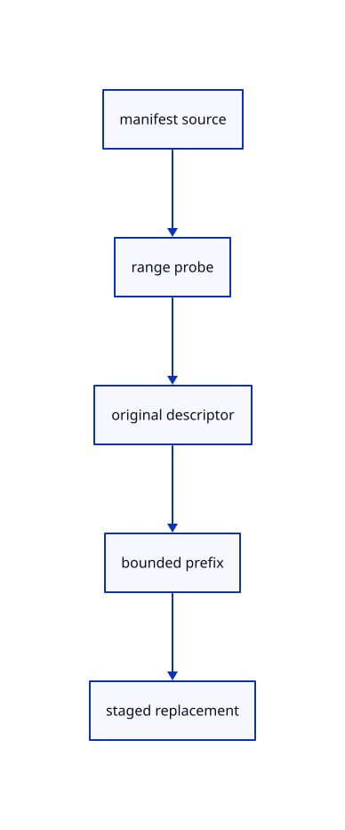

# 12.3.30 · Choose bounded range loading for large originals

**Chapter 12 · Files and streaming · Section 12.3 · Streaming page budgets and rendering** · [Contents](contents.md)

**Typing: 26–51 minutes.** [Estimate](typing-load.md).

Probe unencoded single-cloud sources and stage their checked prefix. Small, mixed or encoded documents retain whole-original loading.

## Type

Continue from [Own cancellation for each published source](68aa-own-cancellation-for-each-published-source.md). [Save or recover your work](recovery.md).

### 1. `src/browser_publication.rs`

Stage original ranged prefixes and keep failed revisions off the current scene.

Edit these blocks from bottom to top. Keep the surrounding lines unchanged.

<details>
<summary>Locate this block</summary>

```rust
    });
}

async fn read(route:&Route,index:&mut Index,signal:&web_sys::AbortSignal)->Result<(),String> {
    let started=crate::browser_phase::now();let mut response=crate::publication_fetch::get(&route.manifest,index.etag(&route.manifest),4*1024*1024,signal).await?;
    if response.status==404&&route.manifest.ends_with(".toml") {let yaml=format!("{}.yaml",route.manifest.trim_end_matches(".toml"));response=crate::publication_fetch::get(&yaml,index.etag(&route.manifest),4*1024*1024,signal).await?;}
    match response.status {304 if index.has_manifest()=>{},200..=299=>{index.manifest(&route.manifest,response.etag,&response.bytes)?;crate::browser_phase::finish("manifest",started,response.bytes.len() as u64,&route.manifest);},status=>return Err(format!("Manifest HTTP {status}"))}
    let mut seen=HashSet::new();
    for url in index.urls() {
        if !seen.insert(url.clone())||crate::manifest::immutable_key(&url)&&index.cached(&url) {continue;}
        let response=crate::publication_fetch::get(&url,index.etag(&url),crate::archive::LIMIT,signal).await?;
        match response.status {
            304 if index.cached(&url)=>{},
            200..=299=>{let started=crate::browser_phase::now();index.source(&url,response.etag,&response.bytes)?;crate::browser_phase::finish("decode/validation/display",started,response.bytes.len() as u64,&url);},
            status=>{index.forget(&url);return Err(format!("Source HTTP {status}: {url}"));}
        }
    }
    Ok(())
}
```

</details>

Replace it with:

```rust
    });
}

async fn read(route:&Route,index:&mut Index,signal:&web_sys::AbortSignal)->Result<Vec<crate::stream_load::Cursor>,String> {
    let mut cursors=Vec::new();let mut points=index.streamed_points();let budget=crate::page_cache::Budget::new(crate::stream_budget::PAGE_BYTES);
    let started=crate::browser_phase::now();let mut response=crate::publication_fetch::get(&route.manifest,index.etag(&route.manifest),4*1024*1024,signal).await?;
    if response.status==404&&route.manifest.ends_with(".toml") {let yaml=format!("{}.yaml",route.manifest.trim_end_matches(".toml"));response=crate::publication_fetch::get(&yaml,index.etag(&route.manifest),4*1024*1024,signal).await?;}
    match response.status {304 if index.has_manifest()=>{},200..=299=>{index.manifest(&route.manifest,response.etag,&response.bytes)?;crate::browser_phase::finish("manifest",started,response.bytes.len() as u64,&route.manifest);},status=>return Err(format!("Manifest HTTP {status}"))}
    let mut seen=HashSet::new();
    for url in index.urls() {
        if !seen.insert(url.clone())||crate::manifest::immutable_key(&url)&&index.cached(&url) {continue;}
        let encoding=index.encoding(&url)?;
        if encoding.name.is_empty()&&url.split('?').next().is_some_and(|path|path.ends_with(".pb")) {
            if let Some(probe)=crate::stream::probe(&url).await {
                if crate::range_shape::single_cloud(&probe.bytes)&&crate::stream::cloud_identity(&probe.bytes).is_some() {
                    let source=crate::range_source::Source::from_probe(url.clone(),&probe).await?;
                    if source.fields.count>crate::stream_budget::PREFIX_POINTS||source.fields.coords_len>=crate::stream_budget::MIN_BYTES {
                        if index.cached(&url)&&source.fields.revision.is_some()&&index.etag(&url)==source.fields.revision {continue;}
                        if signal.aborted() {return Err("Source read cancelled".into());}
                        points=points.saturating_sub(index.source_points(&url));
                        let remaining=crate::stream_budget::MAX_POINTS.saturating_sub(points);
                        if remaining==0 {return Err("Manifest sources exceed the point ceiling".into());}
                        let cursor=crate::stream_load::start(Rc::new(source),budget.clone(),remaining).await?;
                        if signal.aborted() {cursor.prepared.generation.borrow_mut().close();return Err("Source read cancelled".into());}
                        points=points.saturating_add(cursor.loaded);index.stream(&url,cursor.prepared.clone())?;cursors.push(cursor);continue;
                    }
                }
            }
        }
        let response=crate::publication_fetch::get(&url,index.etag(&url),crate::archive::LIMIT,signal).await?;
        match response.status {
            304 if index.cached(&url)=>{},
            200..=299=>{let started=crate::browser_phase::now();let bytes=crate::source_unpack::decode(response.bytes,&encoding,signal).await?;index.source(&url,response.etag,&bytes)?;crate::browser_phase::finish("decode/validation/display",started,bytes.len() as u64,&url);},
            status=>{index.forget(&url);return Err(format!("Source HTTP {status}: {url}"));}
        }
    }
    let extra=crate::stream_budget::MAX_POINTS.saturating_sub(points)/(cursors.len().max(1) as u32);for cursor in &mut cursors {cursor.ceiling=cursor.loaded+extra;}
    Ok(cursors)
}
```

<details>
<summary>Locate this block</summary>

```rust
        let result=read(&route,&mut index,&abort.signal()).await;
        let mut owner=state.borrow_mut();let current=owner.active&&owner.gate.finish(ticket)&&crate::browser_runtime::owns(&owner.fault)&&owner.fault.message().is_none();
        owner.inflight=false;owner.abort=None;if !current {return;}
        let outcome=result.and_then(|()|index.replacement(&owner.document.borrow().scene));owner.index=Some(index);
        let changed=match outcome {Ok(Some(scene))=>{owner.last_error=None;owner.delivery=Some(Ok(Box::new(scene)));true},Ok(None)=>false,Err(error)=>{if owner.last_error.as_ref()==Some(&error) {false} else {let _=crate::browser_report::observe("publication",&error);owner.last_error=Some(error.clone());owner.delivery=Some(Err(error));true}}};
        let again=std::mem::take(&mut owner.again);drop(owner);
        if changed {if let Some(window)=web_sys::window() {if let Ok(event)=web_sys::Event::new("viewer-publication") {let _=window.dispatch_event(&event);}}}
```

</details>

Replace it with:

```rust
        let result=read(&route,&mut index,&abort.signal()).await;
        let mut owner=state.borrow_mut();let current=owner.active&&owner.gate.finish(ticket)&&crate::browser_runtime::owns(&owner.fault)&&owner.fault.message().is_none();
        owner.inflight=false;owner.abort=None;if !current {return;}
        let outcome=result.and_then(|cursors| {for cursor in &cursors {owner.streams.push(Rc::downgrade(&cursor.prepared));}owner.pending_streams.extend(cursors);index.replacement(&owner.document.borrow().scene)});owner.index=Some(index);
        let changed=match outcome {Ok(Some(scene))=>{owner.last_error=None;owner.delivery=Some(Ok(Box::new(scene)));true},Ok(None)=>false,Err(error)=>{if owner.last_error.as_ref()==Some(&error) {false} else {let _=crate::browser_report::observe("publication",&error);owner.last_error=Some(error.clone());owner.delivery=Some(Err(error));true}}};
        let again=std::mem::take(&mut owner.again);drop(owner);
        if changed {if let Some(window)=web_sys::window() {if let Ok(event)=web_sys::Event::new("viewer-publication") {let _=window.dispatch_event(&event);}}}
```

<details>
<summary>Complete updated block reference</summary>

```rust
use crate::{publication_index::Index,publication_route::Route};
use std::{cell::{Cell,RefCell},collections::HashSet,rc::{Rc,Weak}};
use wasm_bindgen::{JsCast,JsValue,closure::Closure};

struct State {
    active:bool,inflight:bool,again:bool,
    pending_streams:Vec<crate::stream_load::Cursor>,streams:Vec<std::rc::Weak<crate::range_cloud::Prepared>>,cancelled:Rc<Cell<bool>>,
    gate:crate::read_gate::ReadGate,
    abort:Option<web_sys::AbortController>,
    route:Route,index:Option<Index>,
    document:crate::drawing_document::Shared,fault:crate::gpu_fault::Fault,
    delivery:Option<Result<Box<crate::scene::Scene>,String>>,last_error:Option<String>,
    timer:Option<i32>,tick:Option<Closure<dyn FnMut()>>,
    notify:Option<web_sys::EventSource>,message:Option<Closure<dyn FnMut(web_sys::MessageEvent)>>,
}
pub struct Publication(Option<Rc<RefCell<State>>>);
#[derive(Clone)]
pub struct Control(Option<Weak<RefCell<State>>>);
impl Publication {
    pub fn new(document:crate::drawing_document::Shared,fault:crate::gpu_fault::Fault)->Result<Self,JsValue> {
        let window=web_sys::window().ok_or("No browser window")?;let url=web_sys::Url::new(&window.location().href()?)?;let q=url.search_params();
        let scene=q.get("scene");let data=q.get("data");let live=q.get("live");let poll=q.get("poll");let notify=q.get("notify");
        let Some(route)=crate::publication_route::select(scene.as_deref(),&window.location().pathname()?,data.as_deref(),live.as_deref(),poll.as_deref(),notify.as_deref()) else {return Ok(Self(None));};
        let index=Index::new(route.base.clone());Ok(Self(Some(Rc::new(RefCell::new(State {active:true,inflight:false,again:false,pending_streams:Vec::new(),streams:Vec::new(),cancelled:Rc::new(Cell::new(false)),gate:Default::default(),abort:None,route,index:Some(index),document,fault,delivery:None,last_error:None,timer:None,tick:None,notify:None,message:None})))))
    }
    pub fn control(&self)->Control {Control(self.0.as_ref().map(Rc::downgrade))}
}
impl Drop for Publication {fn drop(&mut self) {self.control().cancel();}}
impl Control {
    fn state(&self)->Option<Rc<RefCell<State>>> {self.0.as_ref()?.upgrade()}
    pub fn begin(&self) {
        let Some(state)=self.state() else {return;};let Some(window)=web_sys::window() else {return;};
        let route=state.borrow().route.clone();
        if let Some(ms)=route.poll_ms {
            let weak=Rc::downgrade(&state);let callback=Closure::<dyn FnMut()>::new(move ||{if let Some(state)=weak.upgrade() {poll(state);}});
            match window.set_interval_with_callback_and_timeout_and_arguments_0(callback.as_ref().unchecked_ref(),ms) {Ok(id)=>{let mut state=state.borrow_mut();state.timer=Some(id);state.tick=Some(callback);},Err(error)=>crate::browser::report(&format!("Cannot schedule live polling: {error:?}"))}
            if let Some(url)=route.notify {if let Ok(source)=web_sys::EventSource::new(&url) {let weak=Rc::downgrade(&state);let callback=Closure::<dyn FnMut(web_sys::MessageEvent)>::new(move |_|{if let Some(state)=weak.upgrade() {poll(state);}});source.set_onmessage(Some(callback.as_ref().unchecked_ref()));let mut state=state.borrow_mut();state.notify=Some(source);state.message=Some(callback);}}
        }
        poll(state);
    }
    pub fn cancel(&self) {
        let Some(state)=self.state() else {return;};let mut state=state.borrow_mut();state.active=false;state.cancelled.set(true);for source in state.streams.drain(..).filter_map(|s|s.upgrade()) {source.generation.borrow_mut().close();}state.pending_streams.clear();crate::stream::reset_range_gate();state.gate.cancel();state.delivery=None;state.index=None;
        if let Some(abort)=state.abort.take() {abort.abort();}if let Some(id)=state.timer.take() {if let Some(window)=web_sys::window() {window.clear_interval_with_handle(id);}}
        if let Some(source)=state.notify.take() {source.set_onmessage(None);source.close();}state.message=None;state.tick=None;
    }
    pub fn take(&self)->Result<Option<crate::editor::Action>,String> {let Some(state)=self.state() else {return Ok(None);};let mut state=state.borrow_mut();if !state.active {state.delivery=None;return Ok(None);}state.delivery.take().transpose().map(|scene|scene.map(crate::editor::Action::Live))}
}

fn poll(state:Rc<RefCell<State>>) {
    let mut owner=state.borrow_mut();if !owner.active||!crate::browser_runtime::owns(&owner.fault)||owner.fault.message().is_some() {return;}
    if owner.inflight {owner.again=true;return;}
    let Ok(abort)=web_sys::AbortController::new() else {return;};let Ok(ticket)=owner.gate.begin() else {return;};let Some(mut index)=owner.index.take() else {return;};
    owner.inflight=true;owner.abort=Some(abort.clone());let route=owner.route.clone();drop(owner);
    wasm_bindgen_futures::spawn_local(async move {
        let result=read(&route,&mut index,&abort.signal()).await;
        let mut owner=state.borrow_mut();let current=owner.active&&owner.gate.finish(ticket)&&crate::browser_runtime::owns(&owner.fault)&&owner.fault.message().is_none();
        owner.inflight=false;owner.abort=None;if !current {return;}
        let outcome=result.and_then(|cursors| {for cursor in &cursors {owner.streams.push(Rc::downgrade(&cursor.prepared));}owner.pending_streams.extend(cursors);index.replacement(&owner.document.borrow().scene)});owner.index=Some(index);
        let changed=match outcome {Ok(Some(scene))=>{owner.last_error=None;owner.delivery=Some(Ok(Box::new(scene)));true},Ok(None)=>false,Err(error)=>{if owner.last_error.as_ref()==Some(&error) {false} else {let _=crate::browser_report::observe("publication",&error);owner.last_error=Some(error.clone());owner.delivery=Some(Err(error));true}}};
        let again=std::mem::take(&mut owner.again);drop(owner);
        if changed {if let Some(window)=web_sys::window() {if let Ok(event)=web_sys::Event::new("viewer-publication") {let _=window.dispatch_event(&event);}}}
        if again {poll(state);}
    });
}

async fn read(route:&Route,index:&mut Index,signal:&web_sys::AbortSignal)->Result<Vec<crate::stream_load::Cursor>,String> {
    let mut cursors=Vec::new();let mut points=index.streamed_points();let budget=crate::page_cache::Budget::new(crate::stream_budget::PAGE_BYTES);
    let started=crate::browser_phase::now();let mut response=crate::publication_fetch::get(&route.manifest,index.etag(&route.manifest),4*1024*1024,signal).await?;
    if response.status==404&&route.manifest.ends_with(".toml") {let yaml=format!("{}.yaml",route.manifest.trim_end_matches(".toml"));response=crate::publication_fetch::get(&yaml,index.etag(&route.manifest),4*1024*1024,signal).await?;}
    match response.status {304 if index.has_manifest()=>{},200..=299=>{index.manifest(&route.manifest,response.etag,&response.bytes)?;crate::browser_phase::finish("manifest",started,response.bytes.len() as u64,&route.manifest);},status=>return Err(format!("Manifest HTTP {status}"))}
    let mut seen=HashSet::new();
    for url in index.urls() {
        if !seen.insert(url.clone())||crate::manifest::immutable_key(&url)&&index.cached(&url) {continue;}
        let encoding=index.encoding(&url)?;
        if encoding.name.is_empty()&&url.split('?').next().is_some_and(|path|path.ends_with(".pb")) {
            if let Some(probe)=crate::stream::probe(&url).await {
                if crate::range_shape::single_cloud(&probe.bytes)&&crate::stream::cloud_identity(&probe.bytes).is_some() {
                    let source=crate::range_source::Source::from_probe(url.clone(),&probe).await?;
                    if source.fields.count>crate::stream_budget::PREFIX_POINTS||source.fields.coords_len>=crate::stream_budget::MIN_BYTES {
                        if index.cached(&url)&&source.fields.revision.is_some()&&index.etag(&url)==source.fields.revision {continue;}
                        if signal.aborted() {return Err("Source read cancelled".into());}
                        points=points.saturating_sub(index.source_points(&url));
                        let remaining=crate::stream_budget::MAX_POINTS.saturating_sub(points);
                        if remaining==0 {return Err("Manifest sources exceed the point ceiling".into());}
                        let cursor=crate::stream_load::start(Rc::new(source),budget.clone(),remaining).await?;
                        if signal.aborted() {cursor.prepared.generation.borrow_mut().close();return Err("Source read cancelled".into());}
                        points=points.saturating_add(cursor.loaded);index.stream(&url,cursor.prepared.clone())?;cursors.push(cursor);continue;
                    }
                }
            }
        }
        let response=crate::publication_fetch::get(&url,index.etag(&url),crate::archive::LIMIT,signal).await?;
        match response.status {
            304 if index.cached(&url)=>{},
            200..=299=>{let started=crate::browser_phase::now();let bytes=crate::source_unpack::decode(response.bytes,&encoding,signal).await?;index.source(&url,response.etag,&bytes)?;crate::browser_phase::finish("decode/validation/display",started,bytes.len() as u64,&url);},
            status=>{index.forget(&url);return Err(format!("Source HTTP {status}: {url}"));}
        }
    }
    let extra=crate::stream_budget::MAX_POINTS.saturating_sub(points)/(cursors.len().max(1) as u32);for cursor in &mut cursors {cursor.ceiling=cursor.loaded+extra;}
    Ok(cursors)
}
```

</details>

<details>
<summary>Optional patch references</summary>

Use these original edit fragments when comparing a saved checkpoint. Apply the complete blocks above.

```text
--8<-- "journey/code/68ab-choose-bounded-range-loading-for-large-originals-01.rs"
```

```text
--8<-- "journey/code/68ab-choose-bounded-range-loading-for-large-originals-02.rs"
```

```text
--8<-- "journey/code/68ab-choose-bounded-range-loading-for-large-originals-03.rs"
```

</details>

## Run and check

Run this from `session_viewer` to select the fixed dependency versions and install supplied binary assets. It updates Cargo.lock and preserves the previous lock. It does not write implementation code:

```sh
npm --prefix ../session_tests run course -- dependencies 12.3.30
```

In your project:

```sh
cd workspace/journey
REGEN_PROTO=0 cargo build --lib --locked --target wasm32-unknown-unknown -j1
REGEN_PROTO=0 CARGO_BUILD_JOBS=1 trunk serve --port 8780
```

Open `http://127.0.0.1:8780/`. Keep an existing Trunk server running; saving rebuilds it.


### Recorded visual result

**Previous native render — current verification pending.**

The mixed original CAD, surface and coloured cloud scene remains visible.


*This recorded image predates a source or checker change. Rebuild this checkpoint before using it as current evidence; browser controls require separate acceptance.*

This reference image is shared with [12.1.44 · Connect browser save open and URL adoption](66af-connect-browser-save-open-url-adoption.md). It does not demonstrate a new feature by itself.

<details>
<summary>Code explanation and diagram</summary>


manifest source → range probe → original descriptor → bounded prefix → staged replacement.



Can a failed large source range fall back to an unbounded whole decode?

No. Once the large range-readable original is identified, refuse failed ranges while retaining the prior displayed scene.

Study estimate, including typing and experiments: 0.5–1 hours.

</details>

<details>
<summary>Optional experiment</summary>

Compare large cloud, small/mixed original document, encoded source, missing range support and failed source revision routes.

</details>

<details>
<summary>Check and save your work</summary>

Restore experimental edits, then run from `session_viewer`:

```sh
npm --prefix ../session_tests run course -- check 12.3.30
npm --prefix ../session_tests run course -- save 12.3.30
```

Source comparison leaves your project untouched. [Save and recovery instructions](recovery.md).

</details>

<details>
<summary>Viewer coverage and verification</summary>


The existing mixed original archive browser exercise remains authored and unrun. The final cache endpoint adds real ranged URL loading, response validation, cancellation and cleanup exercises, also awaiting browser execution.

[Full validation scope](release.md).

To reproduce the scripted acceptance of the reference checkpoint, run from `session_viewer` with the [course bundle server](release.md#reproduce) running on port 8781:

```sh
npm --prefix ../session_tests run course -- capture 12.3.30
```

This uses the verified reference bundle; it does not check or change your typed project.

</details>
