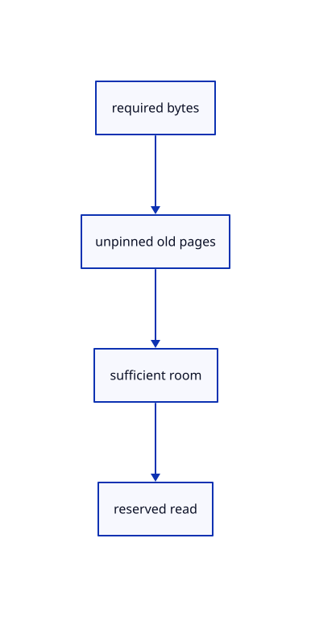

# 12.3.3 · Evict unpinned pages in access order

**Chapter 12 · Files and streaming · Section 12.3 · Streaming page budgets and rendering** · [Contents](contents.md)

**Typing: 14–28 minutes.** [Estimate](typing-load.md).

Choose enough old unpinned entries before changing the cache. Failed reservation preserves current entries.

## Type

Continue from [Keep shared pages alive during eviction](68a-keep-shared-pages-alive-during-eviction.md). [Save or recover your work](recovery.md).

### 1. `src/page_cache.rs`

Reclaim sufficient unpinned payload before reserving a new page.

<details>
<summary>Locate the existing block</summary>

```rust
        self.clock=self.clock.checked_add(1)?;let entry=self.entries.get_mut(key)?;entry.touch=self.clock;Some(entry.value.clone())
    }
    pub fn oldest(&self)->Option<K> {self.entries.iter().min_by_key(|(_,entry)|entry.touch).map(|(key,_)|key.clone())}
    pub fn remove(&mut self,key:&K)->bool {self.entries.remove(key).is_some()}
```

</details>

Edit the existing block to match this code; keep unchanged lines:

```rust
--8<-- "journey/code/68b-evict-unpinned-pages-in-access-order-01.rs"
```

<details>
<summary>Supplied validation fixture</summary>

Copy this supplied authoring fixture once. Continue with the browser build below; the course does not require running native tests.

### 2. `src/page_cache.rs`

Copy cache ownership, reservation and eviction regression fixtures.

<details>
<summary>Locate the existing block</summary>

```text
    pub fn used(&self)->usize {self.budget.used()}
}
```

</details>

After that block, append this supplied code:

```text
--8<-- "journey/code/68b-evict-unpinned-pages-in-access-order-02.rs" skip=53
```

</details>

## Run and check

Run this from `session_viewer` to select the fixed dependency versions and install supplied binary assets. It updates Cargo.lock and preserves the previous lock. It does not write implementation code:

```sh
npm --prefix ../session_tests run course -- dependencies 12.3.3
```

In your project:

```sh
cd workspace/journey
REGEN_PROTO=0 cargo build --lib --locked --target wasm32-unknown-unknown -j1
REGEN_PROTO=0 CARGO_BUILD_JOBS=1 trunk serve --port 8780
```

Open `http://127.0.0.1:8780/`. Keep an existing Trunk server running; saving rebuilds it.


### Recorded visual result

**Previous native render — current verification pending.**

The mixed original CAD, surface and coloured cloud scene remains visible.


*This recorded image predates a source or checker change. Rebuild this checkpoint before using it as current evidence; browser controls require separate acceptance.*

This reference image is shared with [12.1.44 · Connect browser save open and URL adoption](66af-connect-browser-save-open-url-adoption.md). It does not demonstrate a new feature by itself.

<details>
<summary>Code explanation and diagram</summary>


required bytes → unpinned old pages → sufficient room → reserved read.



May a failed reservation remove half the drawing?

No. The reservation first proves enough reclaimable room. Explicit visible eviction later redraws and cancels picks before reuse.

Study estimate, including typing and experiments: 0.5–1 hours.

</details>

<details>
<summary>Optional experiment</summary>

Inspect eviction, pinned failure, foreign-budget refusal and retained-owner release tests.

</details>

<details>
<summary>Check and save your work</summary>

Restore experimental edits, then run from `session_viewer`:

```sh
npm --prefix ../session_tests run course -- check 12.3.3
npm --prefix ../session_tests run course -- save 12.3.3
```

Source comparison leaves your project untouched. [Save and recovery instructions](recovery.md).

</details>

<details>
<summary>Viewer coverage and verification</summary>


The existing mixed original archive browser exercise remains authored and unrun. The final cache endpoint adds real ranged URL loading, response validation, cancellation and cleanup exercises, also awaiting browser execution.

[Full validation scope](release.md).

To reproduce the scripted acceptance of the reference checkpoint, run from `session_viewer` with the [course bundle server](release.md#reproduce) running on port 8781:

```sh
npm --prefix ../session_tests run course -- capture 12.3.3
```

This uses the verified reference bundle; it does not check or change your typed project.

</details>
