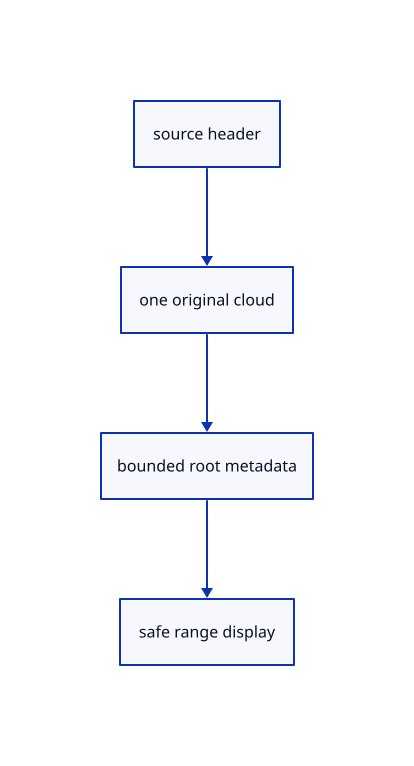

# 12.3.8 · Validate complete source metadata

**Chapter 12 · Files and streaming · Section 12.3 · Streaming page budgets and rendering** · [Contents](contents.md)

**Typing: 24–47 minutes.** [Estimate](typing-load.md).

Validate the complete source envelope before adopting range pages. Unapplied placements and extended originals require complete document loading.

## Type

Continue from [Reuse a checked source probe](68f-reuse-a-checked-source-probe.md). [Save or recover your work](recovery.md).

### 1. `src/range_shape.rs`

Validate single-cloud layout and complete original metadata before sampling.

Create the file and type:

```rust
--8<-- "journey/code/68fa-validate-complete-source-metadata-01.rs"
```

<details>
<summary>Supplied validation fixture</summary>

Copy this supplied authoring fixture once. Continue with the browser build below; the course does not require running native tests.

### 2. `src/range_shape.rs`

Copy original placement, source extension and metadata refusal fixtures.

<details>
<summary>Locate the existing block</summary>

```text
    Ok(())
}
```

</details>

After that block, append this supplied code:

```text
--8<-- "journey/code/68fa-validate-complete-source-metadata-02.rs" skip=13
```

</details>

### 3. `src/lib.rs`

Register complete original metadata validation.

<details>
<summary>Locate the existing block</summary>

```rust

pub mod stream_properties;
```

</details>

After that block, type:

```rust
--8<-- "journey/code/68fa-validate-complete-source-metadata-03.rs" skip=28
```

### 4. `src/range_source.rs`

Refuse unapplied original metadata and mixed source geometry before range adoption.

<details>
<summary>Locate the existing block</summary>

```rust
pub struct Source {pub properties:crate::stream_properties::Properties,pub guid:String,pub name:String,pub url:String,pub fields:crate::stream::CloudFields,pub lod:crate::stream::CloudLod}

#[cfg(target_arch="wasm32")]
impl Source {
    pub async fn open(url:String)->Result<Self,String> {
        let probe=crate::stream::probe(&url).await.ok_or("Source probe failed")?;
        Self::from_probe(url,&probe).await
    }
    pub async fn from_probe(url:String,probe:&crate::range_fetch::Reply)->Result<Self,String> {
        if probe.etag.is_none()&&!crate::manifest::immutable_key(&url) {return Err("Streaming requires an ETag or immutable source URL".into());}
        let (guid,name)=crate::stream::cloud_identity(&probe.bytes).ok_or("Missing original cloud identity")?;
        let mut fields=crate::stream::cloud_fields(&url,probe).await.ok_or("Not a single range-readable cloud")?;
        let lod=crate::stream::cloud_lod(&url,&mut fields).await.ok_or("Invalid original cloud array or octree layout")?;
        let properties=crate::stream::cloud_properties(&url,&fields).await.ok_or("Invalid original cloud presentation fields")?;
        Ok(Self {properties,guid,name,url,fields,lod})
    }
    pub async fn page(&self,rows:std::ops::Range<u32>)->Result<crate::range_page::Page,String> {
        if rows.start>rows.end||rows.end>self.fields.count {return Err("Point rows outside source".into());}
        let count=u64::from(rows.end-rows.start);
        let at=self.fields.coords_at.checked_add(u64::from(rows.start)*24).ok_or("Coordinate offset overflow")?;
        let raw=crate::stream::source_range(&self.url,at,count*24,&self.fields.revision).await.ok_or("Coordinate range failed")?;
        let ids=if self.fields.ids_len==0 {None} else {
            let at=self.fields.ids_at.checked_add(u64::from(rows.start)*4).ok_or("ID offset overflow")?;
            Some(crate::stream::source_range(&self.url,at,count*4,&self.fields.revision).await.ok_or("Original ID range failed")?)
        };
        crate::range_page::Page::decode(rows,self.fields.count,&raw,ids.as_deref()).map_err(str::to_owned)
    }

}

#[cfg(test)]
mod tests {
    use prost::Message;
    #[test]
    fn range_layout_and_original_pages_match_the_kernel_protobuf() {
        let mut cloud=session_rust::PointCloud::from_coords(vec![1_000_000_000.125,2.,3.,1_000_000_000.375,4.,5.],vec![],vec![]);
        cloud.name="Precise ranged source".into();let _=cloud.guid();let mut proto=cloud.to_proto();proto.point_ids=vec![u32::MAX,7];
        let mut objects=session_rust::proto::Objects::default();objects.pointclouds.push(proto.clone());let document=session_rust::proto::Session {objects:Some(objects),..Default::default()};let raw=document.encode_to_vec();
        assert_eq!(crate::stream::cloud_identity(&raw).unwrap(),(proto.guid.clone(),proto.name.clone()));
        let (at,length)=crate::stream::walk_to_coords(&raw).unwrap();assert_eq!(length,48);
        let page=crate::range_page::Page::decode(0..2,2,&raw[at as usize..(at+length) as usize],Some(&proto.point_ids.iter().flat_map(|id|id.to_le_bytes()).collect::<Vec<_>>())).unwrap();
        assert_eq!(page.coordinates,proto.coords);assert_eq!(page.ids,proto.point_ids);
        assert!(crate::stream::walk_to_coords(&raw[..at as usize-1]).is_none());
    }
}
```

</details>

Edit the existing block to match this code; keep unchanged lines:

```rust
pub struct Source {pub properties:crate::stream_properties::Properties,pub guid:String,pub name:String,pub url:String,pub fields:crate::stream::CloudFields,pub lod:crate::stream::CloudLod}


#[cfg(target_arch="wasm32")]
impl Source {
    pub async fn open(url:String)->Result<Self,String> {
        let probe=crate::stream::probe(&url).await.ok_or("Source probe failed")?;
        Self::from_probe(url,&probe).await
    }
    pub async fn from_probe(url:String,probe:&crate::range_fetch::Reply)->Result<Self,String> {
        if !crate::range_shape::single_cloud(&probe.bytes) {return Err("Ranged source must contain one original cloud".into());}
        if probe.etag.is_none()&&!crate::manifest::immutable_key(&url) {return Err("Streaming requires an ETag or immutable source URL".into());}
        let (guid,name)=crate::stream::cloud_identity(&probe.bytes).ok_or("Missing original cloud identity")?;
        let mut fields=crate::stream::cloud_fields(&url,probe).await.ok_or("Not a single range-readable cloud")?;
        let lod=crate::stream::cloud_lod(&url,&mut fields).await.ok_or("Invalid original cloud array or octree layout")?;
        let properties=crate::stream::cloud_properties(&url,&fields).await.ok_or("Invalid original cloud presentation fields")?;
        let total=probe.total.ok_or("Missing original file size")?;
        let length=total.checked_sub(fields.end).ok_or("Cloud exceeds its original file")?;
        if length>1024*1024 {return Err("Original source metadata exceeds its range limit".into());}
        if length>0 {
            let raw=crate::stream::source_range(&url,fields.end,length,&fields.revision).await.ok_or("Original source metadata range failed")?;
            crate::range_shape::metadata(&raw,&guid)?;
        }
        Ok(Self {properties,guid,name,url,fields,lod})
    }
    pub async fn page(&self,rows:std::ops::Range<u32>)->Result<crate::range_page::Page,String> {
        if rows.start>rows.end||rows.end>self.fields.count {return Err("Point rows outside source".into());}
        let count=u64::from(rows.end-rows.start);
        let at=self.fields.coords_at.checked_add(u64::from(rows.start)*24).ok_or("Coordinate offset overflow")?;
        let raw=crate::stream::source_range(&self.url,at,count*24,&self.fields.revision).await.ok_or("Coordinate range failed")?;
        let ids=if self.fields.ids_len==0 {None} else {
            let at=self.fields.ids_at.checked_add(u64::from(rows.start)*4).ok_or("ID offset overflow")?;
            Some(crate::stream::source_range(&self.url,at,count*4,&self.fields.revision).await.ok_or("Original ID range failed")?)
        };
        crate::range_page::Page::decode(rows,self.fields.count,&raw,ids.as_deref()).map_err(str::to_owned)
    }

}

#[cfg(test)]
mod tests {
    use prost::Message;
    #[test]
    fn range_layout_and_original_pages_match_the_kernel_protobuf() {
        let mut cloud=session_rust::PointCloud::from_coords(vec![1_000_000_000.125,2.,3.,1_000_000_000.375,4.,5.],vec![],vec![]);
        cloud.name="Precise ranged source".into();let _=cloud.guid();let mut proto=cloud.to_proto();proto.point_ids=vec![u32::MAX,7];
        let mut objects=session_rust::proto::Objects::default();objects.pointclouds.push(proto.clone());let document=session_rust::proto::Session {objects:Some(objects),..Default::default()};let raw=document.encode_to_vec();
        assert!(crate::range_shape::single_cloud(&raw));assert_eq!(crate::stream::cloud_identity(&raw).unwrap(),(proto.guid.clone(),proto.name.clone()));
        let (at,length)=crate::stream::walk_to_coords(&raw).unwrap();assert_eq!(length,48);
        let page=crate::range_page::Page::decode(0..2,2,&raw[at as usize..(at+length) as usize],Some(&proto.point_ids.iter().flat_map(|id|id.to_le_bytes()).collect::<Vec<_>>())).unwrap();
        assert_eq!(page.coordinates,proto.coords);assert_eq!(page.ids,proto.point_ids);
        assert!(crate::stream::walk_to_coords(&raw[..at as usize-1]).is_none());let mut mixed=document.clone();mixed.objects.as_mut().unwrap().points.push(session_rust::Point::new(0.,0.,0.).to_proto());assert!(!crate::range_shape::single_cloud(&mixed.encode_to_vec()));
    }
}
```

<details>
<summary>Optional patch references</summary>

Use these original edit fragments when comparing a saved checkpoint. Apply the complete blocks above.

```text
--8<-- "journey/code/68fa-validate-complete-source-metadata-04.rs"
```

```text
--8<-- "journey/code/68fa-validate-complete-source-metadata-05.rs"
```

```text
--8<-- "journey/code/68fa-validate-complete-source-metadata-06.rs"
```

```text
--8<-- "journey/code/68fa-validate-complete-source-metadata-07.rs"
```

</details>

## Run and check

Run this from `session_viewer` to select the fixed dependency versions and install supplied binary assets. It updates Cargo.lock and preserves the previous lock. It does not write implementation code:

```sh
npm --prefix ../session_tests run course -- dependencies 12.3.8
```

In your project:

```sh
cd workspace/journey
REGEN_PROTO=0 cargo build --lib --locked --target wasm32-unknown-unknown -j1
REGEN_PROTO=0 CARGO_BUILD_JOBS=1 trunk serve --port 8780
```

Open `http://127.0.0.1:8780/`. Keep an existing Trunk server running; saving rebuilds it.


### Recorded visual result

**Previous native render — current verification pending.**

The mixed original CAD, surface and coloured cloud scene remains visible.


*This recorded image predates a source or checker change. Rebuild this checkpoint before using it as current evidence; browser controls require separate acceptance.*

This reference image is shared with [12.1.44 · Connect browser save open and URL adoption](66af-connect-browser-save-open-url-adoption.md). It does not demonstrate a new feature by itself.

<details>
<summary>Code explanation and diagram</summary>


source header → one original cloud → bounded root metadata → safe range display.



Can a source point or placement be silently skipped by a cloud range reader?

No. Require one original cloud, validate its trailing metadata and refuse unapplied placements, extra objects, definitions or interactions.

Study estimate, including typing and experiments: 0.5–1 hours.

</details>

<details>
<summary>Optional experiment</summary>

Compare a single cloud with a tiny point preceding it; refuse a precise source placement instead of displaying it in the wrong frame.

</details>

<details>
<summary>Check and save your work</summary>

Restore experimental edits, then run from `session_viewer`:

```sh
npm --prefix ../session_tests run course -- check 12.3.8
npm --prefix ../session_tests run course -- save 12.3.8
```

Source comparison leaves your project untouched. [Save and recovery instructions](recovery.md).

</details>

<details>
<summary>Viewer coverage and verification</summary>


The existing mixed original archive browser exercise remains authored and unrun. The final cache endpoint adds real ranged URL loading, response validation, cancellation and cleanup exercises, also awaiting browser execution.

[Full validation scope](release.md).

To reproduce the scripted acceptance of the reference checkpoint, run from `session_viewer` with the [course bundle server](release.md#reproduce) running on port 8781:

```sh
npm --prefix ../session_tests run course -- capture 12.3.8
```

This uses the verified reference bundle; it does not check or change your typed project.

</details>
