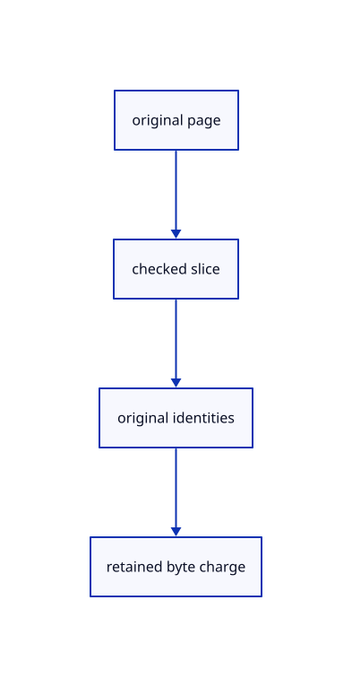

# 12.3.9 · Slice original pages without losing attributes

**Chapter 12 · Files and streaming · Section 12.3 · Streaming page budgets and rendering** · [Contents](contents.md)

**Typing: 15–29 minutes.** [Estimate](typing-load.md).

Retain exact original coordinates, IDs, colours and packed normals for a checked source interval.

## Type

Continue from [Validate complete source metadata](68fa-validate-complete-source-metadata.md). [Save or recover your work](recovery.md).

### 1. `src/range_page.rs`

Keep original attributes and slices with checked page lengths.

<details>
<summary>Locate the existing block</summary>

```rust
use std::ops::Range;

pub struct Page {
    pub rows:Range<u32>,
    pub coordinates:Vec<f64>,
    pub display:Vec<f32>,
    pub ids:Vec<u32>,
}
impl Page {
    pub fn decode(rows:Range<u32>,total:u32,raw:&[u8],ids:Option<&[u8]>)->Result<Self,&'static str> {
        if rows.start>rows.end||rows.end>total {return Err("Point rows outside source");}
        let count=(rows.end-rows.start) as usize;
        if raw.len()!=count.checked_mul(24).ok_or("Page size overflow")? {return Err("Incomplete original coordinate page");}
        let coordinates=raw.chunks_exact(8).map(|v|f64::from_le_bytes(v.try_into().unwrap())).collect::<Vec<_>>();
        if coordinates.iter().any(|v|!v.is_finite()||!(*v as f32).is_finite()) {return Err("Invalid source coordinates");}
        let ids=if let Some(ids)=ids {
            if ids.len()!=count.checked_mul(4).ok_or("ID page size overflow")? {return Err("Incomplete original point ID page");}
            ids.chunks_exact(4).map(|v|u32::from_le_bytes(v.try_into().unwrap())).collect::<Vec<_>>()
        } else {rows.clone().collect()};
        if ids.iter().copied().collect::<std::collections::HashSet<_>>().len()!=count {return Err("Repeated original point IDs");}
        let display=coordinates.iter().map(|v|*v as f32).collect();Ok(Self {rows,coordinates,display,ids})
    }
    pub fn bytes(&self)->usize {self.coordinates.capacity()*8+self.display.capacity()*4+self.ids.capacity()*4}
}

#[cfg(test)]
mod tests {
    use super::*;
    #[test]
    fn pages_keep_original_f64_coordinates_high_ids_and_fallback_rows() {
        let raw=[1_000_000_000.125f64,2.,3.,1_000_000_000.375,4.,5.].into_iter().flat_map(f64::to_le_bytes).collect::<Vec<_>>();
        let ids=[u32::MAX,7].into_iter().flat_map(u32::to_le_bytes).collect::<Vec<_>>();let page=Page::decode(8..10,20,&raw,Some(&ids)).unwrap();
        assert_eq!(page.coordinates[0],1_000_000_000.125);assert_eq!(page.coordinates[3],1_000_000_000.375);assert_eq!(page.display[0],page.display[3]);assert_eq!(page.ids,[u32::MAX,7]);assert_eq!(Page::decode(8..10,20,&raw,None).unwrap().ids,[8,9]);
        assert!(Page::decode(8..10,20,&raw[..47],Some(&ids)).is_err());assert!(Page::decode(8..10,20,&raw,Some(&ids[..7])).is_err());assert!(Page::decode(8..10,9,&raw,None).is_err());assert!(Page::decode(10..8,20,&raw,None).is_err());
        let duplicates=[7u32,7].into_iter().flat_map(u32::to_le_bytes).collect::<Vec<_>>();assert!(Page::decode(8..10,20,&raw,Some(&duplicates)).is_err());
    }
    #[test]
    fn invalid_original_doubles_never_become_a_display_page() {
        for value in [f64::NAN,f64::INFINITY,f64::MAX] {let raw=[value,0.,0.].into_iter().flat_map(f64::to_le_bytes).collect::<Vec<_>>();assert!(Page::decode(0..1,1,&raw,None).is_err());}
    }
}
```

</details>

Edit the existing block to match this code; keep unchanged lines:

```rust
use std::ops::Range;

pub struct Page {
    pub rows:Range<u32>,
    pub coordinates:Vec<f64>,
    pub display:Vec<f32>,
    pub ids:Vec<u32>,
    pub colors:Vec<u32>,
    pub normals:Vec<u32>,
}
impl Page {
    pub fn decode(rows:Range<u32>,total:u32,raw:&[u8],ids:Option<&[u8]>)->Result<Self,&'static str> {
        if rows.start>rows.end||rows.end>total {return Err("Point rows outside source");}
        let count=(rows.end-rows.start) as usize;
        if raw.len()!=count.checked_mul(24).ok_or("Page size overflow")? {return Err("Incomplete original coordinate page");}
        let coordinates=raw.chunks_exact(8).map(|v|f64::from_le_bytes(v.try_into().unwrap())).collect::<Vec<_>>();
        if coordinates.iter().any(|v|!v.is_finite()||!(*v as f32).is_finite()) {return Err("Invalid source coordinates");}
        let ids=if let Some(ids)=ids {
            if ids.len()!=count.checked_mul(4).ok_or("ID page size overflow")? {return Err("Incomplete original point ID page");}
            ids.chunks_exact(4).map(|v|u32::from_le_bytes(v.try_into().unwrap())).collect::<Vec<_>>()
        } else {rows.clone().collect()};
        if ids.iter().copied().collect::<std::collections::HashSet<_>>().len()!=count {return Err("Repeated original point IDs");}
        let display=coordinates.iter().map(|v|*v as f32).collect();Ok(Self {rows,coordinates,display,ids,colors:Vec::new(),normals:Vec::new()})
    }
    pub fn slice(&self,rows:Range<u32>)->Result<Self,&'static str> {
        if rows.start<self.rows.start||rows.end>self.rows.end||rows.start>=rows.end {return Err("Slice is outside its original page");}
        let a=(rows.start-self.rows.start) as usize;let b=(rows.end-self.rows.start) as usize;
        Ok(Self {rows,coordinates:self.coordinates[a*3..b*3].to_vec(),display:self.display[a*3..b*3].to_vec(),ids:self.ids[a..b].to_vec(),colors:if self.colors.is_empty() {Vec::new()} else {self.colors[a..b].to_vec()},normals:if self.normals.is_empty() {Vec::new()} else {self.normals[a..b].to_vec()}})
    }
    pub fn attributes(mut self,colors:Vec<u32>,normals:Vec<u32>)->Result<Self,&'static str> {
        let count=(self.rows.end-self.rows.start) as usize;
        if !colors.is_empty()&&colors.len()!=count||!normals.is_empty()&&normals.len()!=count {return Err("Source page attributes do not match its point rows");}
        self.colors=colors;self.normals=normals;Ok(self)
    }
    pub fn bytes(&self)->usize {self.coordinates.capacity()*8+self.display.capacity()*4+self.ids.capacity()*4+self.colors.capacity()*4+self.normals.capacity()*4}
}

#[cfg(test)]
mod tests {
    use super::*;
    #[test]
    fn pages_keep_original_f64_coordinates_high_ids_and_fallback_rows() {
        let raw=[1_000_000_000.125f64,2.,3.,1_000_000_000.375,4.,5.].into_iter().flat_map(f64::to_le_bytes).collect::<Vec<_>>();
        let ids=[u32::MAX,7].into_iter().flat_map(u32::to_le_bytes).collect::<Vec<_>>();let page=Page::decode(8..10,20,&raw,Some(&ids)).unwrap();
        assert_eq!(page.coordinates[0],1_000_000_000.125);assert_eq!(page.coordinates[3],1_000_000_000.375);assert_eq!(page.display[0],page.display[3]);assert_eq!(page.ids,[u32::MAX,7]);assert_eq!(Page::decode(8..10,20,&raw,None).unwrap().ids,[8,9]);
        assert!(Page::decode(8..10,20,&raw[..47],Some(&ids)).is_err());assert!(Page::decode(8..10,20,&raw,Some(&ids[..7])).is_err());assert!(Page::decode(8..10,9,&raw,None).is_err());assert!(Page::decode(10..8,20,&raw,None).is_err());
        let duplicates=[7u32,7].into_iter().flat_map(u32::to_le_bytes).collect::<Vec<_>>();assert!(Page::decode(8..10,20,&raw,Some(&duplicates)).is_err());
    }
    #[test]
    fn invalid_original_doubles_never_become_a_display_page() {
        for value in [f64::NAN,f64::INFINITY,f64::MAX] {let raw=[value,0.,0.].into_iter().flat_map(f64::to_le_bytes).collect::<Vec<_>>();assert!(Page::decode(0..1,1,&raw,None).is_err());}
    }
}

impl crate::page_cache::ByteSize for Page {fn bytes(&self)->usize {Page::bytes(self)}}
```

<details>
<summary>Optional patch references</summary>

Use these original edit fragments when comparing a saved checkpoint. Apply the complete blocks above.

```text
--8<-- "journey/code/68g-slice-original-pages-without-losing-attributes-01.rs"
```

```text
--8<-- "journey/code/68g-slice-original-pages-without-losing-attributes-02.rs"
```

```text
--8<-- "journey/code/68g-slice-original-pages-without-losing-attributes-03.rs"
```

</details>

<details>
<summary>Supplied validation fixture</summary>

Copy this supplied authoring fixture once. Continue with the browser build below; the course does not require running native tests.

### 2. `src/range_page.rs`

Copy exact attribute and slice regression fixtures.

<details>
<summary>Locate the existing block</summary>

```text

impl crate::page_cache::ByteSize for Page {fn bytes(&self)->usize {Page::bytes(self)}}
```

</details>

After that block, append this supplied code:

```text
--8<-- "journey/code/68g-slice-original-pages-without-losing-attributes-04.rs" skip=88
```

</details>

## Run and check

Run this from `session_viewer` to select the fixed dependency versions and install supplied binary assets. It updates Cargo.lock and preserves the previous lock. It does not write implementation code:

```sh
npm --prefix ../session_tests run course -- dependencies 12.3.9
```

In your project:

```sh
cd workspace/journey
REGEN_PROTO=0 cargo build --lib --locked --target wasm32-unknown-unknown -j1
REGEN_PROTO=0 CARGO_BUILD_JOBS=1 trunk serve --port 8780
```

Open `http://127.0.0.1:8780/`. Keep an existing Trunk server running; saving rebuilds it.


### Recorded visual result

**Previous native render — current verification pending.**

The mixed original CAD, surface and coloured cloud scene remains visible.

This checkpoint was rendered independently and has the same native comparison frame as [Validate complete source metadata](68fa-validate-complete-source-metadata.md). Use its state checks and browser exercise to assess the changed behavior.


*This recorded image predates a source or checker change. Rebuild this checkpoint before using it as current evidence; browser controls require separate acceptance.*

This reference image is shared with [12.1.44 · Connect browser save open and URL adoption](66af-connect-browser-save-open-url-adoption.md). It does not demonstrate a new feature by itself.

<details>
<summary>Code explanation and diagram</summary>


original page → checked slice → original identities → retained byte charge.



Does slicing a page renumber its original points?

No. The slice preserves the original source row interval and ID column.

Study estimate, including typing and experiments: 0.5–1 hours.

</details>

<details>
<summary>Optional experiment</summary>

Slice the second point, compare exact colour/normal words and reject incomplete attribute columns.

</details>

<details>
<summary>Check and save your work</summary>

Restore experimental edits, then run from `session_viewer`:

```sh
npm --prefix ../session_tests run course -- check 12.3.9
npm --prefix ../session_tests run course -- save 12.3.9
```

Source comparison leaves your project untouched. [Save and recovery instructions](recovery.md).

</details>

<details>
<summary>Viewer coverage and verification</summary>


The existing mixed original archive browser exercise remains authored and unrun. The final cache endpoint adds real ranged URL loading, response validation, cancellation and cleanup exercises, also awaiting browser execution.

[Full validation scope](release.md).

To reproduce the scripted acceptance of the reference checkpoint, run from `session_viewer` with the [course bundle server](release.md#reproduce) running on port 8781:

```sh
npm --prefix ../session_tests run course -- capture 12.3.9
```

This uses the verified reference bundle; it does not check or change your typed project.

</details>
