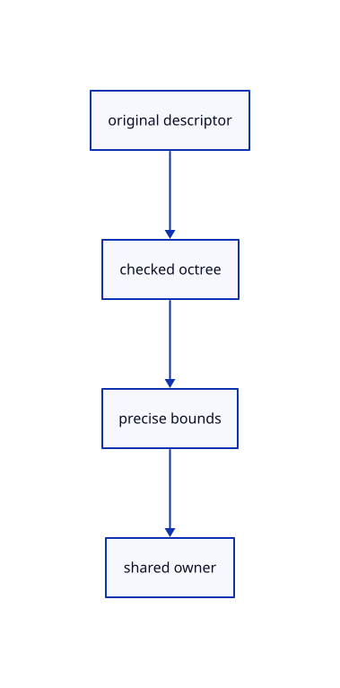

# 12.3.10 · Prepare shared remote source owners

**Chapter 12 · Files and streaming · Section 12.3 · Streaming page budgets and rendering** · [Contents](contents.md)

**Typing: 18–36 minutes.** [Estimate](typing-load.md).

Keep original source identity, full octree bounds and charged cached pages in one shared owner.

## Type

Continue from [Slice original pages without losing attributes](68g-slice-original-pages-without-losing-attributes.md). [Save or recover your work](recovery.md).

### 1. `src/range_cloud.rs`

Own the complete remote descriptor and precise original bounds.

Create the file and type:

```rust
--8<-- "journey/code/68h-prepare-shared-remote-source-owners-01.rs"
```

### 2. `src/lib.rs`

Register the source component.

<details>
<summary>Locate the existing block</summary>

```rust

pub mod stream_properties;
```

</details>

After that block, type:

```rust
--8<-- "journey/code/68h-prepare-shared-remote-source-owners-02.rs" skip=28
```

## Run and check

Run this from `session_viewer` to select the fixed dependency versions and install supplied binary assets. It updates Cargo.lock and preserves the previous lock. It does not write implementation code:

```sh
npm --prefix ../session_tests run course -- dependencies 12.3.10
```

In your project:

```sh
cd workspace/journey
REGEN_PROTO=0 cargo build --lib --locked --target wasm32-unknown-unknown -j1
REGEN_PROTO=0 CARGO_BUILD_JOBS=1 trunk serve --port 8780
```

Open `http://127.0.0.1:8780/`. Keep an existing Trunk server running; saving rebuilds it.


### Recorded visual result

**Previous native render — current verification pending.**

The mixed original CAD, surface and coloured cloud scene remains visible.


*This recorded image predates a source or checker change. Rebuild this checkpoint before using it as current evidence; browser controls require separate acceptance.*

This reference image is shared with [12.1.44 · Connect browser save open and URL adoption](66af-connect-browser-save-open-url-adoption.md). It does not demonstrate a new feature by itself.

<details>
<summary>Code explanation and diagram</summary>


original descriptor → checked octree → precise bounds → shared owner.



Does a sampled page define the complete source bounds?

No. The checked original octree retains the source extent even when detailed pages are absent.

Study estimate, including typing and experiments: 0.5–1 hours.

</details>

<details>
<summary>Optional experiment</summary>

Reject an unversioned mutable source and compare original f64 bounds with derived node floats.

</details>

<details>
<summary>Check and save your work</summary>

Restore experimental edits, then run from `session_viewer`:

```sh
npm --prefix ../session_tests run course -- check 12.3.10
npm --prefix ../session_tests run course -- save 12.3.10
```

Source comparison leaves your project untouched. [Save and recovery instructions](recovery.md).

</details>

<details>
<summary>Viewer coverage and verification</summary>


The existing mixed original archive browser exercise remains authored and unrun. The final cache endpoint adds real ranged URL loading, response validation, cancellation and cleanup exercises, also awaiting browser execution.

[Full validation scope](release.md).

To reproduce the scripted acceptance of the reference checkpoint, run from `session_viewer` with the [course bundle server](release.md#reproduce) running on port 8781:

```sh
npm --prefix ../session_tests run course -- capture 12.3.10
```

This uses the verified reference bundle; it does not check or change your typed project.

</details>
