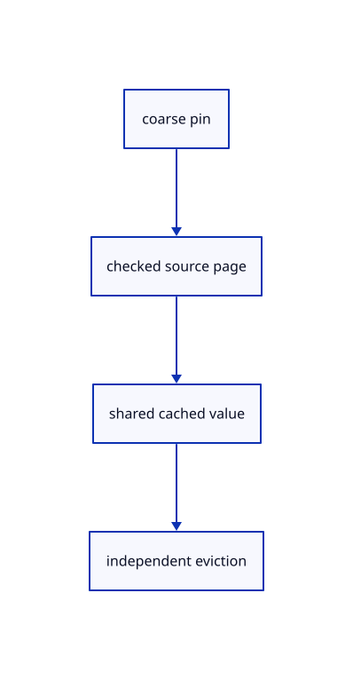

# 12.3.12 · Pin coarse pages and adopt checked ranges

**Chapter 12 · Files and streaming · Section 12.3 · Streaming page budgets and rendering** · [Contents](contents.md)

**Typing: 22–43 minutes.** [Estimate](typing-load.md).

Keep a coarse source page available after detailed eviction. Refuse overlapping retained ranges and repeated original IDs.

## Type

Continue from [Keep independent streamed placements](68i-keep-independent-streamed-placements.md). [Save or recover your work](recovery.md).

### 1. `src/range_cloud.rs`

Adopt checked original pages and retain a coarse fallback.

<details>
<summary>Locate the existing block</summary>

```rust
        Ok(Rc::new(Self {source,nodes:Rc::new(nodes),bounds:Bounds {min,max},pages:RefCell::new(Cache::new(budget)),root:RefCell::new(None),generation:RefCell::new(Default::default()),loaded:std::cell::Cell::new(0)}))
    }
}
```

</details>

Edit the existing block to match this code; keep unchanged lines:

```rust
--8<-- "journey/code/68j-pin-coarse-pages-and-adopt-checked-ranges-01.rs"
```

<details>
<summary>Supplied validation fixture</summary>

Copy this supplied authoring fixture once. Continue with the browser build below; the course does not require running native tests.

### 2. `src/range_cloud.rs`

Copy source descriptor, page identity and lifetime fixtures.

<details>
<summary>Locate the existing block</summary>

```text
        for x in [bounds.min[0],bounds.max[0]] {for y in [bounds.min[1],bounds.max[1]] {for z in [bounds.min[2],bounds.max[2]] {let p=self.model.transform_point(&session_rust::Point::new(x,y,z));result.include([p[0],p[1],p[2]]);}}}result
    }
}
```

</details>

After that block, append this supplied code:

```text
--8<-- "journey/code/68j-pin-coarse-pages-and-adopt-checked-ranges-02.rs" skip=246
```

</details>

## Run and check

Run this from `session_viewer` to select the fixed dependency versions and install supplied binary assets. It updates Cargo.lock and preserves the previous lock. It does not write implementation code:

```sh
npm --prefix ../session_tests run course -- dependencies 12.3.12
```

In your project:

```sh
cd workspace/journey
REGEN_PROTO=0 cargo build --lib --locked --target wasm32-unknown-unknown -j1
REGEN_PROTO=0 CARGO_BUILD_JOBS=1 trunk serve --port 8780
```

Open `http://127.0.0.1:8780/`. Keep an existing Trunk server running; saving rebuilds it.


### Recorded visual result

**Previous native render — current verification pending.**

The mixed original CAD, surface and coloured cloud scene remains visible.


*This recorded image predates a source or checker change. Rebuild this checkpoint before using it as current evidence; browser controls require separate acceptance.*

This reference image is shared with [12.1.44 · Connect browser save open and URL adoption](66af-connect-browser-save-open-url-adoption.md). It does not demonstrate a new feature by itself.

<details>
<summary>Code explanation and diagram</summary>


coarse pin → checked source page → shared cached value → independent eviction.



Can eviction make the complete source disappear?

The pinned coarse page remains available. Detailed pages may leave the cache while external owners retain their charges.

Study estimate, including typing and experiments: 0.5–1 hours.

</details>

<details>
<summary>Optional experiment</summary>

Inspect original ID/precision, overlap refusal, unversioned source and retained-charge cleanup fixtures.

</details>

<details>
<summary>Check and save your work</summary>

Restore experimental edits, then run from `session_viewer`:

```sh
npm --prefix ../session_tests run course -- check 12.3.12
npm --prefix ../session_tests run course -- save 12.3.12
```

Source comparison leaves your project untouched. [Save and recovery instructions](recovery.md).

</details>

<details>
<summary>Viewer coverage and verification</summary>


The existing mixed original archive browser exercise remains authored and unrun. The final cache endpoint adds real ranged URL loading, response validation, cancellation and cleanup exercises, also awaiting browser execution.

[Full validation scope](release.md).

To reproduce the scripted acceptance of the reference checkpoint, run from `session_viewer` with the [course bundle server](release.md#reproduce) running on port 8781:

```sh
npm --prefix ../session_tests run course -- capture 12.3.12
```

This uses the verified reference bundle; it does not check or change your typed project.

</details>
