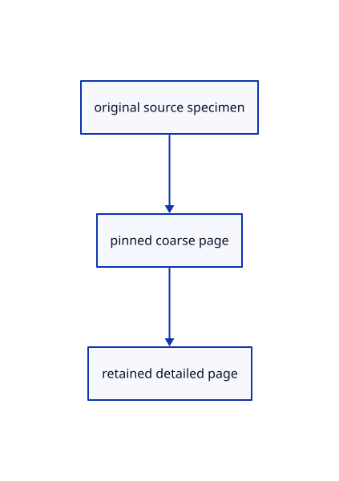

# 12.3.13 · Supply coarse and detailed page specimens

**Chapter 12 · Files and streaming · Section 12.3 · Streaming page budgets and rendering** · [Contents](contents.md)

**Typing: 1–1 minutes.** [Estimate](typing-load.md).

Copy original page specimens with exact coordinates, colour words and full-u32 point identities.

## Type

Continue from [Pin coarse pages and adopt checked ranges](68j-pin-coarse-pages-and-adopt-checked-ranges.md). [Save or recover your work](recovery.md).

<details>
<summary>Supplied example data</summary>

Copy this supplied data once; it is excluded from the typing estimate.

### 1. `src/range_example.rs`

Copy source-page rendering and ownership specimens.

Copy this supplied file:

```text
--8<-- "journey/code/68k-supply-coarse-and-detailed-page-specimens-01.rs"
```

</details>

### 2. `src/lib.rs`

Register the source component.

<details>
<summary>Locate the existing block</summary>

```rust

pub mod range_cloud;
```

</details>

After that block, type:

```rust
--8<-- "journey/code/68k-supply-coarse-and-detailed-page-specimens-02.rs" skip=22
```

## Run and check

Run this from `session_viewer` to select the fixed dependency versions and install supplied binary assets. It updates Cargo.lock and preserves the previous lock. It does not write implementation code:

```sh
npm --prefix ../session_tests run course -- dependencies 12.3.13
```

In your project:

```sh
cd workspace/journey
REGEN_PROTO=0 cargo build --lib --locked --target wasm32-unknown-unknown -j1
REGEN_PROTO=0 CARGO_BUILD_JOBS=1 trunk serve --port 8780
```

Open `http://127.0.0.1:8780/`. Keep an existing Trunk server running; saving rebuilds it.


### Recorded visual result

**Previous native render — current verification pending.**

The mixed original CAD, surface and coloured cloud scene remains visible.


*This recorded image predates a source or checker change. Rebuild this checkpoint before using it as current evidence; browser controls require separate acceptance.*

This reference image is shared with [12.1.44 · Connect browser save open and URL adoption](66af-connect-browser-save-open-url-adoption.md). It does not demonstrate a new feature by itself.

<details>
<summary>Code explanation and diagram</summary>


original source specimen → pinned coarse page → retained detailed page.



Are these specimens evidence of browser network reads?

No. They isolate original page ownership and rendering. Actual HTTP ranges are exercised by the later browser contract.

Study estimate, including typing and experiments: 0.5–1 hours.

</details>

<details>
<summary>Optional experiment</summary>

Compare original IDs10,11,4294967295 and16777217 across their two page ranges.

</details>

<details>
<summary>Check and save your work</summary>

Restore experimental edits, then run from `session_viewer`:

```sh
npm --prefix ../session_tests run course -- check 12.3.13
npm --prefix ../session_tests run course -- save 12.3.13
```

Source comparison leaves your project untouched. [Save and recovery instructions](recovery.md).

</details>

<details>
<summary>Viewer coverage and verification</summary>


The existing mixed original archive browser exercise remains authored and unrun. The final cache endpoint adds real ranged URL loading, response validation, cancellation and cleanup exercises, also awaiting browser execution.

[Full validation scope](release.md).

To reproduce the scripted acceptance of the reference checkpoint, run from `session_viewer` with the [course bundle server](release.md#reproduce) running on port 8781:

```sh
npm --prefix ../session_tests run course -- capture 12.3.13
```

This uses the verified reference bundle; it does not check or change your typed project.

</details>
