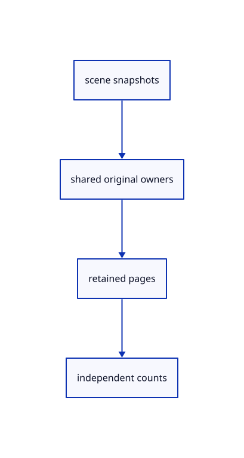

# 12.3.17 · Account for original and retained source data

**Chapter 12 · Files and streaming · Section 12.3 · Streaming page budgets and rendering** · [Contents](contents.md)

**Typing: 6–12 minutes.** [Estimate](typing-load.md).

Count shared originals once and distinguish full source point count from charged retained page payload.

## Type

Continue from [Resolve compact picks to original point IDs](68n-resolve-compact-picks-to-original-point-ids.md). [Save or recover your work](recovery.md).

### 1. `src/memory.rs`

Count shared streamed sources and retained payload separately.

<details>
<summary>Locate the existing block</summary>

```rust
    usage[1]=seen.len();usage
}
```

</details>

After that block, type:

```rust
--8<-- "journey/code/68o-account-for-original-and-retained-source-data-01.rs" skip=32
```

<details>
<summary>Supplied validation fixture</summary>

Copy this supplied authoring fixture once. Continue with the browser build below; the course does not require running native tests.

### 2. `src/stream_row_tests.rs`

Copy streamed identity, placement, accounting and lifetime regressions.

Copy this supplied file:

```text
--8<-- "journey/code/68o-account-for-original-and-retained-source-data-02.rs"
```

</details>

### 3. `src/lib.rs`

Register the source component.

<details>
<summary>Locate the existing block</summary>

```rust

pub mod range_example;
```

</details>

After that block, type:

```rust
--8<-- "journey/code/68o-account-for-original-and-retained-source-data-03.rs" skip=24
```

<details>
<summary>Supplied validation fixture</summary>

Copy this supplied authoring fixture once. Continue with the browser build below; the course does not require running native tests.

### 4. `src/lib.rs`

Keep regression fixtures outside browser builds.

<details>
<summary>Locate the existing block</summary>

```text
pub mod range_example;

pub mod stream_row_tests;
```

</details>

Update the existing block with this supplied code; keep unchanged lines:

```text
--8<-- "journey/code/68o-account-for-original-and-retained-source-data-04.rs"
```

</details>

## Run and check

Run this from `session_viewer` to select the fixed dependency versions and install supplied binary assets. It updates Cargo.lock and preserves the previous lock. It does not write implementation code:

```sh
npm --prefix ../session_tests run course -- dependencies 12.3.17
```

In your project:

```sh
cd workspace/journey
REGEN_PROTO=0 cargo build --lib --locked --target wasm32-unknown-unknown -j1
REGEN_PROTO=0 CARGO_BUILD_JOBS=1 trunk serve --port 8780
```

Open `http://127.0.0.1:8780/`. Keep an existing Trunk server running; saving rebuilds it.


### Recorded visual result

**Previous native render — current verification pending.**

The mixed original CAD, surface and coloured cloud scene remains visible.


*This recorded image predates a source or checker change. Rebuild this checkpoint before using it as current evidence; browser controls require separate acceptance.*

This reference image is shared with [12.2.1 · Bound scalar headers and byte addresses](67-supply-checked-array-layout-readers.md). It does not demonstrate a new feature by itself.

<details>
<summary>Code explanation and diagram</summary>


scene snapshots → shared original owners → retained pages → independent counts.



Does the retained page count equal the complete original point count?

Only when every point is retained. The full original count survives eviction and shared snapshots do not duplicate payload accounting.

Study estimate, including typing and experiments: 0.5–1 hours.

</details>

<details>
<summary>Optional experiment</summary>

Inspect shared row, original ID, coarse fallback, incomplete Save, Select All and Close fixtures.

</details>

<details>
<summary>Check and save your work</summary>

Restore experimental edits, then run from `session_viewer`:

```sh
npm --prefix ../session_tests run course -- check 12.3.17
npm --prefix ../session_tests run course -- save 12.3.17
```

Source comparison leaves your project untouched. [Save and recovery instructions](recovery.md).

</details>

<details>
<summary>Viewer coverage and verification</summary>


The existing mixed original archive browser exercise remains authored and unrun. The final cache endpoint adds real ranged URL loading, response validation, cancellation and cleanup exercises, also awaiting browser execution.

[Full validation scope](release.md).

To reproduce the scripted acceptance of the reference checkpoint, run from `session_viewer` with the [course bundle server](release.md#reproduce) running on port 8781:

```sh
npm --prefix ../session_tests run course -- capture 12.3.17
```

This uses the verified reference bundle; it does not check or change your typed project.

</details>
