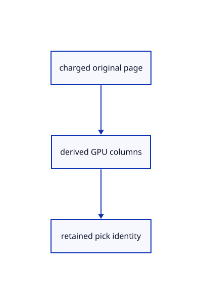

# 12.3.19 · Retain page owners beside GPU buffers

**Chapter 12 · Files and streaming · Section 12.3 · Streaming page budgets and rendering** · [Contents](contents.md)

**Typing: 10–20 minutes.** [Estimate](typing-load.md).

Upload derived positions and original colour/normal words. Retain precise page identity while the GPU still uses it.

## Type

Continue from [Keep original attributes in ranged pages](68p-keep-original-attributes-in-ranged-pages.md). [Save or recover your work](recovery.md).

### 1. `src/cloud_gpu.rs`

Retain charged original page owners with their derived GPU columns.

Edit these blocks from bottom to top. Keep the surrounding lines unchanged.

<details>
<summary>Locate this block</summary>

```rust
      .flat_map(u32::to_ne_bytes)
      .collect::<Vec<_>>();
    Ok(Self {
      positions: buffer(&ctx.device, "original cloud positions", &positions),
      colors: buffer(&ctx.device, "original cloud colors", &colors),
      normals: buffer(&ctx.device, "original cloud normals", &normals),
      has_normals,
    })
  }
  fn bytes(&self) -> u64 {
    self.positions.size() + self.colors.size() + self.normals.size()
  }
```

</details>

Replace it with:

```rust
      .flat_map(u32::to_ne_bytes)
      .collect::<Vec<_>>();
    Ok(Self {
      _page:None,
      positions: buffer(&ctx.device, "original cloud positions", &positions),
      colors: buffer(&ctx.device, "original cloud colors", &colors),
      normals: buffer(&ctx.device, "original cloud normals", &normals),
      has_normals,
    })
  }
  fn page(ctx:&GpuCtx,held:Rc<crate::page_cache::Held<crate::range_page::Page>>)->Result<Self,&'static str> {
    let page=&held.value;let count=page.rows.end-page.rows.start;
    if u64::from(count)*12>u64::from(ctx.device.limits().max_storage_buffer_binding_size) {return Err("Cloud page exceeds the device storage binding limit");}
    let positions=page.display.iter().flat_map(|value|value.to_ne_bytes()).collect::<Vec<_>>();let colors=(0..count as usize).flat_map(|i|page.colors.get(i).copied().unwrap_or(0xff00_0000).to_ne_bytes()).collect::<Vec<_>>();let normals=page.normals.iter().flat_map(|v|v.to_ne_bytes()).collect::<Vec<_>>();
    Ok(Self {positions:buffer(&ctx.device,"streamed source positions",&positions),colors:buffer(&ctx.device,"streamed source colours",&colors),normals:buffer(&ctx.device,"streamed source normals",&normals),has_normals:!page.normals.is_empty(),_page:Some(held)})
  }
  fn bytes(&self) -> u64 {
    self.positions.size() + self.colors.size() + self.normals.size()
  }
```

<details>
<summary>Locate this block</summary>

```rust
  }
}
struct Columns {
  positions: wgpu::Buffer,
  colors: wgpu::Buffer,
  normals: wgpu::Buffer,
```

</details>

Replace it with:

```rust
  }
}
struct Columns {
  _page:Option<Rc<crate::page_cache::Held<crate::range_page::Page>>>,
  positions: wgpu::Buffer,
  colors: wgpu::Buffer,
  normals: wgpu::Buffer,
```

<details>
<summary>Complete updated block reference</summary>

```rust
use crate::{
  cloud::Row,
  cloud_lod::{LodWalk, Projection},
  text_gpu_support::{GpuCtx, resource_group},
};
use std::{collections::HashMap, rc::Rc};
use wgpu::util::DeviceExt;
const MAX_RECORDS: usize = 4096;

#[derive(Clone, Copy)]
pub struct View {
  pub eye: [f32; 3],
  pub ortho_h: f32,
  pub lod_px: f32,
}
impl Default for View {
  fn default() -> Self {
    Self { eye: [0., 0., 3.], ortho_h: 0., lod_px: 2. }
  }
}
impl View {
  pub fn camera(camera: &crate::camera::Camera) -> Self {
    let forward = camera.orientation.rotate_vector(session_rust::Vector::y_axis());
    Self {
      eye: std::array::from_fn(|i| (camera.target[i] - forward[i] * camera.distance) as f32),
      ortho_h: if camera.projection == crate::camera::Projection::Orthographic {
        (camera.distance * std::f64::consts::FRAC_PI_6.tan()) as f32
      } else {
        0.
      },
      lod_px: 2.,
    }
  }
}
struct Columns {
  _page:Option<Rc<crate::page_cache::Held<crate::range_page::Page>>>,
  positions: wgpu::Buffer,
  colors: wgpu::Buffer,
  normals: wgpu::Buffer,
  has_normals: bool,
}
impl Columns {
  fn new(ctx: &GpuCtx, row: &Row) -> Result<Self, &'static str> {
    let source = &row.prepared.source;
    let count = source.len();
    let limit = ctx.device.limits().max_storage_buffer_binding_size as usize;
    if count.checked_mul(12).is_none_or(|n| n > limit) {
      return Err("Cloud positions exceed this device's storage binding limit");
    }
    let positions = source.coords().iter().flat_map(|v| (*v as f32).to_ne_bytes()).collect::<Vec<_>>();
    let colors = (0..count)
      .map(|i| {
        if source.colors().is_empty() {
          0xff00_0000
        } else {
          let c = &source.colors()[i * 4..i * 4 + 4];
          (c[0] as u32) | (c[1] as u32) << 8 | (c[2] as u32) << 16 | (c[3] as u32) << 24
        }
      })
      .flat_map(u32::to_ne_bytes)
      .collect::<Vec<_>>();
    let has_normals = !source.normals().is_empty();
    let normals = source
      .normals()
      .chunks_exact(3)
      .map(|n| crate::cloud_normals::oct16(&[n[0], n[1], n[2]]).unwrap_or(0))
      .flat_map(u32::to_ne_bytes)
      .collect::<Vec<_>>();
    Ok(Self {
      _page:None,
      positions: buffer(&ctx.device, "original cloud positions", &positions),
      colors: buffer(&ctx.device, "original cloud colors", &colors),
      normals: buffer(&ctx.device, "original cloud normals", &normals),
      has_normals,
    })
  }
  fn page(ctx:&GpuCtx,held:Rc<crate::page_cache::Held<crate::range_page::Page>>)->Result<Self,&'static str> {
    let page=&held.value;let count=page.rows.end-page.rows.start;
    if u64::from(count)*12>u64::from(ctx.device.limits().max_storage_buffer_binding_size) {return Err("Cloud page exceeds the device storage binding limit");}
    let positions=page.display.iter().flat_map(|value|value.to_ne_bytes()).collect::<Vec<_>>();let colors=(0..count as usize).flat_map(|i|page.colors.get(i).copied().unwrap_or(0xff00_0000).to_ne_bytes()).collect::<Vec<_>>();let normals=page.normals.iter().flat_map(|v|v.to_ne_bytes()).collect::<Vec<_>>();
    Ok(Self {positions:buffer(&ctx.device,"streamed source positions",&positions),colors:buffer(&ctx.device,"streamed source colours",&colors),normals:buffer(&ctx.device,"streamed source normals",&normals),has_normals:!page.normals.is_empty(),_page:Some(held)})
  }
  fn bytes(&self) -> u64 {
    self.positions.size() + self.colors.size() + self.normals.size()
  }
}
fn buffer(device: &wgpu::Device, label: &str, bytes: &[u8]) -> wgpu::Buffer {
  device.create_buffer_init(&wgpu::util::BufferInitDescriptor {
    label: Some(label),
    contents: if bytes.is_empty() { &[0; 4] } else { bytes },
    usage: wgpu::BufferUsages::STORAGE,
  })
}
struct Draw {
  row: Row,
  columns: Rc<Columns>,
  records: wgpu::Buffer,
  group: wgpu::BindGroup,
  visible: bool,
  pickable: bool,
  selected: bool,
  color: Option<[u8; 3]>,
  total: u32,
}
struct Image {
  texture: wgpu::Texture,
  view: wgpu::TextureView,
  bytes: u64,
}
impl Image {
  fn new(device: &wgpu::Device, size: [u32; 2], format: wgpu::TextureFormat, bytes: u64) -> Self {
    let texture = device.create_texture(&wgpu::TextureDescriptor {
      label: Some("cached cloud image"),
      size: wgpu::Extent3d { width: size[0], height: size[1], depth_or_array_layers: 1 },
      mip_level_count: 1,
      sample_count: 1,
      dimension: wgpu::TextureDimension::D2,
      format,
      usage: wgpu::TextureUsages::RENDER_ATTACHMENT | wgpu::TextureUsages::TEXTURE_BINDING,
      view_formats: &[],
    });
    let view = texture.create_view(&Default::default());
    Self { texture, view, bytes: bytes * size[0] as u64 * size[1] as u64 }
  }
}
impl Drop for Image {
  fn drop(&mut self) {
    self.texture.destroy();
  }
}
struct Targets {
  color: Image,
  depth: Image,
  ids: Image,
  size: [u32; 2],
  group: wgpu::BindGroup,
}
#[derive(PartialEq)]
struct Key {
  transform: [f32; 16],
  size: [u32; 2],
  density: u32,
  eye: [u32; 3],
  ortho: u32,
  lod: u32,
  revision: u64,
}

pub struct Lane {
  point: wgpu::RenderPipeline,
  resolve: wgpu::RenderPipeline,
  pick: wgpu::RenderPipeline,
  settings: wgpu::Buffer,
  settings_group: wgpu::BindGroup,
  columns_layout: wgpu::BindGroupLayout,
  image_layout: wgpu::BindGroupLayout,
  window: wgpu::Buffer,
  window_group: wgpu::BindGroup,
  draws: Vec<Draw>,
  targets: Option<Targets>,
  key: Option<Key>,
  revision: u64,
  pub uploads: u64,
  pub preparations: u64,
  pub skips: u64,
  pub total: u64,
}
impl Lane {
  pub fn new(ctx: &GpuCtx, format: wgpu::TextureFormat) -> Self {
    let layouts = layouts(ctx);
    let make_buffer = |label, size| {
      ctx.device.create_buffer(&wgpu::BufferDescriptor {
        label: Some(label),
        size,
        usage: wgpu::BufferUsages::UNIFORM | wgpu::BufferUsages::COPY_DST,
        mapped_at_creation: false,
      })
    };
    let settings = make_buffer("cloud frame settings", 48);
    let settings_group =
      resource_group(ctx, &layouts.uniform, "cloud frame settings", [(0, settings.as_entire_binding())]);
    let window = make_buffer("cloud pick origin", 16);
    let window_group = resource_group(ctx, &layouts.window, "cloud pick origin", [(0, window.as_entire_binding())]);
    let [point, resolve, pick] = pipelines(ctx, format, &layouts);
    Self {
      point,
      resolve,
      pick,
      settings,
      settings_group,
      columns_layout: layouts.columns,
      image_layout: layouts.image,
      window,
      window_group,
      draws: Vec::new(),
      targets: None,
      key: None,
      revision: 0,
      uploads: 0,
      preparations: 0,
      skips: 0,
      total: 0,
    }
  }
  pub fn set_scene(
    &mut self,
    ctx: &GpuCtx,
    scene: &crate::scene::Scene,
    selected: &[crate::scene::ObjectId],
  ) -> Result<(), &'static str> {
    let mut cache: HashMap<usize, Rc<Columns>> =
      self.draws.iter().map(|d| (Rc::as_ptr(&d.row.prepared.source) as usize, d.columns.clone())).collect();
    let mut old = std::mem::take(&mut self.draws);
    let mut draws = Vec::with_capacity(scene.clouds().len());
    for row in scene.clouds() {
      let address = Rc::as_ptr(&row.prepared.source) as usize;
      let columns = if let Some(columns) = cache.get(&address) {
        columns.clone()
      } else {
        let columns = Rc::new(Columns::new(ctx, row)?);
        self.uploads += 1;
        cache.insert(address, columns.clone());
        columns
      };
      let (records, group) =
        if let Some(i) = old.iter().position(|d| d.row.id == row.id && Rc::ptr_eq(&d.columns, &columns)) {
          let d = old.swap_remove(i);
          (d.records, d.group)
        } else {
          let records = ctx.device.create_buffer(&wgpu::BufferDescriptor {
            label: Some("bounded cloud draw records"),
            size: 16,
            usage: wgpu::BufferUsages::STORAGE | wgpu::BufferUsages::COPY_DST,
            mapped_at_creation: false,
          });
          let group = resource_group(
            ctx,
            &self.columns_layout,
            "cloud source and records",
            [
              (0, records.as_entire_binding()),
              (1, columns.positions.as_entire_binding()),
              (2, columns.colors.as_entire_binding()),
              (3, columns.normals.as_entire_binding()),
            ],
          );
          (records, group)
        };
      draws.push(Draw {
        row: row.clone(),
        columns,
        records,
        group,
        visible: scene.visible(row.id),
        pickable: scene.pick_id(row.id.value()).is_some(),
        selected: selected.contains(&row.id),
        color: scene.view.faces.get(&row.id).copied(),
        total: 0,
      });
    }
    self.draws = draws;
    self.revision = self.revision.wrapping_add(1);
    self.key = None;
    Ok(())
  }
  fn records(
    &mut self,
    ctx: &GpuCtx,
    transform: [f32; 16],
    size: [u32; 2],
    density: f32,
    view: View,
  ) -> Result<(), &'static str> {
    let mut total = 0u64;
    let mut records_used = 0usize;
    let mut walk = LodWalk::default();
    for draw in &mut self.draws {
      draw.total = 0;
      if !draw.visible {
        continue;
      }
      let row = &draw.row;
      let model = row.model.to_f32();
      let projection = Projection {
        eye: view.eye,
        ortho_h: view.ortho_h,
        height_px: size[1],
        lod_px: if row.controls_visible {0.} else {view.lod_px},
        nodes: &row.prepared.nodes,
      };
      walk.select(&projection, &row.prepared.descriptor(), &model);
      records_used += walk.ranges.len();
      if records_used > MAX_RECORDS {
        return Err("Cloud view exceeds the 4096-record budget");
      }
      let (bytes, count) = record_bytes(draw, transform, density, view, &walk.ranges)?;
      draw.total = count;
      if bytes.len() as u64 > draw.records.size() {
        let capacity = walk.ranges.len().next_power_of_two().min(MAX_RECORDS);
        draw.records = ctx.device.create_buffer(&wgpu::BufferDescriptor {
          label: Some("bounded cloud draw records"),
          size: 16 + 160 * capacity as u64,
          usage: wgpu::BufferUsages::STORAGE | wgpu::BufferUsages::COPY_DST,
          mapped_at_creation: false,
        });
        draw.group = resource_group(
          ctx,
          &self.columns_layout,
          "cloud source and records",
          [
            (0, draw.records.as_entire_binding()),
            (1, draw.columns.positions.as_entire_binding()),
            (2, draw.columns.colors.as_entire_binding()),
            (3, draw.columns.normals.as_entire_binding()),
          ],
        );
      }
      ctx.queue.write_buffer(&draw.records, 0, &bytes);
      total += draw.total as u64;
    }
    self.total = total;
    Ok(())
  }
  fn render_points(&self, ctx: &GpuCtx, size: [u32; 2]) {
    let settings = [1., size[0] as f32, size[1] as f32, 0., 0., 0., 0., 0., size[0] as f32, size[1] as f32, 0., 0.];
    ctx.queue.write_buffer(&self.settings, 0, &settings.into_iter().flat_map(f32::to_ne_bytes).collect::<Vec<_>>());
    let t = self.targets.as_ref().unwrap();
    let mut encoder = ctx.device.create_command_encoder(&Default::default());
    {
      let color = |view| {
        Some(wgpu::RenderPassColorAttachment {
          view,
          depth_slice: None,
          resolve_target: None,
          ops: wgpu::Operations { load: wgpu::LoadOp::Clear(wgpu::Color::TRANSPARENT), store: wgpu::StoreOp::Store },
        })
      };
      let mut pass = encoder.begin_render_pass(&wgpu::RenderPassDescriptor {
        label: Some("cached original cloud discs"),
        color_attachments: &[color(&t.color.view), color(&t.ids.view)],
        depth_stencil_attachment: Some(wgpu::RenderPassDepthStencilAttachment {
          view: &t.depth.view,
          depth_ops: Some(wgpu::Operations { load: wgpu::LoadOp::Clear(1.), store: wgpu::StoreOp::Store }),
          stencil_ops: None,
        }),
        ..Default::default()
      });
      pass.set_pipeline(&self.point);
      pass.set_bind_group(0, &self.settings_group, &[]);
      for draw in &self.draws {
        if draw.total > 0 {
          pass.set_bind_group(1, &draw.group, &[]);
          pass.draw(0..6 * draw.total, 0..1);
        }
      }
    }
    ctx.queue.submit([encoder.finish()]);
  }
  pub fn prepare(
    &mut self,
    ctx: &GpuCtx,
    transform: [f32; 16],
    size: [u32; 2],
    density: f32,
    view: View,
  ) -> Result<(), &'static str> {
    let key = Key {
      transform,
      size,
      density: density.to_bits(),
      eye: view.eye.map(f32::to_bits),
      ortho: view.ortho_h.to_bits(),
      lod: view.lod_px.to_bits(),
      revision: self.revision,
    };
    if self.key.as_ref() == Some(&key) {
      self.skips += 1;
      return Ok(());
    }
    self.records(ctx, transform, size, density, view)?;
    if self.targets.as_ref().is_none_or(|t| t.size != size) {
      let color = Image::new(&ctx.device, size, wgpu::TextureFormat::Rgba8Unorm, 4);
      let depth = Image::new(&ctx.device, size, crate::depth::FORMAT, 4);
      let ids = Image::new(&ctx.device, size, wgpu::TextureFormat::Rg32Uint, 8);
      let group = resource_group(
        ctx,
        &self.image_layout,
        "cached cloud pixels",
        [
          (0, wgpu::BindingResource::TextureView(&depth.view)),
          (1, wgpu::BindingResource::TextureView(&color.view)),
          (2, wgpu::BindingResource::TextureView(&ids.view)),
        ],
      );
      self.targets = Some(Targets { color, depth, ids, size, group });
    }
    self.render_points(ctx, size);
    self.key = Some(key);
    self.preparations += 1;
    Ok(())
  }
  pub fn failed(&mut self) {
    self.targets = None;
    self.key = None;
    self.total = 0;
  }
  pub fn draw(&self, pass: &mut wgpu::RenderPass<'_>) {
    let Some(t) = &self.targets else {
      return;
    };
    pass.set_pipeline(&self.resolve);
    pass.set_bind_group(0, &t.group, &[]);
    pass.set_bind_group(1, &self.window_group, &[]);
    pass.draw(0..3, 0..1);
  }
  pub fn pick(
    &self,
    ctx: &GpuCtx,
    pass: &mut wgpu::RenderPass<'_>,
    window: crate::pick_window::Window,
    mode: crate::pick_sources::Mode,
  ) {
    let Some(t) = &self.targets else {
      return;
    };
    let words = [window.draw[0], window.draw[1], mode as u32, 0];
    ctx.queue.write_buffer(&self.window, 0, &words.into_iter().flat_map(u32::to_ne_bytes).collect::<Vec<_>>());
    pass.set_pipeline(&self.pick);
    pass.set_bind_group(0, &t.group, &[]);
    pass.set_bind_group(1, &self.window_group, &[]);
    pass.draw(0..3, 0..1);
  }
  pub fn usage(&self) -> [u64; 5] {
    let mut seen = std::collections::HashSet::new();
    let columns =
      self.draws.iter().filter(|d| seen.insert(Rc::as_ptr(&d.columns))).map(|d| d.columns.bytes()).sum::<u64>();
    let targets = self.targets.as_ref().map_or(0, |t| t.color.bytes + t.depth.bytes + t.ids.bytes);
    [
      self.total,
      columns
        + self.draws.iter().map(|d| d.records.size()).sum::<u64>()
        + targets
        + self.settings.size()
        + self.window.size(),
      self.uploads,
      self.preparations,
      self.skips,
    ]
  }
}
fn pipeline(
  device: &wgpu::Device,
  shader: &wgpu::ShaderModule,
  groups: &[&wgpu::BindGroupLayout],
  vertex: &str,
  fragment: &str,
  formats: &[wgpu::TextureFormat],
) -> wgpu::RenderPipeline {
  let layout = device.create_pipeline_layout(&wgpu::PipelineLayoutDescriptor {
    label: Some(fragment),
    bind_group_layouts: &groups.iter().map(|g| Some(*g)).collect::<Vec<_>>(),
    immediate_size: 0,
  });
  device.create_render_pipeline(&wgpu::RenderPipelineDescriptor {
    label: Some(fragment),
    layout: Some(&layout),
    vertex: wgpu::VertexState {
      module: shader,
      entry_point: Some(vertex),
      buffers: &[],
      compilation_options: Default::default(),
    },
    fragment: Some(wgpu::FragmentState {
      module: shader,
      entry_point: Some(fragment),
      targets: &formats.iter().copied().map(|format| Some(format.into())).collect::<Vec<_>>(),
      compilation_options: Default::default(),
    }),
    primitive: Default::default(),
    depth_stencil: Some(wgpu::DepthStencilState {
      format: crate::depth::FORMAT,
      depth_write_enabled: Some(true),
      depth_compare: Some(wgpu::CompareFunction::LessEqual),
      stencil: Default::default(),
      bias: Default::default(),
    }),
    multisample: Default::default(),
    multiview_mask: None,
    cache: None,
  })
}

struct Layouts {
  uniform: wgpu::BindGroupLayout,
  window: wgpu::BindGroupLayout,
  columns: wgpu::BindGroupLayout,
  image: wgpu::BindGroupLayout,
}
fn layouts(ctx: &GpuCtx) -> Layouts {
  let uniform = crate::gpu_layout::uniform(&ctx.device, 48);
  let window_layout = crate::gpu_layout::uniform(&ctx.device, 16);
  let storage = |binding| wgpu::BindGroupLayoutEntry {
    binding,
    visibility: wgpu::ShaderStages::VERTEX,
    ty: wgpu::BindingType::Buffer {
      ty: wgpu::BufferBindingType::Storage { read_only: true },
      has_dynamic_offset: false,
      min_binding_size: None,
    },
    count: None,
  };
  let columns_layout = ctx.device.create_bind_group_layout(&wgpu::BindGroupLayoutDescriptor {
    label: Some("cloud source columns and bounded records"),
    entries: &[storage(0), storage(1), storage(2), storage(3)],
  });
  let texture = |binding, sample_type| {
    crate::text_gpu_support::texture_entry(binding, wgpu::ShaderStages::FRAGMENT, sample_type, false)
  };
  let image_layout = ctx.device.create_bind_group_layout(&wgpu::BindGroupLayoutDescriptor {
    label: Some("cached cloud images"),
    entries: &[
      texture(0, wgpu::TextureSampleType::Depth),
      texture(1, wgpu::TextureSampleType::Float { filterable: false }),
      texture(2, wgpu::TextureSampleType::Uint),
    ],
  });
  Layouts { uniform, window: window_layout, columns: columns_layout, image: image_layout }
}
fn pipelines(ctx: &GpuCtx, format: wgpu::TextureFormat, layouts: &Layouts) -> [wgpu::RenderPipeline; 3] {
  let shader = ctx.device.create_shader_module(wgpu::ShaderModuleDescriptor {
    label: Some("current production cloud discs"),
    source: wgpu::ShaderSource::Wgsl(include_str!("cloud_points.wgsl").into()),
  });
  let resolver = ctx.device.create_shader_module(wgpu::ShaderModuleDescriptor {
    label: Some("forward-depth cloud resolve"),
    source: wgpu::ShaderSource::Wgsl(include_str!("cloud_resolve.wgsl").into()),
  });
  let point = pipeline(
    &ctx.device,
    &shader,
    &[&layouts.uniform, &layouts.columns],
    "vs_point",
    "fs_point",
    &[wgpu::TextureFormat::Rgba8Unorm, wgpu::TextureFormat::Rg32Uint],
  );
  let resolve = pipeline(&ctx.device, &resolver, &[&layouts.image, &layouts.window], "vertex", "color", &[format]);
  let pick = pipeline(
    &ctx.device,
    &resolver,
    &[&layouts.image, &layouts.window],
    "vertex",
    "pick",
    &[wgpu::TextureFormat::Rg32Uint],
  );
  [point, resolve, pick]
}

fn record_bytes(
  draw: &Draw,
  transform: [f32; 16],
  density: f32,
  view: View,
  ranges: &[crate::cloud_lod::Range],
) -> Result<(Vec<u8>, u32), &'static str> {
  let row = &draw.row;
  let source = &row.prepared.source;
  let model = row.model.to_f32();
  let scale = row.model.uniform_scale();
  let mut total = 0u32;
  let m = (&session_rust::Xform::from_matrix(transform.map(f64::from)) * &row.model).to_f32();
  let rot = [
    model[0], model[1], model[2], model[12], model[4], model[5], model[6], model[13], model[8], model[9], model[10],
    model[14],
  ];
  let rgb = draw.color.map_or([1., 1., 1.], |c| c.map(|v| v as f32 / 255.));
  let px = if row.point_px > 0. { row.point_px } else { source.point_size as f32 };
  let flags = u32::from(draw.selected) | if draw.color.is_some() { 256 } else { 0 };
  let instance = if draw.pickable { row.id.value() - 1 } else { u32::MAX };
  let mut bytes = vec![0; 16];
  for range in ranges {
    let cumulative = total;
    total = total
      .checked_add(range.count)
      .filter(|n| *n <= u32::MAX / 6)
      .ok_or("Cloud vertex count exceeds the draw limit")?;
    let words = m
      .map(f32::to_bits)
      .into_iter()
      .chain([rgb[0].to_bits(), rgb[1].to_bits(), rgb[2].to_bits(), (px * density * 0.5).max(0.5).to_bits()])
      .chain([range.first, range.count, cumulative, radius_factor(range, px, scale, view.ortho_h).to_bits()])
      .chain(rot.map(f32::to_bits))
      .chain([if draw.columns.has_normals { range.first } else { u32::MAX }, instance, flags, 0]);
    bytes.extend(words.flat_map(u32::to_ne_bytes));
  }
  bytes[..4].copy_from_slice(&(ranges.len() as u32).to_ne_bytes());
  bytes[4..8].copy_from_slice(&total.to_ne_bytes());
  Ok((bytes, total))
}

pub fn radius_factor(range: &crate::cloud_lod::Range, px: f32, scale: f64, ortho_h: f32) -> f32 {
  crate::cloud_lod::radius_factor(range, px, scale, ortho_h) * if ortho_h > 0. { 1. } else { 1000. }
}
```

</details>

<details>
<summary>Optional patch references</summary>

Use these original edit fragments when comparing a saved checkpoint. Apply the complete blocks above.

```text
--8<-- "journey/code/68q-retain-page-owners-beside-gpu-buffers-01.rs"
```

```text
--8<-- "journey/code/68q-retain-page-owners-beside-gpu-buffers-02.rs"
```

```text
--8<-- "journey/code/68q-retain-page-owners-beside-gpu-buffers-03.rs"
```

</details>

## Run and check

Run this from `session_viewer` to select the fixed dependency versions and install supplied binary assets. It updates Cargo.lock and preserves the previous lock. It does not write implementation code:

```sh
npm --prefix ../session_tests run course -- dependencies 12.3.19
```

In your project:

```sh
cd workspace/journey
REGEN_PROTO=0 cargo build --lib --locked --target wasm32-unknown-unknown -j1
REGEN_PROTO=0 CARGO_BUILD_JOBS=1 trunk serve --port 8780
```

Open `http://127.0.0.1:8780/`. Keep an existing Trunk server running; saving rebuilds it.


### Recorded visual result

**Previous native render — current verification pending.**

The mixed original CAD, surface and coloured cloud scene remains visible.


*This recorded image predates a source or checker change. Rebuild this checkpoint before using it as current evidence; browser controls require separate acceptance.*

This reference image is shared with [12.1.44 · Connect browser save open and URL adoption](66af-connect-browser-save-open-url-adoption.md). It does not demonstrate a new feature by itself.

<details>
<summary>Code explanation and diagram</summary>


charged original page → derived GPU columns → retained pick identity.



Can evicting a CPU cache entry invalidate an active GPU address?

The GPU columns retain the original page. Redrawing drops old column owners and cancels picks before compact addresses are reused.

Study estimate, including typing and experiments: 0.5–1 hours.

</details>

<details>
<summary>Optional experiment</summary>

Trace the page owner across cache removal, renderer synchronization and final release.

</details>

<details>
<summary>Check and save your work</summary>

Restore experimental edits, then run from `session_viewer`:

```sh
npm --prefix ../session_tests run course -- check 12.3.19
npm --prefix ../session_tests run course -- save 12.3.19
```

Source comparison leaves your project untouched. [Save and recovery instructions](recovery.md).

</details>

<details>
<summary>Viewer coverage and verification</summary>


The existing mixed original archive browser exercise remains authored and unrun. The final cache endpoint adds real ranged URL loading, response validation, cancellation and cleanup exercises, also awaiting browser execution.

[Full validation scope](release.md).

To reproduce the scripted acceptance of the reference checkpoint, run from `session_viewer` with the [course bundle server](release.md#reproduce) running on port 8781:

```sh
npm --prefix ../session_tests run course -- capture 12.3.19
```

This uses the verified reference bundle; it does not check or change your typed project.

</details>
