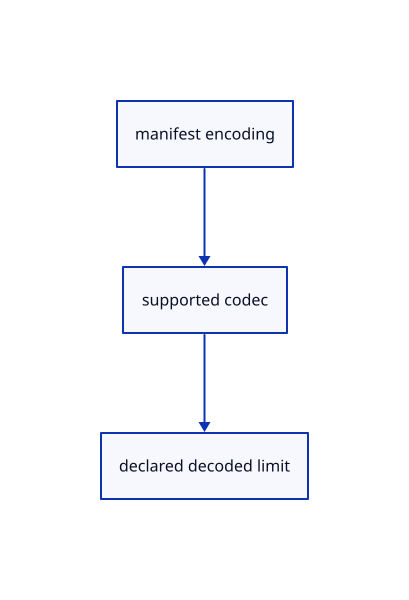

# 12.3.22 · Validate encoded source metadata

**Chapter 12 · Files and streaming · Section 12.3 · Streaming page budgets and rendering** · [Contents](contents.md)

**Typing: 9–17 minutes.** [Estimate](typing-load.md).

Require a supported codec and bounded declared decoded size before reading an encoded source.

## Type

Continue from [Draw shared source pages at independent placements](68s-draw-shared-source-pages-at-independent-placements.md). [Save or recover your work](recovery.md).

### 1. `src/source_encoding.rs`

Validate supported source encodings and exact decoded size.

Create the file and type:

```rust
--8<-- "journey/code/68t-validate-encoded-source-metadata-01.rs"
```

### 2. `src/lib.rs`

Register the source component.

<details>
<summary>Locate the existing block</summary>

```rust
#[cfg(test)]
mod stream_row_tests;
```

</details>

After that block, type:

```rust
--8<-- "journey/code/68t-validate-encoded-source-metadata-02.rs" skip=35
```

<details>
<summary>Supplied validation fixture</summary>

Copy this supplied authoring fixture once. Continue with the browser build below; the course does not require running native tests.

### 3. `src/source_encoding.rs`

Copy encoded size and codec refusal fixtures.

<details>
<summary>Locate the existing block</summary>

```text
        if bytes>crate::archive::LIMIT||self.decoded.is_some_and(|size|size!=bytes) {return Err("Decoded source size does not match its manifest".into());}Ok(())
    }
}
```

</details>

After that block, append this supplied code:

```text
--8<-- "journey/code/68t-validate-encoded-source-metadata-03.rs" skip=169
```

</details>

## Run and check

Run this from `session_viewer` to select the fixed dependency versions and install supplied binary assets. It updates Cargo.lock and preserves the previous lock. It does not write implementation code:

```sh
npm --prefix ../session_tests run course -- dependencies 12.3.22
```

In your project:

```sh
cd workspace/journey
REGEN_PROTO=0 cargo build --lib --locked --target wasm32-unknown-unknown -j1
REGEN_PROTO=0 CARGO_BUILD_JOBS=1 trunk serve --port 8780
```

Open `http://127.0.0.1:8780/`. Keep an existing Trunk server running; saving rebuilds it.


### Recorded visual result

**Previous native render — current verification pending.**

The mixed original CAD, surface and coloured cloud scene remains visible.


*This recorded image predates a source or checker change. Rebuild this checkpoint before using it as current evidence; browser controls require separate acceptance.*

This reference image is shared with [12.1.44 · Connect browser save open and URL adoption](66af-connect-browser-save-open-url-adoption.md). It does not demonstrate a new feature by itself.

<details>
<summary>Code explanation and diagram</summary>


manifest encoding → supported codec → declared decoded limit.



Can an encoded source omit its decoded byte limit?

No. Require a positive bounded size and match the decoded byte count exactly.

Study estimate, including typing and experiments: 0.5–1 hours.

</details>

<details>
<summary>Optional experiment</summary>

Refuse an unsupported codec, zero or oversized limit and mismatched decoded length.

</details>

<details>
<summary>Check and save your work</summary>

Restore experimental edits, then run from `session_viewer`:

```sh
npm --prefix ../session_tests run course -- check 12.3.22
npm --prefix ../session_tests run course -- save 12.3.22
```

Source comparison leaves your project untouched. [Save and recovery instructions](recovery.md).

</details>

<details>
<summary>Viewer coverage and verification</summary>


The existing mixed original archive browser exercise remains authored and unrun. The final cache endpoint adds real ranged URL loading, response validation, cancellation and cleanup exercises, also awaiting browser execution.

[Full validation scope](release.md).

To reproduce the scripted acceptance of the reference checkpoint, run from `session_viewer` with the [course bundle server](release.md#reproduce) running on port 8781:

```sh
npm --prefix ../session_tests run course -- capture 12.3.22
```

This uses the verified reference bundle; it does not check or change your typed project.

</details>
