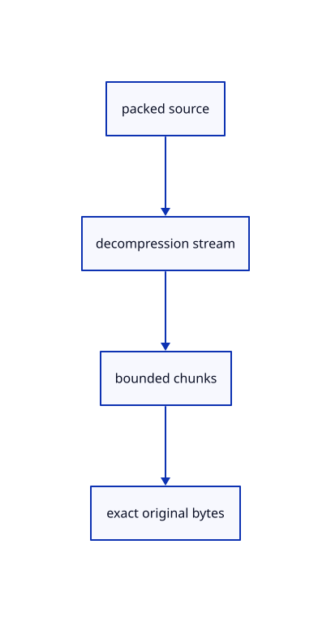

# 12.3.23 · Decode bounded cancellable source streams

**Chapter 12 · Files and streaming · Section 12.3 · Streaming page budgets and rendering** · [Contents](contents.md)

**Typing: 23–45 minutes.** [Estimate](typing-load.md).

Read decompressed chunks under the declared byte limit. Cancel the reader and release its lock on failed work.

## Type

Continue from [Validate encoded source metadata](68t-validate-encoded-source-metadata.md). [Save or recover your work](recovery.md).

### 1. `Cargo.toml`

Copy the pinned browser stream dependency configuration.

<details>
<summary>Locate the existing block</summary>

```text
[package]
name = "viewer_journey"
version = "0.1.0"
edition = "2024"

[lib]
crate-type = ["cdylib", "rlib"]

[workspace]

[dependencies]
wasm-bindgen = "=0.2.128"
web-sys = { version = "=0.3.105", features = ["console", "Window", "Document", "Element", "HtmlCanvasElement", "EventTarget", "AddEventListenerOptions", "PageTransitionEvent", "ErrorEvent", "PromiseRejectionEvent", "Location", "History", "UrlSearchParams", "Navigator", "Storage", "Performance", "PerformanceResourceTiming", "PerformanceEntry", "Event", "MouseEvent", "PointerEvent", "DomRect", "KeyboardEvent", "WheelEvent", "AddEventListenerOptions", "HtmlElement", "HtmlInputElement", "File", "FileList", "Blob", "CustomEvent", "CustomEventInit", "FocusOptions", "Url", "HtmlAnchorElement", "AbortController", "AbortSignal", "RequestInit", "RequestMode", "RequestCache", "EventSource", "MessageEvent", "Response", "Headers", "ReadableStream", "ReadableStreamDefaultReader"] }
console_error_panic_hook = "=0.1.7"
prost = "=0.14.4"
sha2 = "=0.10.8"
uuid = { version = "=1.26.1", features = ["v4", "js"] }
js-sys = "=0.3.105"
wasm-bindgen-futures = "=0.4.78"
wgpu = "=29.0.4"
session_rust = { path = "../../../session_rust", default-features = false }
getrandom = { version = "=0.2.17", features = ["js"] }

egui = { version = "=0.34.3", default-features = false }
egui-wgpu = { version = "=0.34.3", default-features = false }

serde = { version = "1.0", features = ["derive"] }
serde_json = { version = "1.0", features = ["float_roundtrip"] }

glyphon = "=0.11.0"
anyhow = "=1.0.104"
ttf-parser = {version="=0.25.1",default-features=false}

serde_yaml_ng = "=0.10.0"
toml = { version = "=0.8.23", optional = true }

[features]
json-sessions = []
toml-manifests = ["dep:toml"]

[dev-dependencies]
pollster = "=0.4.0"
log = "=0.4.34"
```

</details>

Update the existing block with this supplied code; keep unchanged lines:

```text
--8<-- "journey/code/68u-decode-bounded-cancellable-source-streams-cargo.toml"
```

### 2. `src/source_unpack.rs`

Decode bounded cancellable original source streams.

Create the file and type:

```rust
--8<-- "journey/code/68u-decode-bounded-cancellable-source-streams-01.rs"
```

### 3. `src/lib.rs`

Register the source component.

<details>
<summary>Locate the existing block</summary>

```rust

pub mod source_encoding;
```

</details>

After that block, type:

```rust
--8<-- "journey/code/68u-decode-bounded-cancellable-source-streams-02.rs" skip=26
```

## Run and check

Run this from `session_viewer` to select the fixed dependency versions and install supplied binary assets. It updates Cargo.lock and preserves the previous lock. It does not write implementation code:

```sh
npm --prefix ../session_tests run course -- dependencies 12.3.23
```

In your project:

```sh
cd workspace/journey
REGEN_PROTO=0 cargo build --lib --locked --target wasm32-unknown-unknown -j1
REGEN_PROTO=0 CARGO_BUILD_JOBS=1 trunk serve --port 8780
```

Open `http://127.0.0.1:8780/`. Keep an existing Trunk server running; saving rebuilds it.


### Recorded visual result

**Previous native render — current verification pending.**

The mixed original CAD, surface and coloured cloud scene remains visible.


*This recorded image predates a source or checker change. Rebuild this checkpoint before using it as current evidence; browser controls require separate acceptance.*

This reference image is shared with [12.1.44 · Connect browser save open and URL adoption](66af-connect-browser-save-open-url-adoption.md). It does not demonstrate a new feature by itself.

<details>
<summary>Code explanation and diagram</summary>


packed source → decompression stream → bounded chunks → exact original bytes.



Does array_buffer keep decompressed reads bounded?

No. Consume chunks under the declared limit so excess output is refused before building a whole oversized buffer.

Study estimate, including typing and experiments: 0.5–1 hours.

</details>

<details>
<summary>Optional experiment</summary>

Trace explicit cancellation, gzip magic, HTTP-decoded gzip and exact final byte validation.

</details>

<details>
<summary>Check and save your work</summary>

Restore experimental edits, then run from `session_viewer`:

```sh
npm --prefix ../session_tests run course -- check 12.3.23
npm --prefix ../session_tests run course -- save 12.3.23
```

Source comparison leaves your project untouched. [Save and recovery instructions](recovery.md).

</details>

<details>
<summary>Viewer coverage and verification</summary>


The existing mixed original archive browser exercise remains authored and unrun. The final cache endpoint adds real ranged URL loading, response validation, cancellation and cleanup exercises, also awaiting browser execution.

[Full validation scope](release.md).

To reproduce the scripted acceptance of the reference checkpoint, run from `session_viewer` with the [course bundle server](release.md#reproduce) running on port 8781:

```sh
npm --prefix ../session_tests run course -- capture 12.3.23
```

This uses the verified reference bundle; it does not check or change your typed project.

</details>
