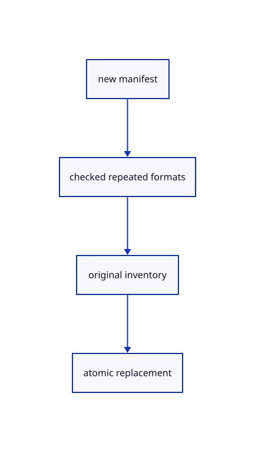

# 12.3.24 · Refuse conflicting source encoding revisions

**Chapter 12 · Files and streaming · Section 12.3 · Streaming page budgets and rendering** · [Contents](contents.md)

**Typing: 23–45 minutes.** [Estimate](typing-load.md).

Validate source formats before adopting a changed manifest. Failed metadata keeps the previous valid source inventory.

## Type

Continue from [Decode bounded cancellable source streams](68u-decode-bounded-cancellable-source-streams.md). [Save or recover your work](recovery.md).

### 1. `src/publication_index.rs`

Validate manifest source formats before changing the original inventory.

<details>
<summary>Locate the existing block</summary>

```rust
use crate::{manifest::Manifest,scene::Scene};
use std::{collections::{HashMap,HashSet},rc::Rc};

pub struct Index {
    base:String,
    revisions:crate::live_revision::Revisions,
    manifest:Option<Manifest>,
    sources:HashMap<String,Scene>,
    sizes:HashMap<String,usize>,
    pending:bool,
}
impl Index {
    pub fn new(base:String)->Self {Self {base,revisions:Default::default(),manifest:None,sources:HashMap::new(),sizes:HashMap::new(),pending:false}}
    pub fn etag(&self,url:&str)->Option<String> {self.revisions.etag(url)}
    pub fn has_manifest(&self)->bool {self.manifest.is_some()}
    pub fn cached(&self,url:&str)->bool {self.sources.contains_key(url)}
    pub fn forget(&mut self,url:&str) {self.revisions.forget(url);}
    pub fn urls(&self)->Vec<String> {self.manifest.as_ref().map_or_else(Vec::new,|manifest|manifest.items.iter().map(|item|crate::publication_route::join(&self.base,&item.file)).collect())}
    pub fn manifest(&mut self,url:&str,etag:Option<String>,bytes:&[u8])->Result<bool,String> {
        if !self.revisions.changed(url,etag,bytes) {return Ok(false);}
        let manifest=match Manifest::parse(bytes) {Ok(value)=>value,Err(error)=>{self.revisions.forget(url);return Err(error);}};
        self.manifest=Some(manifest);self.pending=true;let used=self.urls().into_iter().collect::<HashSet<_>>();self.sources.retain(|url,_|used.contains(url));self.sizes.retain(|url,_|used.contains(url));Ok(true)
    }
    pub fn source(&mut self,url:&str,etag:Option<String>,bytes:&[u8])->Result<bool,String> {
        if !self.revisions.changed(url,etag,bytes) {return Ok(false);}
        let size=self.sizes.iter().filter(|(key,_)|key.as_str()!=url).try_fold(bytes.len(),|sum,(_,size)|sum.checked_add(*size)).ok_or("Source inventory size overflow")?;
        if size>crate::archive::LIMIT {self.revisions.forget(url);return Err("Source inventory exceeds the 512 MiB file limit".into());}
        let source=match crate::publication::prepare(&Scene::empty(),bytes,true,Some(Rc::new(crate::reload_url::ReloadUrl::new(url.into())))) {Ok(source)=>source,Err(error)=>{self.revisions.forget(url);return Err(error);}};
        self.sources.insert(url.into(),source);self.sizes.insert(url.into(),bytes.len());self.pending=true;Ok(true)
    }
    pub fn replacement(&mut self,previous:&Scene)->Result<Option<Scene>,String> {
        if !self.pending {return Ok(None);}
        let manifest=self.manifest.as_ref().ok_or("Live manifest is missing")?;
        for (item,url) in manifest.items.iter().zip(self.urls()) {if let Some(expected)=item.encoded_size() {if self.sizes.get(&url).copied().map(|size|size as u64)!=Some(expected) {self.revisions.forget(&url);return Err("Encoded source decoded size does not match the manifest".into());}}}
        let scene=crate::scene_manifest::prepare(previous,manifest,&self.urls(),&self.sources)?;self.pending=false;Ok(Some(scene))
    }
}

#[cfg(test)]
mod tests {
    use super::*;
    #[test]
    fn validators_and_unchanged_bytes_keep_original_sources_and_viewer_ids() {
        let mut index=Index::new("files/".into());let manifest=b"items: [{file: mesh.pb}]";let raw=crate::specimen::bytes();let mut scene=Scene::empty();assert!(index.manifest("scene",Some("a".into()),manifest).unwrap());assert!(index.source("files/mesh.pb",Some("b".into()),&raw).unwrap());scene=index.replacement(&scene).unwrap().unwrap();let id=scene.objects()[0].id;let geometry=Rc::clone(scene.objects()[0].geometry().unwrap());
        assert!(!index.manifest("scene",Some("W/c".into()),manifest).unwrap());assert!(!index.source("files/mesh.pb",None,&raw).unwrap());assert_eq!(index.etag("scene"),Some("W/c".into()));assert_eq!(index.etag("files/mesh.pb"),None);assert!(index.replacement(&scene).unwrap().is_none());assert_eq!(scene.objects()[0].id,id);assert!(Rc::ptr_eq(scene.objects()[0].geometry().unwrap(),&geometry));
        assert!(index.source("files/mesh.pb",None,&crate::specimen::precise_bytes()).unwrap());let changed=index.replacement(&scene).unwrap().unwrap();assert_ne!(changed.objects()[0].id,id);assert!(!Rc::ptr_eq(changed.objects()[0].geometry().unwrap(),&geometry));assert!(Rc::ptr_eq(scene.objects()[0].geometry().unwrap(),&geometry));
    }
    #[test]
    fn invalid_or_incomplete_live_updates_keep_the_last_display_and_retry_failed_bytes() {
        let mut index=Index::new(String::new());let manifest=b"items: [{file: mesh.pb}]";let raw=crate::specimen::bytes();index.manifest("scene",None,manifest).unwrap();assert!(index.replacement(&Scene::empty()).is_err());index.source("mesh.pb",Some("good".into()),&raw).unwrap();let scene=index.replacement(&Scene::empty()).unwrap().unwrap();let id=scene.objects()[0].id;
        assert!(index.source("mesh.pb",Some("bad".into()),b"broken").is_err());assert_eq!(index.etag("mesh.pb"),None);assert!(index.replacement(&scene).unwrap().is_none());assert_eq!(scene.objects()[0].id,id);assert!(index.manifest("scene",None,b"invalid: manifest").is_err());assert_eq!(index.etag("scene"),None);assert!(index.manifest("scene",None,manifest).unwrap());assert!(index.replacement(&scene).unwrap().is_some());
        let mesh=Rc::downgrade(scene.objects()[0].geometry().unwrap());drop(scene);index.manifest("scene",None,b"items: []").unwrap();assert!(mesh.upgrade().is_none());assert!(!index.cached("mesh.pb"));
    }
}
```

</details>

Edit the existing block to match this code; keep unchanged lines:

```rust
use crate::{manifest::Manifest,scene::Scene};
use std::{collections::{HashMap,HashSet},rc::Rc};

pub struct Index {
    base:String,
    revisions:crate::live_revision::Revisions,
    manifest:Option<Manifest>,
    sources:HashMap<String,Scene>,
    sizes:HashMap<String,usize>,
    pending:bool,
}
impl Index {
    pub fn new(base:String)->Self {Self {base,revisions:Default::default(),manifest:None,sources:HashMap::new(),sizes:HashMap::new(),pending:false}}
    pub fn etag(&self,url:&str)->Option<String> {self.revisions.etag(url)}
    pub fn has_manifest(&self)->bool {self.manifest.is_some()}
    pub fn cached(&self,url:&str)->bool {self.sources.contains_key(url)}
    pub fn forget(&mut self,url:&str) {self.revisions.forget(url);}
    pub fn urls(&self)->Vec<String> {self.manifest.as_ref().map_or_else(Vec::new,|manifest|manifest.items.iter().map(|item|crate::publication_route::join(&self.base,&item.file)).collect())}
    pub fn encoding(&self,url:&str)->Result<crate::source_encoding::Encoding,String> {
        let manifest=self.manifest.as_ref().ok_or("Source manifest is missing")?;let mut encoding=None;
        for item in &manifest.items {if crate::publication_route::join(&self.base,&item.file)==url {
            let value=crate::source_encoding::Encoding::new(&item.encoding,item.size)?;
            if encoding.as_ref().is_some_and(|previous|previous!=&value) {return Err("Repeated source has conflicting encoding metadata".into());}encoding=Some(value);
        }}encoding.ok_or_else(||"Source URL is absent from its manifest".into())
    }
    pub fn manifest(&mut self,url:&str,etag:Option<String>,bytes:&[u8])->Result<bool,String> {
        if !self.revisions.changed(url,etag,bytes) {return Ok(false);}
        let manifest=match Manifest::parse(bytes) {Ok(value)=>value,Err(error)=>{self.revisions.forget(url);return Err(error);}};
        let mut formats=HashMap::new();
        for item in &manifest.items {
            let format=match crate::source_encoding::Encoding::new(&item.encoding,item.size) {Ok(format)=>format,Err(error)=>{self.revisions.forget(url);return Err(error);}};
            let key=crate::publication_route::join(&self.base,&item.file);
            if formats.insert(key,format.clone()).is_some_and(|previous|previous!=format) {self.revisions.forget(url);return Err("Repeated source has conflicting encoding metadata".into());}
        }
        self.manifest=Some(manifest);self.pending=true;let used=self.urls().into_iter().collect::<HashSet<_>>();self.sources.retain(|url,_|used.contains(url));self.sizes.retain(|url,_|used.contains(url));Ok(true)
    }
    pub fn source(&mut self,url:&str,etag:Option<String>,bytes:&[u8])->Result<bool,String> {
        if !self.revisions.changed(url,etag,bytes) {return Ok(false);}
        let size=self.sizes.iter().filter(|(key,_)|key.as_str()!=url).try_fold(bytes.len(),|sum,(_,size)|sum.checked_add(*size)).ok_or("Source inventory size overflow")?;
        if size>crate::archive::LIMIT {self.revisions.forget(url);return Err("Source inventory exceeds the 512 MiB file limit".into());}
        let source=match crate::publication::prepare(&Scene::empty(),bytes,true,Some(Rc::new(crate::reload_url::ReloadUrl::new(url.into())))) {Ok(source)=>source,Err(error)=>{self.revisions.forget(url);return Err(error);}};
        self.sources.insert(url.into(),source);self.sizes.insert(url.into(),bytes.len());self.pending=true;Ok(true)
    }
    pub fn replacement(&mut self,previous:&Scene)->Result<Option<Scene>,String> {
        if !self.pending {return Ok(None);}
        let manifest=self.manifest.as_ref().ok_or("Live manifest is missing")?;
        for (item,url) in manifest.items.iter().zip(self.urls()) {if let Some(expected)=item.encoded_size() {if self.sizes.get(&url).copied().map(|size|size as u64)!=Some(expected) {self.revisions.forget(&url);return Err("Encoded source decoded size does not match the manifest".into());}}}
        let scene=crate::scene_manifest::prepare(previous,manifest,&self.urls(),&self.sources)?;self.pending=false;Ok(Some(scene))
    }
}

#[cfg(test)]
mod tests {
    use super::*;
    #[test]
    fn validators_and_unchanged_bytes_keep_original_sources_and_viewer_ids() {
        let mut index=Index::new("files/".into());let manifest=b"items: [{file: mesh.pb}]";let raw=crate::specimen::bytes();let mut scene=Scene::empty();assert!(index.manifest("scene",Some("a".into()),manifest).unwrap());assert!(index.source("files/mesh.pb",Some("b".into()),&raw).unwrap());scene=index.replacement(&scene).unwrap().unwrap();let id=scene.objects()[0].id;let geometry=Rc::clone(scene.objects()[0].geometry().unwrap());
        assert!(!index.manifest("scene",Some("W/c".into()),manifest).unwrap());assert!(!index.source("files/mesh.pb",None,&raw).unwrap());assert_eq!(index.etag("scene"),Some("W/c".into()));assert_eq!(index.etag("files/mesh.pb"),None);assert!(index.replacement(&scene).unwrap().is_none());assert_eq!(scene.objects()[0].id,id);assert!(Rc::ptr_eq(scene.objects()[0].geometry().unwrap(),&geometry));
        assert!(index.source("files/mesh.pb",None,&crate::specimen::precise_bytes()).unwrap());let changed=index.replacement(&scene).unwrap().unwrap();assert_ne!(changed.objects()[0].id,id);assert!(!Rc::ptr_eq(changed.objects()[0].geometry().unwrap(),&geometry));assert!(Rc::ptr_eq(scene.objects()[0].geometry().unwrap(),&geometry));
    }
    #[test]
    fn invalid_or_incomplete_live_updates_keep_the_last_display_and_retry_failed_bytes() {
        let mut index=Index::new(String::new());let manifest=b"items: [{file: mesh.pb}]";let raw=crate::specimen::bytes();index.manifest("scene",None,manifest).unwrap();assert!(index.replacement(&Scene::empty()).is_err());index.source("mesh.pb",Some("good".into()),&raw).unwrap();let scene=index.replacement(&Scene::empty()).unwrap().unwrap();let id=scene.objects()[0].id;
        assert!(index.source("mesh.pb",Some("bad".into()),b"broken").is_err());assert_eq!(index.etag("mesh.pb"),None);assert!(index.replacement(&scene).unwrap().is_none());assert_eq!(scene.objects()[0].id,id);assert!(index.manifest("scene",None,b"invalid: manifest").is_err());assert_eq!(index.etag("scene"),None);assert!(index.manifest("scene",None,manifest).unwrap());assert!(index.replacement(&scene).unwrap().is_some());
        let mesh=Rc::downgrade(scene.objects()[0].geometry().unwrap());drop(scene);index.manifest("scene",None,b"items: []").unwrap();assert!(mesh.upgrade().is_none());assert!(!index.cached("mesh.pb"));
    }
    #[test]
    fn refused_encoding_changes_keep_the_existing_manifest_and_original_sources() {
        let mut index=Index::new("files/".into());let raw=crate::specimen::bytes();index.manifest("scene",None,b"items: [{file: mesh.pb}]").unwrap();index.source("files/mesh.pb",None,&raw).unwrap();let scene=index.replacement(&Scene::empty()).unwrap().unwrap();let original=Rc::clone(scene.objects()[0].geometry().unwrap());
        for manifest in [b"items: [{file: mesh.pb, encoding: gzip, size: 2}, {file: mesh.pb, encoding: gzip, size: 3}]".as_slice(),b"items: [{file: mesh.pb, encoding: brotli, size: 24}]".as_slice()] {
            assert!(index.manifest("scene",Some("bad".into()),manifest).is_err());assert_eq!(index.etag("scene"),None);assert_eq!(index.urls(),["files/mesh.pb"]);assert!(index.replacement(&scene).unwrap().is_none());assert!(Rc::ptr_eq(scene.objects()[0].geometry().unwrap(),&original));
        }
        assert!(index.manifest("scene",None,b"items: [{file: mesh.pb}]").unwrap());assert!(index.replacement(&scene).unwrap().is_some());
    }

}
```

<details>
<summary>Optional patch references</summary>

Use these original edit fragments when comparing a saved checkpoint. Apply the complete blocks above.

```text
--8<-- "journey/code/68v-refuse-conflicting-source-encoding-revisions-01.rs"
```

```text
--8<-- "journey/code/68v-refuse-conflicting-source-encoding-revisions-02.rs"
```

</details>

## Run and check

Run this from `session_viewer` to select the fixed dependency versions and install supplied binary assets. It updates Cargo.lock and preserves the previous lock. It does not write implementation code:

```sh
npm --prefix ../session_tests run course -- dependencies 12.3.24
```

In your project:

```sh
cd workspace/journey
REGEN_PROTO=0 cargo build --lib --locked --target wasm32-unknown-unknown -j1
REGEN_PROTO=0 CARGO_BUILD_JOBS=1 trunk serve --port 8780
```

Open `http://127.0.0.1:8780/`. Keep an existing Trunk server running; saving rebuilds it.


### Recorded visual result

**Previous native render — current verification pending.**

The mixed original CAD, surface and coloured cloud scene remains visible.


*This recorded image predates a source or checker change. Rebuild this checkpoint before using it as current evidence; browser controls require separate acceptance.*

This reference image is shared with [12.1.44 · Connect browser save open and URL adoption](66af-connect-browser-save-open-url-adoption.md). It does not demonstrate a new feature by itself.

<details>
<summary>Code explanation and diagram</summary>


new manifest → checked repeated formats → original inventory → atomic replacement.



May a repeated source declare two different decoded sizes?

No. Every placement of the same URL must agree on its source encoding and decoded size.

Study estimate, including typing and experiments: 0.5–1 hours.

</details>

<details>
<summary>Optional experiment</summary>

Refuse conflicting formats, keep old original sources and retry a valid manifest after the failure.

</details>

<details>
<summary>Check and save your work</summary>

Restore experimental edits, then run from `session_viewer`:

```sh
npm --prefix ../session_tests run course -- check 12.3.24
npm --prefix ../session_tests run course -- save 12.3.24
```

Source comparison leaves your project untouched. [Save and recovery instructions](recovery.md).

</details>

<details>
<summary>Viewer coverage and verification</summary>


The existing mixed original archive browser exercise remains authored and unrun. The final cache endpoint adds real ranged URL loading, response validation, cancellation and cleanup exercises, also awaiting browser execution.

[Full validation scope](release.md).

To reproduce the scripted acceptance of the reference checkpoint, run from `session_viewer` with the [course bundle server](release.md#reproduce) running on port 8781:

```sh
npm --prefix ../session_tests run course -- capture 12.3.24
```

This uses the verified reference bundle; it does not check or change your typed project.

</details>
