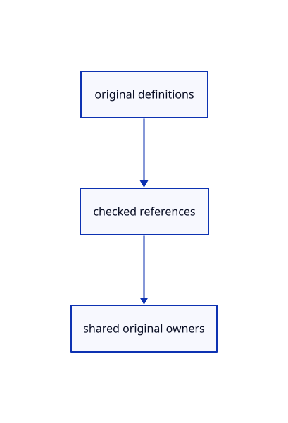

# 13.1.1 · Validate original definition references

**Chapter 13 · Shared definitions and drawing sheets · Section 13.1 · Shared CAD definitions** · [Contents](contents.md)

**Typing: 24–47 minutes.** [Estimate](typing-load.md).

Check definition identities and supported families before deriving any placed display rows.

## Type

Continue from [Connect current pages to the browser renderer](68ac-connect-current-pages-to-the-browser-renderer.md). [Save or recover your work](recovery.md).

### 1. `src/instance_plan.rs`

Validate original definition references and retain shared owners.

Create the file and type:

```rust
--8<-- "journey/code/69-validate-original-definition-references-01.rs"
```

### 2. `src/lib.rs`

Register the source component.

<details>
<summary>Locate the existing block</summary>

```rust

pub mod range_shape;
```

</details>

After that block, type:

```rust
--8<-- "journey/code/69-validate-original-definition-references-02.rs" skip=22
```

<details>
<summary>Supplied validation fixture</summary>

Copy this supplied authoring fixture once. Continue with the browser build below; the course does not require running native tests.

### 3. `src/instance_plan.rs`

Copy source identity, invalid-reference and release fixtures.

<details>
<summary>Locate the existing block</summary>

```text
    }
}
```

</details>

After that block, append this supplied code:

```text
--8<-- "journey/code/69-validate-original-definition-references-03.rs" skip=8
```

</details>

## Run and check

Run this from `session_viewer` to select the fixed dependency versions and install supplied binary assets. It updates Cargo.lock and preserves the previous lock. It does not write implementation code:

```sh
npm --prefix ../session_tests run course -- dependencies 13.1.1
```

In your project:

```sh
cd workspace/journey
REGEN_PROTO=0 cargo build --lib --locked --target wasm32-unknown-unknown -j1
REGEN_PROTO=0 CARGO_BUILD_JOBS=1 trunk serve --port 8780
```

Open `http://127.0.0.1:8780/`. Keep an existing Trunk server running; saving rebuilds it.

The previous mixed original source scene remains visible while shared definitions connect. The final endpoint adds two independently selectable placements of one original definition.

### Recorded visual result

**Previous native render — current verification pending.**

The existing CAD, surface and original coarse/detailed point pages remain visible.


*This recorded image predates a source or checker change. Rebuild this checkpoint before using it as current evidence; browser controls require separate acceptance.*

<details>
<summary>Code explanation and diagram</summary>


original definitions → checked references → shared original owners.



Does an instance contain its own geometry copy?

No. It references one original definition by GUID. Keep the reference and shared original separate from its viewer identity and placement.

Study estimate, including typing and experiments: 0.5–1 hours.

</details>

<details>
<summary>Optional experiment</summary>

Refuse missing, duplicate and unsupported definitions; trace the shared original owner through release.

</details>

<details>
<summary>Check and save your work</summary>

Restore experimental edits, then run from `session_viewer`:

```sh
npm --prefix ../session_tests run course -- check 13.1.1
npm --prefix ../session_tests run course -- save 13.1.1
```

Source comparison leaves your project untouched. [Save and recovery instructions](recovery.md).

</details>

<details>
<summary>Viewer coverage and verification</summary>


The inherited range exercise remains authored and unrun. The final instance exercise checks shared definitions, independent placements, Save/Open, Move, Delete, Undo/Redo and Close; browser execution remains required.

[Full validation scope](release.md).

To reproduce the scripted acceptance of the reference checkpoint, run from `session_viewer` with the [course bundle server](release.md#reproduce) running on port 8781:

```sh
npm --prefix ../session_tests run course -- capture 13.1.1
```

This uses the verified reference bundle; it does not check or change your typed project.

</details>
