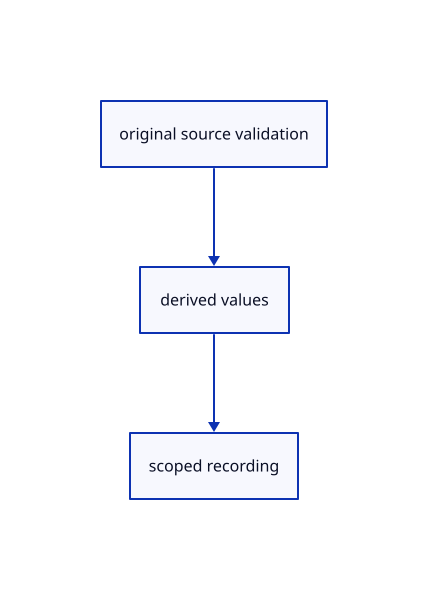

# 13.1.19 · Retain cloneable derived CAD values

**Chapter 13 · Shared definitions and drawing sheets · Section 13.1 · Shared CAD definitions** · [Contents](contents.md)

**Typing: 6–12 minutes.** [Estimate](typing-load.md).

Keep derived display values cloneable and validate original topology/control storage separately from tessellation.

## Type

Continue from [Assemble an original rigid shape key](69a-describe-a-rigid-frame-and-original-shape-key.md). [Save or recover your work](recovery.md).

### 1. `src/mesh.rs`

Separate original validation and cloneable derived CAD values.

<details>
<summary>Locate the existing block</summary>

```rust
pub struct Mesh {
    vertices: Vec<[f32; 6]>,
```

</details>

Edit the existing block to match this code; keep unchanged lines:

```rust
--8<-- "journey/code/69aa-retain-cloneable-derived-cad-values-01.rs"
```

### 2. `src/mesh_parts.rs`

Separate original validation and cloneable derived CAD values.

<details>
<summary>Locate the existing block</summary>

```rust
#[derive(Default)]
pub struct Parts {
    pub faces: Vec<usize>,
```

</details>

Edit the existing block to match this code; keep unchanged lines:

```rust
--8<-- "journey/code/69aa-retain-cloneable-derived-cad-values-02.rs"
```

### 3. `src/cad_face.rs`

Separate original validation and cloneable derived CAD values.

<details>
<summary>Locate the existing block</summary>

```rust
use session_rust::Point;
pub struct Sample {pub vertex:u32,pub surface:usize,pub uv:[f64;2],pub sign:f64}
pub struct Data {pub points:Vec<Point>,pub faces:Vec<Vec<usize>>,pub vertices:Vec<[f32;6]>,pub normals:Vec<[f32;3]>,pub indices:Vec<u32>,pub face_ids:Vec<u32>,pub keys:Vec<std::collections::HashMap<usize,u32>>,pub samples:Vec<Sample>}
```

</details>

Edit the existing block to match this code; keep unchanged lines:

```rust
--8<-- "journey/code/69aa-retain-cloneable-derived-cad-values-03.rs"
```

### 4. `src/cad_display.rs`

Separate original validation and cloneable derived CAD values.

<details>
<summary>Locate the existing block</summary>

```rust
use session_rust::Xform;

pub struct Boundary {pub edge:usize,pub points:Vec<[f64;3]>}
pub struct Prepared {pub source:Rc<session_rust::BRep>,pub edges:Vec<Boundary>,pub samples:Vec<crate::cad_face::Sample>,pub face_count:usize,pub edge_ids:Vec<usize>}
```

</details>

Edit the existing block to match this code; keep unchanged lines:

```rust
--8<-- "journey/code/69aa-retain-cloneable-derived-cad-values-04.rs"
```

### 5. `src/cad_boundary.rs`

Separate original validation and cloneable derived CAD values.

<details>
<summary>Locate the existing block</summary>

```rust
use session_rust::{BRep, Mesh};
use std::rc::Rc;

pub const QUALITY: (f64, f64) = (5., 0.001);
pub struct Prepared {
    pub source: Rc<BRep>,
    pub faces: Vec<Mesh>,
    pub chains: Vec<Option<crate::cad_edges::EdgeChain>>,
}
impl Prepared {
    pub fn new(source: Rc<BRep>) -> Result<Self, &'static str> {
        if !source.is_valid() {
            return Err("BRep topology contains an invalid reference");
        }
        if source.m_faces.len() > 65_536 || source.m_edges.len() > 262_144 {
            return Err("BRep topology exceeds the display budget");
        }
        for surface in &source.m_surfaces {
            crate::surface::validate(surface)?;
        }
        for curve in source.m_curves_3d.iter().chain(&source.m_curves_2d) {
            crate::curve::validate(curve)?;
        }
        let _ = source.guid();
        let faces = source.face_meshes_q(Some(QUALITY));
        if faces.len() != source.m_faces.len() || faces.iter().any(|face| face.face.is_empty()) {
            return Err("BRep face could not be tessellated");
        }
        let chains = crate::cad_edges::edge_chains(&source, &faces);
        for (index, (edge, chain)) in source.m_edges.iter().zip(&chains).enumerate() {
            if !edge.degenerated && !source.edge_faces(index).is_empty() && chain.is_none() {
                return Err("A CAD edge has no coherent face boundary");
            }
        }
        Ok(Self {
            source,
            faces,
            chains,
        })
    }
    pub fn points(&self, edge: usize) -> Option<Vec<[f64; 3]>> {
        Some(self.display(edge)?.0)
    }
    pub fn display(&self, edge: usize) -> Option<(Vec<[f64; 3]>, Vec<usize>)> {
        let chain = self.chains.get(edge)?.as_ref()?;
        let face = self.faces.get(chain.face)?;
        let coarse: Vec<[f64; 3]> = chain
            .keys
            .iter()
            .map(|key| face.vertex.get(key).map(|v| [v.x, v.y, v.z]))
            .collect::<Option<_>>()?;
        let source = self.source.m_edges.get(edge)?;
        let Some(curve) = usize::try_from(source.curve_3d_index)
            .ok()
            .and_then(|index| self.source.m_curves_3d.get(index))
        else {
            return Some((coarse, (0..chain.keys.len().saturating_sub(1)).collect()));
        };
        let count = crate::curve::sample(curve)
            .ok()?
            .len()
            .saturating_sub(1)
            .max(1);
        let (start, end) = curve.domain();
        let period = end - start;
        if coarse.len() < 2 || !period.is_finite() || period <= 0. {
            return None;
        }
        let mut parameters: Vec<f64> = coarse
            .iter()
            .map(|&p| curve_parameter(curve, p, 8 * count))
            .collect();
        if curve.is_closed() {
            for k in 1..parameters.len() {
                while parameters[k] - parameters[k - 1] > 0.5 * period {
                    parameters[k] -= period;
                }
                while parameters[k] - parameters[k - 1] < -0.5 * period {
                    parameters[k] += period;
                }
            }
            let last = parameters.len() - 1;
            if chain.keys.first() == chain.keys.last() && last > 1 {
                parameters[last] = parameters[0]
                    + if parameters[last - 1] > parameters[0] {
                        period
                    } else {
                        -period
                    };
            }
        }
        let wrap = |t: f64| {
            if curve.is_closed() {
                start + (t - start).rem_euclid(period)
            } else {
                t.clamp(start, end)
            }
        };
        let total: f64 = parameters.windows(2).map(|p| (p[1] - p[0]).abs()).sum();
        let point = |t: f64| {
            let p = curve.point_at(wrap(t));
            [p[0], p[1], p[2]]
        };
        let mut points = vec![point(parameters[0])];
        let mut spans = Vec::new();
        for k in 0..parameters.len() - 1 {
            let share = if total > 0. {
                (parameters[k + 1] - parameters[k]).abs() / total
            } else {
                0.
            };
            let steps = ((count as f64 * share).ceil() as usize).max(1);
            for j in 1..=steps {
                points.push(point(
                    parameters[k] + (parameters[k + 1] - parameters[k]) * j as f64 / steps as f64,
                ));
                spans.push(k);
            }
        }
        Some((points, spans))
    }
}

fn curve_parameter(curve: &session_rust::NurbsCurve, p: [f64; 3], count: usize) -> f64 {
    let (t0, t1) = curve.domain();
    let distance = |t: f64| {
        let q = curve.point_at(t);
        (0..3).map(|axis| (q[axis] - p[axis]).powi(2)).sum::<f64>()
    };
    let step = (t1 - t0) / count as f64;
    let nearest = (0..=count)
        .min_by(|&i, &j| distance(t0 + step * i as f64).total_cmp(&distance(t0 + step * j as f64)))
        .unwrap_or(0);
    let (mut lo, mut hi) = (
        (t0 + step * (nearest as f64 - 1.0)).max(t0),
        (t0 + step * (nearest as f64 + 1.0)).min(t1),
    );
    let ratio = 0.5 * (5.0f64.sqrt() - 1.0);

    for _ in 0..60 {
        let (m1, m2) = (hi - ratio * (hi - lo), lo + ratio * (hi - lo));

        if distance(m1) < distance(m2) {
            hi = m2;
        } else {
            lo = m1;
        }
    }

    0.5 * (lo + hi)
}
```

</details>

Edit the existing block to match this code; keep unchanged lines:

```rust
use std::rc::Rc;
use session_rust::{BRep,Mesh};

pub const QUALITY:(f64,f64)=(5.,0.001);
pub struct Prepared {pub source:Rc<BRep>,pub faces:Vec<Mesh>,pub chains:Vec<Option<crate::cad_edges::EdgeChain>>}
impl Prepared {
    pub fn new(source:Rc<BRep>)->Result<Self,&'static str> {
        validate(&source)?;
        let _=source.guid();let faces=source.face_meshes_q(Some(QUALITY));
        if faces.len()!=source.m_faces.len()||faces.iter().any(|face|face.face.is_empty()) {return Err("BRep face could not be tessellated");}
        let chains=crate::cad_edges::edge_chains(&source,&faces);
        for (index,(edge,chain)) in source.m_edges.iter().zip(&chains).enumerate() {
            if !edge.degenerated&&!source.edge_faces(index).is_empty()&&chain.is_none() {return Err("A CAD edge has no coherent face boundary");}
        }
        Ok(Self {source,faces,chains})
    }
    pub fn points(&self, edge: usize) -> Option<Vec<[f64; 3]>> {
        Some(self.display(edge)?.0)
    }
    pub fn display(&self, edge: usize) -> Option<(Vec<[f64; 3]>, Vec<usize>)> {
        let chain = self.chains.get(edge)?.as_ref()?;
        let face = self.faces.get(chain.face)?;
        let coarse: Vec<[f64; 3]> = chain
            .keys
            .iter()
            .map(|key| face.vertex.get(key).map(|v| [v.x, v.y, v.z]))
            .collect::<Option<_>>()?;
        let source = self.source.m_edges.get(edge)?;
        let Some(curve) = usize::try_from(source.curve_3d_index)
            .ok()
            .and_then(|index| self.source.m_curves_3d.get(index))
        else {
            return Some((coarse, (0..chain.keys.len().saturating_sub(1)).collect()));
        };
        let count = crate::curve::sample(curve)
            .ok()?
            .len()
            .saturating_sub(1)
            .max(1);
        let (start, end) = curve.domain();
        let period = end - start;
        if coarse.len() < 2 || !period.is_finite() || period <= 0. {
            return None;
        }
        let mut parameters: Vec<f64> = coarse
            .iter()
            .map(|&p| curve_parameter(curve, p, 8 * count))
            .collect();
        if curve.is_closed() {
            for k in 1..parameters.len() {
                while parameters[k] - parameters[k - 1] > 0.5 * period {
                    parameters[k] -= period;
                }
                while parameters[k] - parameters[k - 1] < -0.5 * period {
                    parameters[k] += period;
                }
            }
            let last = parameters.len() - 1;
            if chain.keys.first() == chain.keys.last() && last > 1 {
                parameters[last] = parameters[0]
                    + if parameters[last - 1] > parameters[0] {
                        period
                    } else {
                        -period
                    };
            }
        }
        let wrap = |t: f64| {
            if curve.is_closed() {
                start + (t - start).rem_euclid(period)
            } else {
                t.clamp(start, end)
            }
        };
        let total: f64 = parameters.windows(2).map(|p| (p[1] - p[0]).abs()).sum();
        let point = |t: f64| {
            let p = curve.point_at(wrap(t));
            [p[0], p[1], p[2]]
        };
        let mut points = vec![point(parameters[0])];
        let mut spans = Vec::new();
        for k in 0..parameters.len() - 1 {
            let share = if total > 0. {
                (parameters[k + 1] - parameters[k]).abs() / total
            } else {
                0.
            };
            let steps = ((count as f64 * share).ceil() as usize).max(1);
            for j in 1..=steps {
                points.push(point(
                    parameters[k] + (parameters[k + 1] - parameters[k]) * j as f64 / steps as f64,
                ));
                spans.push(k);
            }
        }
        Some((points, spans))
    }
}

fn curve_parameter(curve: &session_rust::NurbsCurve, p: [f64; 3], count: usize) -> f64 {
    let (t0, t1) = curve.domain();
    let distance = |t: f64| {
        let q = curve.point_at(t);
        (0..3).map(|axis| (q[axis] - p[axis]).powi(2)).sum::<f64>()
    };
    let step = (t1 - t0) / count as f64;
    let nearest = (0..=count)
        .min_by(|&i, &j| distance(t0 + step * i as f64).total_cmp(&distance(t0 + step * j as f64)))
        .unwrap_or(0);
    let (mut lo, mut hi) = (
        (t0 + step * (nearest as f64 - 1.0)).max(t0),
        (t0 + step * (nearest as f64 + 1.0)).min(t1),
    );
    let ratio = 0.5 * (5.0f64.sqrt() - 1.0);

    for _ in 0..60 {
        let (m1, m2) = (hi - ratio * (hi - lo), lo + ratio * (hi - lo));

        if distance(m1) < distance(m2) {
            hi = m2;
        } else {
            lo = m1;
        }
    }

    0.5 * (lo + hi)
}

pub fn validate(source:&BRep)->Result<(),&'static str> {
        if !source.is_valid() {return Err("BRep topology contains an invalid reference");}
        if source.m_faces.len()>65_536||source.m_edges.len()>262_144 {return Err("BRep topology exceeds the display budget");}
        for surface in &source.m_surfaces {crate::surface::validate(surface)?;}
        for curve in source.m_curves_3d.iter().chain(&source.m_curves_2d) {crate::curve::validate(curve)?;}
    Ok(())
}
```

<details>
<summary>Optional patch references</summary>

Use these original edit fragments when comparing a saved checkpoint. Apply the complete blocks above.

```text
--8<-- "journey/code/69aa-retain-cloneable-derived-cad-values-05.rs"
```

```text
--8<-- "journey/code/69aa-retain-cloneable-derived-cad-values-06.rs"
```

</details>

## Run and check

Run this from `session_viewer` to select the fixed dependency versions and install supplied binary assets. It updates Cargo.lock and preserves the previous lock. It does not write implementation code:

```sh
npm --prefix ../session_tests run course -- dependencies 13.1.19
```

In your project:

```sh
cd workspace/journey
REGEN_PROTO=0 cargo build --lib --locked --target wasm32-unknown-unknown -j1
REGEN_PROTO=0 CARGO_BUILD_JOBS=1 trunk serve --port 8780
```

Open `http://127.0.0.1:8780/`. Keep an existing Trunk server running; saving rebuilds it.


### Recorded visual result

**Previous native render — current verification pending.**

Independent yellow and blue shared-definition placements remain visible beside original CAD borders.


*This recorded image predates a source or checker change. Rebuild this checkpoint before using it as current evidence; browser controls require separate acceptance.*

This reference image is shared with [13.1.14 · Inspect and exercise original definition instances](69n-inspect-and-exercise-original-definition-instances.md). It does not demonstrate a new feature by itself.

<details>
<summary>Code explanation and diagram</summary>


original source validation → derived values → scoped recording.



Are copied display values another editable BRep?

No. Original BRep records remain the editable source. Sampled vertices, normals, boundary chords and source mappings are derived display values.

Study estimate, including typing and experiments: 0.5–1 hours.

</details>

<details>
<summary>Optional experiment</summary>

Inspect original source sharing beside copied display arrays and their exact source face and edge mappings.

</details>

<details>
<summary>Check and save your work</summary>

Restore experimental edits, then run from `session_viewer`:

```sh
npm --prefix ../session_tests run course -- check 13.1.19
npm --prefix ../session_tests run course -- save 13.1.19
```

Source comparison leaves your project untouched. [Save and recovery instructions](recovery.md).

</details>

<details>
<summary>Viewer coverage and verification</summary>


The inherited instance acceptance remains authored and unrun. The final congruent-CAD exercise inspects one walk/one replay, original identities, Save/Open, Delete/Undo/Redo and Close; actual browser execution remains required.

[Full validation scope](release.md).

To reproduce the scripted acceptance of the reference checkpoint, run from `session_viewer` with the [course bundle server](release.md#reproduce) running on port 8781:

```sh
npm --prefix ../session_tests run course -- capture 13.1.19
```

This uses the verified reference bundle; it does not check or change your typed project.

</details>
