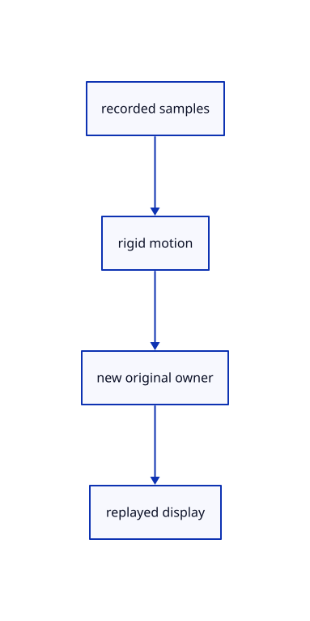

# 13.1.20 · Replay sampled geometry in the new rigid frame

**Chapter 13 · Shared definitions and drawing sheets · Section 13.1 · Shared CAD definitions** · [Contents](contents.md)

**Typing: 19–37 minutes.** [Estimate](typing-load.md).

Transform display positions, normals, precise boundary endpoints and proxy geometry while retaining the new original BRep.

## Type

Continue from [Retain cloneable derived CAD values](69aa-retain-cloneable-derived-cad-values.md). [Save or recover your work](recovery.md).

### 1. `src/cad_shape_cache.rs`

Replay recorded display values with the correct independent original owner.

Create the file and type:

```rust
--8<-- "journey/code/69ab-replay-sampled-geometry-in-the-new-rigid-frame-01.rs"
```

### 2. `src/lib.rs`

Register the CAD preparation component.

<details>
<summary>Locate the existing block</summary>

```rust

pub mod cad_shape_key;
```

</details>

After that block, type:

```rust
--8<-- "journey/code/69ab-replay-sampled-geometry-in-the-new-rigid-frame-02.rs" skip=24
```

## Run and check

Run this from `session_viewer` to select the fixed dependency versions and install supplied binary assets. It updates Cargo.lock and preserves the previous lock. It does not write implementation code:

```sh
npm --prefix ../session_tests run course -- dependencies 13.1.20
```

In your project:

```sh
cd workspace/journey
REGEN_PROTO=0 cargo build --lib --locked --target wasm32-unknown-unknown -j1
REGEN_PROTO=0 CARGO_BUILD_JOBS=1 trunk serve --port 8780
```

Open `http://127.0.0.1:8780/`. Keep an existing Trunk server running; saving rebuilds it.


### Recorded visual result

**Previous native render — current verification pending.**

Independent yellow and blue shared-definition placements remain visible beside original CAD borders.


*This recorded image predates a source or checker change. Rebuild this checkpoint before using it as current evidence; browser controls require separate acceptance.*

This reference image is shared with [13.1.14 · Inspect and exercise original definition instances](69n-inspect-and-exercise-original-definition-instances.md). It does not demonstrate a new feature by itself.

<details>
<summary>Code explanation and diagram</summary>


recorded samples → rigid motion → new original owner → replayed display.



Should replay retain the first BRep as the new editable source?

No. Keep the new original source, GUID, flags and name. Only its display values reuse the first walk.

Study estimate, including typing and experiments: 0.5–1 hours.

</details>

<details>
<summary>Optional experiment</summary>

Compare independent original GUIDs, UV samples, topology and boundary endpoints after a skew rotation.

</details>

<details>
<summary>Check and save your work</summary>

Restore experimental edits, then run from `session_viewer`:

```sh
npm --prefix ../session_tests run course -- check 13.1.20
npm --prefix ../session_tests run course -- save 13.1.20
```

Source comparison leaves your project untouched. [Save and recovery instructions](recovery.md).

</details>

<details>
<summary>Viewer coverage and verification</summary>


The inherited instance acceptance remains authored and unrun. The final congruent-CAD exercise inspects one walk/one replay, original identities, Save/Open, Delete/Undo/Redo and Close; actual browser execution remains required.

[Full validation scope](release.md).

To reproduce the scripted acceptance of the reference checkpoint, run from `session_viewer` with the [course bundle server](release.md#reproduce) running on port 8781:

```sh
npm --prefix ../session_tests run course -- capture 13.1.20
```

This uses the verified reference bundle; it does not check or change your typed project.

</details>
